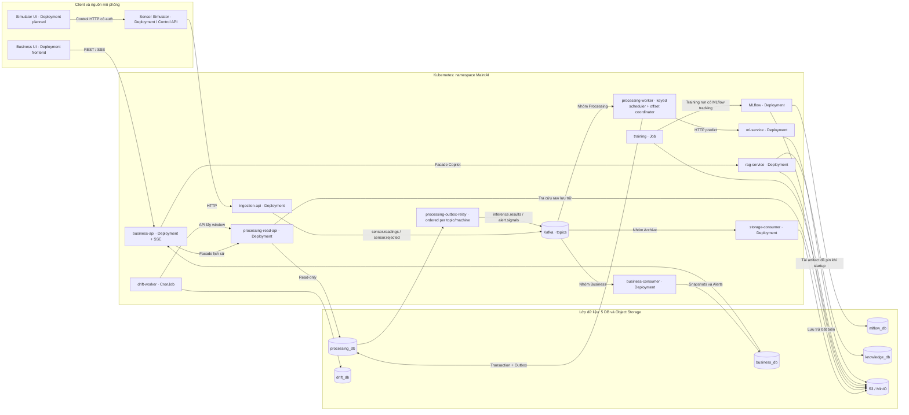

> **Source update23/10 — SDK0.2.0/bundle1.1.0:** keyed runner/coordinator,
> durable handler/DB fence, ordered relay, migration002 và transport wrappers đã
> có source/tests. Full app callbacks/probes/images/deployment còn cần tích hợp.
> [Implementation report](PROCESSING_ORDERING_IMPLEMENTATION_REPORT.md) và
> readiness §19 ghi bằng chứng, commands và giới hạn; các snapshot cũ đọc theo ngày.

> **Tích hợp MaintAI — 2026-10-19:** Tài liệu thiết kế mục tiêu v1.4, chưa xác nhận code/DB/GitOps đã migrate. Đọc [docs index](README.md) để áp dụng quyết định nhóm 4 người, Simulator UI riêng và thứ tự ưu tiên; [readiness](implementation-readiness.md) ghi các schema/scaffold chưa được cung cấp.

# MaintAI v1.4 — Kiến trúc triển khai Kubernetes theo Deployment

**Trạng thái:** Đặc tả kiến trúc mục tiêu (sẵn sàng làm cơ sở triển khai), **không phải bằng chứng cluster đang chạy**. Ngày quyết định: 19/10/2026. Kế thừa MaintAI v1.3.1; cần chủ sở hữu duyệt và merge vào repo source/GitOps thật.

## 1. Phạm vi, thuật ngữ và danh sách workload

**Không đồng nhất** codebase, Kubernetes Deployment, Kubernetes Service, logical database và Kafka consumer group:

- **Codebase** chứa mã nguồn; cùng một image có thể có nhiều startup commands để chạy `processing-worker`, `processing-read-api`, `processing-outbox-relay` trong **ba Deployments khác nhau**.
- **Deployment** quản lý Pods và replicas. **Kubernetes Service** cho địa chỉ mạng ổn định tới Pods, thường cần cho HTTP API nhưng không bắt buộc cho Worker chỉ consume Kafka.
- `business-api` và `business-consumer` là hai Deployments thuộc cùng codebase Business, sở hữu `business_db` và migration chung.
- Ban đầu dùng **một PostgreSQL instance, năm logical DB**; chia logical DB không tự tách CPU, RAM, I/O, connections.
- Ba consumer groups đọc `sensor.readings` để xử lý, lưu trữ và chiếu telemetry; đó không phải ba bản sao vật lý của Kafka topic.

| Workload | Kubernetes resource | Quy mô dựa vào | Quyền truy cập | Ghi chú |
|---|---|---|---|---|
| Business React Frontend | Deployment + Service `frontend`, image/config riêng | Lưu lượng người dùng | Business REST/SSE, không có DB credentials | Người1, release độc lập Simulator |
| Simulator UI riêng | Deployment + Service `simulator-ui`, React/client/demo + Dockerfile riêng; chưa build/deploy | Người vận hành demo | Sensor Control API0.3.0, provider HTTP đã test local | Người4, release độc lập Business và Sensor backend |
| Simulator + Control | Deployment + internal Service | Kịch bản demo | SQLite/WAL state/spool; persistent local volume, Recreate | Ban đầu 1 replica, không phải PLC |
| Ingestion API | Deployment + Service | HTTP RPS, ACK p95 | Kafka producer | Auth, envelope validation, accepted/rejected |
| Processing Worker | Deployment | Kafka lag/age, keyed queue, ML/DB throughput | Ghi `processing_db`, gọi ML | Target PROC-ORDER-01: per-machine FIFO + bounded concurrency + offset coordinator |
| Processing Read API | **Deployment + Service riêng** | History RPS/p95 | `processing_db` read-only, S3 read | History API logic, **không** cần `history_db` |
| Processing Outbox Relay | Deployment | Pending/blocked-key age | Quyền outbox có giới hạn + Kafka producer | Target ordered dispatch theo topic/máy; SDK ordered mode đã có; full runtime chưa Ready |
| Storage Consumer | Deployment | Archive lag, S3 throughput | Kafka consume, S3 write | Accepted/rejected/outcome (tùy chọn) |
| Business Consumer | Deployment | Projection lag | Kafka + ghi `business_db` | Ba handlers, không infer ML |
| Business API | Deployment + Service | REST RPS/SSE clients | `business_db` với quyền theo nhiệm vụ | Alert, Feedback, SSE, facades |
| ML inference | Deployment + internal Service | Inference QPS/p95 | Model artifacts được pin | Không quyết định Alert |
| RAG API | Deployment + internal Service | Retrieval/LLM QPS | `knowledge_db`, S3 manuals | Lỗi RAG không làm chặn Alert |
| MLflow Server | Deployment + Service | Train/tracking/registry | `mlflow_db` và S3 artifacts | Image source `ml-service/mlflow/`; deployment/config GitOps |
| Drift Worker | CronJob | Theo lịch và data window | `drift_db`, S3 hoặc Read API | Không nằm trên inference critical path |
| Training Pipeline | Job/Workflow theo yêu cầu | Dataset release đã duyệt | Curated S3 + MLflow | Không auto-run do raw upload |
| Prometheus/Grafana/Pushgateway | Workload Platform | Monitoring | TSDB/metrics | Manifest hạ tầng tách khỏi ứng dụng |

### 1.1. Bốn UI và đơn vị cập nhật — UI-01, 2026-10-20

[UI Architecture](UI_ARCHITECTURE.md) chốt bốn UI: **Business, Sensor Simulator,
Grafana, MLflow**. Hai frontend do nhóm viết có source/build output/image,
Deployment/Service và runtime config riêng. Grafana UI nằm trong Grafana workload;
MLflow UI nằm trong MLflow Server; không tạo React app để thay UI của hai công cụ.

Business `frontend/` vẫn giữ runtime ID `frontend`; `sensor-simulator-UI/` đã có source/client.
Portal điều hướng không là service bắt buộc. Số UI không đồng nghĩa số microservices,
DB hoặc số manifests mới: runtime map hiện có14 descriptors, gồm Simulator UI;
Grafana/MLflow là platform. MLflow có platform descriptor và image packaging trong
app ML codebase; không tăng số deployment khi chuyển source. UI source không
chứng minh đã có deployment.

Mỗi UI có origin/ingress route và public config phù hợp. Có thể chung Ingress
controller/IdP nhưng mỗi frontend phục vụ từ workload riêng; Sensor Control là
backend riêng. Thay Business UI chỉ đổi digest/config của `frontend`, thay
Simulator UI chỉ đổi `simulator-ui`. Thay backend Sensor không buộc redeploy
hai UI nếu contract tương thích. Shared library/API breaking change cần release
phối hợp; tách Deployments không tự cô lập shared cluster/Ingress/IdP failures.

CI chọn affected components và GitOps chỉ sửa image/config của component liên quan,
giữ Pod templates khác nguyên vẹn. Grafana dashboard/datasource revision và MLflow
server/config có vòng cập nhật riêng. Acceptance: rollout/rollback một UI phải có
bằng chứng các workloads không liên quan giữ image/config/Pod template.

## 2. Sơ đồ Deployment — nguồn Mermaid chỉnh sửa được

Đây là **sơ đồ phụ thuộc logic của các Deployments**. Kafka/PostgreSQL/S3 có thể đặt trong cluster demo hoặc dùng dịch vụ managed/external; không suy ra tính sẵn sàng cao (HA). `processing-read-api` là Deployment riêng; tài liệu nguồn mô tả Compose entrypoint, nhưng app repo hiện vẫn skeleton và chưa xác minh startup command. `processing-worker` không phục vụ HTTP history.

## 3. Chủ sở hữu dữ liệu và phân quyền DB

| Database | Owner | Client và quyền đề xuất | Ranh giới |
|---|---|---|---|
| `processing_db` | Processing | Worker `processing_rw`, Relay quyền outbox, Read API `processing_ro` | Business/Drift không SQL trực tiếp |
| `business_db` | Business | Consumer `business_rw`, API theo scope | Alert, lifecycle, feedback, brief, latest snapshots; **không** full raw history |
| `drift_db` | Drift | Worker `drift_rw` | Checkpoints, drift reports |
| `mlflow_db` | MLflow | Chỉ MLflow Server | Migration do MLflow quản lý |
| `knowledge_db` | RAG | Service `rag_rw` | Documents, chunks, pgvector |

Storage Consumer lưu **raw accepted**, schema-rejected được phép lưu và tùy chọn outcome dài hạn vào S3. `processing_db` có thể giữ sensor payload **trong hot window có giới hạn** để hỗ trợ UI. S3 là kho lưu trữ dài hạn. History Read API không được quét toàn bộ bucket cho mỗi query; phải dùng DB index, manifest chia partition/ngày hoặc query engine. **Lịch sử Alert thuộc Business**, query `business_db`, không chuyển qua Processing Read API.

## 4. Kafka topics, publisher và consumer

| Topic | Publisher | Consumer groups | Ý nghĩa |
|---|---|---|---|
| `sensor.readings` | Ingestion | `processing-v1`, `raw-archive-v1`, `business-live-v1` | Chỉ được xác nhận đúng schema/envelope, **chưa** có DQ result |
| `sensor.rejected` **mới v1.4** | Ingestion | `raw-rejected-archive-v1` | Request sai cấu trúc được quarantine an toàn trong giới hạn auth/size |
| `inference.results` | Processing Outbox Relay | `business-prediction-v1`, `outcome-archive-v1` tùy chọn | Tagged union `PREDICTION_COMPLETED`, `DATA_INVALID`, `INFERENCE_UNAVAILABLE` |
| `alert.signals` | Processing Outbox Relay | `business-alert-v1` | Business dedupe và quản lý vòng đời |

Giữ tên `inference.results` để tương thích v1.3.1 dù topic cũng chứa `DATA_INVALID`; đổi thành `processing.results` sẽ là breaking change và **không thực hiện trong v1.4**. Không bắt buộc topic thứ năm `sensor.quality.results` vì outcome DQ đã nằm trong tagged union. Hệ thống là **at-least-once**; không cam kết exactly-once toàn luồng.

## 5. Luồng schema rejection và các trường hợp crash

1. Ingestion kiểm tra auth, kích thước request và JSON/envelope. **Không archive payload không xác thực hoặc quá lớn** một cách vô điều kiện.
2. Request đã xác thực, nằm trong quarantine size limit nhưng malformed JSON/envelope: tạo `rejection_id` server-side, nhận diện nguồn, `request_id`, thời gian nhận UTC, lỗi schema, payload đã sanitize/giới hạn hoặc hash không đảo ngược. Publish `sensor.rejected` với `acks=all`; **chỉ sau ACK** mới trả `400` (JSON parse) hoặc `422` (envelope). Kafka publish thất bại => `503/504` có thể retry, không nói đã lưu. Dedupe bằng request identity/rejection ID phù hợp.
3. Envelope hợp lệ => publish `sensor.readings`, đợi ACK => `202 ACCEPTED/PENDING`, ngay cả khi features sau đó bị DQ loại.
4. Ingestion/Kafka unavailable => Simulator giữ bounded local retry spool và `event_id` ổn định; UI thể hiện stale. Không hứa lưu vô hạn nếu spool đầy.
5. Processing DQ INVALID => lưu outcome+outbox, không gọi ML, không tự đóng Alert; raw được Storage Consumer archive độc lập, có thể hoàn tất sau.

**Đây là thay đổi contract so với câu chữ cũ chỉ ghi log lỗi schema ở Simulator.** Hệ thống thật cần migration producer/consumer và kiểm thử security/quarantine.

## 6. Tách luồng ghi realtime và luồng đọc lịch sử

**Online write:** Simulator → Ingestion → Kafka → Processing (DQ/ML/Risk) → transaction `processing_db` + outbox → Kafka outcomes/signals → Business Consumer → `business_db` → Business API/SSE. Song song: Storage Consumer → S3; Business telemetry projection nhận raw sớm nhưng đánh dấu `UNVERIFIED`.

**Query read:** React → Business API. Dashboard/Alert đọc `business_db`; trạng thái/lịch sử reading qua `processing-read-api` → indexed `processing_db` và S3 có giới hạn; drift reports qua adapter/API phù hợp. Không bắt Processing Worker thực hiện truy vấn HTTP.

**Tra cứu event cũ:** Index theo `event_id`, `machine_id` (nếu có), nguồn/tenant, schema version, `topic/partition/offset` và `server_accepted_at` UTC. Hot query trả từ DB. Cold query tra partition/ngày/manifest trước rồi đọc object S3 và gắn DQ/prediction bằng event ID. Chưa archive xong phải trả `PENDING_ARCHIVE`, không giả có dữ liệu trên S3. Schema-rejected có thể không có machine ID; phải query theo source/request/time có phân quyền.

## 7. Scale, tính bền vững và giới hạn HA

- Kafka partitions giới hạn số consumer members có assignment trong một group.
  Target PROC-ORDER-01 cho nhiều máy chạy đồng thời trong một member, kể cả cùng
  partition; active keyed tasks còn bị giới hạn bởi queues, per-key sequential
  rate, ML/DB throughput và latency. Không cần một partition/consumer mỗi máy.
  HPA/KEDA chỉ bật sau baseline, không tăng replicas vượt partition count để kỳ
  vọng có thêm members đọc. SDK0.2.0 đã có opt-in keyed scheduler/coordinator;
  application callbacks và deployment chưa được hoàn tất.
- Read API scale độc lập Worker, nhưng dùng chung `processing_db` nên vẫn có read/write contention. MVP: index, pagination, bounded query, pool/timeout; chỉ cân nhắc read replica sau benchmark. Thêm logical DB thứ sáu cùng instance không cách ly tài nguyên vật lý.
- Kafka offset chỉ commit sau durable side effects: Processing transaction, Business transaction + idempotency inbox, Storage S3 object+manifest. Processing outbox nằm cùng transaction prediction/risk để chống mất event sau commit DB.
- SSE nhiều Business API replicas cần fan-out (`LISTEN/NOTIFY` demo hoặc Redis Pub/Sub) sau projector commit. Reconnect dùng REST snapshot để đồng bộ; không hứa replay toàn bộ SSE.
- Retention Kafka phải đủ bao phủ downtime + recovery + safety margin; cảnh báo khi lag sắp chạm retention.
- Single broker PostgreSQL/MinIO node chỉ phục vụ demo, **không phải production HA**.

## 8. Điều kiện bảo mật và vận hành

- HTTPS/Ingress cho React và Business API; Ingestion chỉ public nếu cần nhận sensor bên ngoài. Processing Read API, ML, RAG, MLflow và Simulator Control là internal có auth/ACL.
- Kubernetes NetworkPolicy, DB roles tối thiểu, Kafka topic ACL, IAM theo S3 bucket/prefix; secret qua Secret/secret manager, không hard-code trong Git.
- `processing_ro`: chỉ SELECT các bảng/views được duyệt. `processing_rw`: quyền ghi cho Worker. Relay: quyền trên outbox và trạng thái gửi có giới hạn. Migration chạy bằng Job riêng trước rollout, không tự migrate khi mỗi Pod startup.
- Image thực tế được pin bằng OCI SHA256 digest trong overlays; rollback bằng approved release manifest và kế hoạch migration tương thích.
- Không cho phép sửa audit/feedback âm thầm; kiểm tra quyền thao tác Alert và đọc sensor/manual.
- Grafana/MLflow dùng quyền platform và management ingress/auth proxy; UI không
  kết nối browser trực tiếp tới DB/S3 credentials. Prometheus là nguồn metrics
  Grafana chính. Datasource report/histogram từ drift_db views hoặc catalog adapter
  cần Drift owner freeze/query budget/grants riêng trước khi enable; ZIP không
  tự cấp SELECT. Business vẫn không SQL drift_db, MLflow chỉ server đọc mlflow_db.
- Rate/counters của Simulator demo chưa có trong Control DTO baseline. Không nới
  schema hoặc invent API chỉ để giống HTML; xem [UI-01 §4](UI_ARCHITECTURE.md#4-api-simulator-phần-đã-đặc-tả-và-khoảng-cách-với-demo).

## 9. Điều kiện hoàn thành và bằng chứng

Chuẩn instrumentation/handoff: [OBS-01](OBSERVABILITY_IMPLEMENTATION.md),
[MLFLOW-01](MLFLOW_INTEGRATION_GUIDE.md), System Contracts §41. App source xuất
metrics/logging/training data; GitOps giữ scrape/target labels/Pushgateway,
dashboards/rules và MLflow Server config; infrastructure giữ cloud resources.
Không thêm service/UI/DB chỉ vì tạo tài liệu instrumentation. Cặp exact MLflow
client/server versions và runtime pins còn cần được chốt trước triển khai.

Chỉ gọi kiến trúc này là **đã triển khai** khi: (a) Deployments/Services/CronJobs tồn tại ở Compose/K8s; (b) Read API tăng replicas độc lập Worker; (c) migrations/grants được áp dụng; (d) contracts accepted/rejected/outcomes được kiểm thử; (e) Kafka/outbox/S3 phục hồi sau crash; (f) release manifest thật nối Git/image/model/dataset/policy; (g) có kết quả load/failure benchmarks.

Manifest kèm bộ bàn giao là **scaffold có placeholder**, không phải bằng chứng cluster đã chạy.

## 10. PROC-ORDER-01 — nội bộ runtime thay đổi, topology giữ nguyên

Quyết định23/10/2026 tại [đặc tả concurrency/ordering](PROCESSING_CONCURRENCY_AND_ORDERING.md),
System Contracts §42, Guide §53. Worker chứa poll loop, keyed FIFO/executor,
completion coordinator và durable assignment fence. Relay thêm per-topic/key
head-of-line cursor/lease. Không tạo thêm Scheduler/Coordinator Deployment,
Kubernetes Service, DB, Kafka topic hoặc UI. Read API giữ read-only role.

Budgets Worker: số active machines, pending records/bytes kể cả done-behind-hole,
fetch reserve, per-key cap, ML semaphore, DB pool và bounded drain. Tính tổng
qua replicas, giữ poll/heartbeat khi pause admission. Với12 partitions/3 members,
mỗi member thường4 partitions nhưng tải có thể lệch; nhiều keyed tasks/member
không làm một hot machine xử lý song song hoặc DB/ML có capacity vô hạn.

Migration do Processing owner thực hiện trước enable; old Worker/relay không
hiểu durable fence/head-of-key phải được drain và chặn startup bằng capability
gate. Rolling update cần reader/writer compatibility và kill/rebalance tests;
DB row fencing không tự hủy Kafka/HTTP request đang bay. Duplicate vật lý vẫn
có thể xuất hiện, Business inbox/CAS và alert lifecycle tiếp tục bắt buộc.

Giữ image group Processing với entrypoints Worker/Read API/Relay. GitOps cập
nhật config/concurrency/pool/grace/pinned image khi có PR implementation và số
đo; lượt docs không thay sibling manifests hay bật autoscaling/deployment.

## 11. Local k3d profile — LOCAL-K3D-01

Bổ sung ngày23/10: [MaintAI-k3d](../../MaintAI-k3d/README.md) là folder hạ tầng
local riêng, không thay topology AWS ở trên. k3s1.35.5/1 node, Kafka4/1 broker với
12 partition/topic, PostgreSQL/pgvector và MinIO versioning; optional Prometheus/
Grafana/Pushgateway. Apps disabled trước khi có actual images/callbacks/auth/probes/
owner migrations. MLflow vẫn lấy source image từ app, còn khóa review chưa hoàn tất.

Không có Scheduler/Coordinator Deployment mới. Giữ13 long-running workload slots
trong local catalog, chưa có renderer batch Training/Drift ở profile0.1. Cloud
Strimzi/HA/RDS/S3/IAM/ALB/Argo CD không được chứng minh bởi profile này. Private
kubeconfig/loopback port-forward, owner Secrets và data path tách biệt. Hướng dẫn,
readiness/activation và giới hạn ở [Local development](LOCAL_DEVELOPMENT_K3D.md).
Chưa chạy cluster/build/E2E; không bật production workloads hoặc sửa Terraform.

## 12. Capacity baseline100 và scale-ready choX>100

Giả định khởi đầu100 máy×1 reading/s=100/s, không là hard limit. Kiến trúc scale-ready
cho phép tối ưu/scale stage riêng, giữ Consumer groups và source-order invariants.
Local phân tích bắt đầu1 member/group,8 active keys/Worker và12 partition; source
config/cloud replicas không tự thay vì cập nhật tài liệu. Nếu key đều, mỗi partition
trung bình8,33 reading/s, nhưng burst/skew cần đo riêng.

VớiX>100, tínhR=X×r, n/c/pool budgets theo mean stage time/headroom; đo queue age,
ML/DB time, outbox/archive age và end-to-end browser p95 trước khi chọn thêm replicas,
CPU/pool hoặc tối ưu query/model. Tăng partition chỉ khi có nhu cầu/cutover review;
không đồng nhấtX máy vớiX partition/consumer. [Capacity và latency plan](design-basis/02_ASSUMPTIONS_AND_CAPACITY.md#11-scale-ready-tính-và-tối-ưu-latency-khi-x100).
