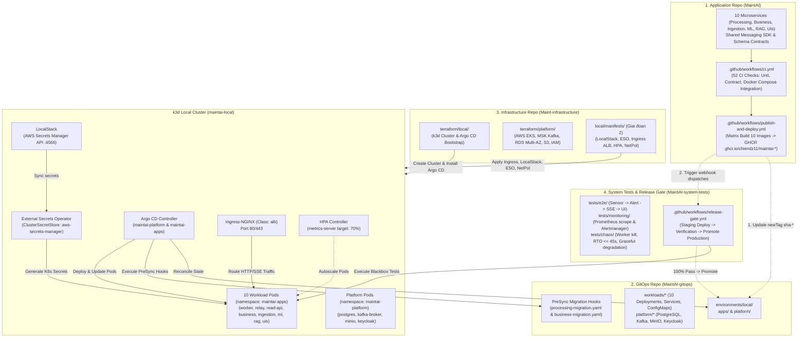
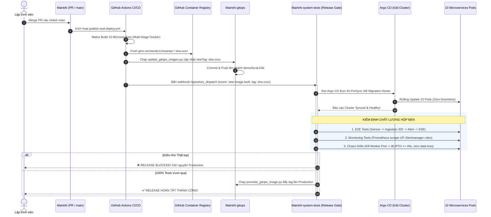

# Framework & Hướng Dẫn Tổng Quát: Cấu Hình k3d Local, Argo CD GitOps và Luồng CI/CD Đa Repository (MaintAI)

Tài liệu này đóng vai trò là **khung chuẩn hóa (DevOps Framework)** và **sổ tay vận hành kỹ thuật (Engineering Runbook)** cho toàn bộ hệ sinh thái **MaintAI (Predictive Maintenance Platform)**. Framework này quy định cách thức phối hợp giữa 4 repositories, quy trình khởi tạo cụm Kubernetes cục bộ (`k3d`) bằng Terraform, cơ chế đồng bộ khai báo qua GitOps (`Argo CD`), kiến trúc quản lý bí mật (**LocalStack + External Secrets Operator**), và luồng tự động hóa tích hợp/phát hành liên tục (`CI/CD`) kết hợp cổng kiểm định chất lượng độc lập (`MaintAI-system-tests`).

---

## 1. Kiến Trúc Tổng Thể 4-Tier Multi-Repository

Hệ sinh thái MaintAI được tổ chức theo mô hình phân tách trách nhiệm tuyệt đối giữa **Mã nguồn ứng dụng**, **Cấu hình trạng thái khai báo (Desired State)**, **Mã nguồn hạ tầng (IaC)** và **Kiểm định chất lượng độc lập (System Tests)**:



### Bảng Trách Nhiệm Từng Repository

| Repository | Công nghệ chính | Trách nhiệm cốt lõi |
| :--- | :--- | :--- |
| **`MaintAI`** | Python 3.12 (FastAPI, PyTorch, Psycopg 3), React 19 (TypeScript, Tailwind, Vite), Docker, Kafka SDK | Chứa toàn bộ nghiệp vụ 10 microservices (`ingestion-api`, `processing-worker`, `processing-outbox-relay`, `processing-read-api`, `business-api`, `business-consumer`, `ml-service`, `rag-service`, `drift-worker`, `frontend`, `simulator-ui`), wire contracts v1.4, thực thi 52 CI checks và build image đẩy lên GHCR. |
| **`MaintAI-gitops`** | Kustomize, Argo CD Applications, PreSync Kubernetes Hooks | Single Source of Truth lưu trữ cấu hình mong muốn (Desired State) của toàn bộ cụm K8s (`environments/local/apps`, `environments/local/platform`, `workloads/*`, `platform/*`, PreSync DB Migrations, `ConfigMaps`, `ExternalSecrets`, `HPAs`, `NetworkPolicies`). |
| **`Maint-infrastructure`** | Terraform, k3d, Helm, LocalStack, External Secrets Operator | Tự động hóa hạ tầng (IaC): khởi tạo cụm `k3d` local (`maintai-local`), cấu hình LocalStack Secrets Manager + ESO, Ingress ALB controller, bootstrap Argo CD, và cung cấp Terraform modules cho AWS Cloud Production (`terraform/platform/`). |
| **`MaintAI-system-tests`** | Python 3.12, Pytest, Requests, Httpx, Kubernetes SDK | "Chánh thanh tra độc lập" kiểm thử toàn trình hộp đen (E2E), kiểm tra hệ thống giám sát (Prometheus/Alertmanager), diễn tập phục hồi sự cố (Chaos Drills: Worker kill, RTO, RPO=0), và sở hữu Pipeline Release Gate quyết định promote image lên Production. |

---

## 2. Thiết Lập & Cấu Hình Cụm `k3d` Local Bằng Terraform

Cụm `k3d` được thiết kế để tái tạo chính xác các dịch vụ AWS Production ngay trên máy trạm thông qua Docker.

### 2.1. Cấu hình Mạng & Volume Mounts
- **Cluster Name**: `maintai-local`.
- **Kubernetes API Endpoint**: Bind cố định trên `127.0.0.1:6550`, sử dụng kubeconfig cô lập tại `Maint-infrastructure/.local/kubeconfig`.
- **Volume Bind Mount**:
  Mount thư mục cục bộ vào Rancher `local-path-provisioner` để duy trì dữ liệu PostgreSQL 17 (`processing_db`, `business_db`), Kafka logs và MinIO objects ngay cả khi dừng container (`k3d cluster stop maintai-local`).
- **Tắt dịch vụ thừa**: Khai báo `--disable=traefik` và `--disable=servicelb` trong k3s extraArgs để giải phóng cổng 80/443 cho Ingress-NGINX mô phỏng AWS ALB chuyên dụng.

### 2.2. Khởi tạo 1-Click bằng Terraform & Makefile
Đứng tại thư mục `Maint-infrastructure`:
```bash
# 1. Khởi tạo cụm k3d, cấu hình secrets và cài đặt Argo CD + attach GitOps
make tf-init
make tf-apply

# Lệnh trên sẽ tự động:
# - Tạo cụm k3d maintai-local
# - Cấu hình Local Storage
# - Cài đặt Argo CD phiên bản v2.10.x
# - Bootstrap Argo CD Applications (maintai-platform & maintai-apps) trỏ vào MaintAI-gitops
```

---

## 3. Kiến Trúc & Vận Hành Argo CD GitOps

Argo CD vận hành theo mô hình khai báo Kustomize, đóng vai trò đồng bộ liên tục giữa repository `MaintAI-gitops` và cụm Kubernetes.

### 3.1. Các Ứng Dụng Khai Báo (Argo Applications)
Trong namespace `argocd`, hệ thống quản lý 2 ứng dụng độc lập:

1. **`maintai-platform`**:
   - Git Path: `environments/local/platform`
   - Quản trị hạ tầng lõi: PostgreSQL 17 (2 databases logic: `processing_db` và `business_db`), Apache Kafka broker (Strimzi/KRaft), MinIO (S3 compatible), và Keycloak OIDC Provider.
2. **`maintai-apps`**:
   - Git Path: `environments/local/apps`
   - Quản trị: Toàn bộ 10 workloads ứng dụng của MaintAI kèm PreSync Migration Hooks.

### 3.2. Cơ chế PreSync Database Migration Hooks
Để đảm bảo schema database luôn được nâng cấp trước khi Pod ứng dụng mới nhận traffic, MaintAI sử dụng Kubernetes Jobs với annotation Argo CD PreSync:
* [`processing-migration.yaml`](file:///home/chienqt/Dev/newBTL/MaintAI-gitops/environments/local/apps/hooks/processing-migration.yaml): Chạy lệnh `maintai-processing-migrate upgrade` và cấp quyền PostgreSQL role `processing_app` trước khi `maintai-processing-worker` rollout.
* [`business-migration.yaml`](file:///home/chienqt/Dev/newBTL/MaintAI-gitops/environments/local/apps/hooks/business-migration.yaml): Chạy lệnh `maintai-business-migrate upgrade` và cấp quyền PostgreSQL role `business_app` trước khi `maintai-business-api` rollout.

```yaml
apiVersion: batch/v1
kind: Job
metadata:
  name: maintai-processing-migration
  annotations:
    argocd.argoproj.io/hook: PreSync
    argocd.argoproj.io/hook-delete-policy: BeforeHookCreation
```

### 3.3. Cơ chế Tự Động Đồng Bộ & Tự Khắc Phục (Self-Healing)
```yaml
spec:
  syncPolicy:
    automated:
      prune: false       # Không xóa nhầm tài nguyên stateful (Postgres/Kafka PVC)
      selfHeal: true     # Tự động ghi đè mọi can thiệp thủ công (manual drift) về đúng Git
    syncOptions:
    - CreateNamespace=true
    - FailOnSharedResource=true
```

---

## 4. Luồng Tự Động Hóa CI/CD & System Tests Release Gate



---

## 5. Phân Tích AWS Cloud Parity: Cấu Trúc Local vs Production

| Thành phần Kiến trúc | Môi trường Local (`k3d`) | Môi trường Production (AWS Cloud) | Cơ chế chuyển đổi & Parity |
| :--- | :--- | :--- | :--- |
| **Kubernetes Engine** | **k3d v5.x** (k3s container, 1 server node) | **Amazon EKS v1.35** (Managed Node Groups Multi-AZ) | Cùng chung K8s manifests, API resources và Kustomize overlays. |
| **Message Broker** | **Apache Kafka KRaft** (Strimzi Pod trong cụm) | **Amazon MSK (Managed Streaming for Kafka)** | Kết nối qua `KAFKA_BOOTSTRAP_SERVERS`; giữ nguyên topics `sensor.readings`, `inference.results`, `alert.signals`. |
| **Relational Database** | **PostgreSQL 17 Container** (`postgres:17.10` + PVC) | **Amazon RDS PostgreSQL 17 Multi-AZ** (Encrypted) | 2 logical DBs (`processing_db`, `business_db`), giữ nguyên Alembic/SQL migrations. |
| **Object Storage** | **MinIO S3 API** (`minio:RELEASE...` + PVC) | **Amazon S3** (Versioning + KMS Encryption) | Cùng sử dụng AWS S3 SDK (boto3) với `S3_ENDPOINT_URL`. |
| **Secrets Management** | **LocalStack** + **External Secrets Operator** | **AWS Secrets Manager** + **AWS KMS** (IRSA) | ESO kết nối LocalStack cổng 4566 ở Local; kết nối AWS Secrets Manager thật qua IAM Role trên Cloud. |
| **Ingress & Edge** | **Ingress-NGINX** (`ingressClassName: alb`) | **AWS Application Load Balancer (ALB)** | Sử dụng chung chuẩn Ingress annotations, định tuyến domain ảo. |
| **AI Inference & LLM** | **Groq Cloud / Local ML Model** | **Groq API / AWS SageMaker / Bedrock** | Giữ nguyên schema `MaintenanceBriefRequest` và timeout budgets. |

---

## 6. Lộ Trình Nâng Cấp Hệ Thống (Giai Đoạn 2: Production Parity)

Để đưa hệ thống MaintAI đạt chuẩn 100% tương đương với framework chuẩn mực của `Legal-Ai-Compliance-Checker`, hệ thống thực hiện 4 trụ cột nâng cấp:

```mermaid
flowchart TD
    subgraph P1["Trụ Cột 1: Secrets Management"]
        LS["LocalStack (:4566)<br/>AWS Secrets Manager Simulation"] -->|ClusterSecretStore: aws-secrets-manager| ESO["External Secrets Operator (ESO)"]
        ESO -->|Tự động sinh| K8S_SEC["K8s Secrets:<br/>maintai-database, maintai-kafka, groq-api-key"]
    end

    subgraph P2["Trụ Cột 2: Edge Routing"]
        ING_CTRL["Ingress-NGINX (Class: alb)<br/>Port 80/443"]
        ING_CTRL -->|Host: app.maintai.local| FE["Service/maintai-frontend:80"]
        ING_CTRL -->|Host: simulator.maintai.local| SIM["Service/maintai-simulator-ui:80"]
        ING_CTRL -->|Host: api.maintai.local| BIZ["Service/maintai-business-api:8000"]
        ING_CTRL -->|Host: ingest.maintai.local| ING["Service/maintai-ingestion-api:8000"]
    end

    subgraph P3["Trụ Cột 3: Autoscaling & K8s Policies"]
        MS["metrics-server"] -->|Scrape CPU/RAM| HPA["HPA Controller<br/>(Worker & Business API: 2-4 pods, target: 70%)"]
        PDB["PodDisruptionBudget (PDB)<br/>(minAvailable: 1)"]
        NETPOL["Zero-Trust NetworkPolicies<br/>(Cách ly Worker, Postgres, Kafka, Ingress)"]
    end

    subgraph P4["Trụ Cột 4: Observability (Metrics + Logs)"]
        PROM["kube-prometheus-stack<br/>(Scrape 10 microservices /metrics)"]
        LOKI["Grafana Loki + Promtail<br/>(Gom log container stdout/stderr)"]
        PROM --> GRAF["Grafana Dashboards<br/>(Biểu đồ Rung chấn, Lag Kafka, Error Rate)"]
        LOKI --> GRAF
    end
```



### Chi Tiết 4 Trụ Cột Nâng Cấp:

#### Trụ Cột 1: Quản Lý Bí Mật Tự Động (LocalStack + ESO)
1. Thêm manifest LocalStack (`local/manifests/localstack.yaml`) trong `Maint-infrastructure` chạy container `localstack/localstack:3.8.0` mở cổng `4566`.
2. Seed các secrets vào LocalStack:
   * `maintai/local/database`: chứa `DATABASE_URL` của `processing_db` và `business_db`.
   * `maintai/local/llm`: chứa `GROQ_API_KEY` cho `rag-service`.
   * `maintai/local/auth`: chứa JWT secret key cho Ingestion API.
3. Cài đặt Helm chart `external-secrets` trong namespace `external-secrets`.
4. Tạo `ClusterSecretStore` tên `aws-secrets-manager` trỏ tới `http://localstack.localstack.svc.cluster.local:4566`.
5. Trong `MaintAI-gitops`, thay thế K8s Secret tĩnh bằng `ExternalSecret` manifests với annotation sync-wave `argocd.argoproj.io/sync-wave: "-20"`.

#### Trụ Cột 2: Edge Routing & Domain Resolution (Ingress-NGINX mô phỏng ALB)
1. Cài đặt `ingress-nginx` trong cụm `k3d`, lắng nghe trên cổng `80` và `443` của load balancer `k3d-maintai-local`.
2. Tạo manifest `workloads/edge/ingress.yaml` trong `MaintAI-gitops` định tuyến các domain ảo (cấu hình trong `/etc/hosts` trỏ về `127.0.0.1`):
   * `app.maintai.local` $\rightarrow$ `maintai-frontend:80` (Giao diện kỹ thuật viên).
   * `simulator.maintai.local` $\rightarrow$ `maintai-simulator-ui:80` (Giao diện mô phỏng cảm biến).
   * `api.maintai.local` $\rightarrow$ `maintai-business-api:8000` (REST & SSE Stream).
   * `ingest.maintai.local` $\rightarrow$ `maintai-ingestion-api:8000` (HTTP Ingestion).
   * `processing.maintai.local` $\rightarrow$ `maintai-processing-read-api:8000` (History facade).

#### Trụ Cột 3: Autoscaling & K8s Policies (HPA, PDB & Zero-Trust NetworkPolicies)
1. **Metrics Server & HPA**:
   * Đảm bảo cả 10 deployments khai báo đầy đủ `resources.requests.cpu` (ví dụ `100m`) và `resources.requests.memory` (ví dụ `256Mi`).
   * Khai báo `hpa.yaml` cho `maintai-ingestion-api`, `maintai-processing-worker`, `maintai-business-api` (min 2, max 4 pods, target CPU 70%).
2. **PodDisruptionBudget (PDB)**:
   * Khai báo `pdb.yaml` cho `maintai-processing-worker` và `maintai-business-api` với `minAvailable: 1`, đảm bảo luôn có ít nhất 1 Pod phục vụ khi bảo trì cụm.
3. **Zero-Trust NetworkPolicies**:
   * Khóa Ingress/Egress mặc định trong namespace `maintai-apps`.
   * Cho phép Ingress-NGINX gọi vào `maintai-frontend` và `maintai-business-api`.
   * Cho phép `maintai-processing-worker` kết nối Kafka cổng `9092`, PostgreSQL cổng `5432` và `maintai-ml-service` cổng `8000`.
   * Mở Egress cổng `443` cho `maintai-rag-service` gọi Groq LLM API.

#### Trụ Cột 4: Nền Tảng Giám Sát & Ghi Log Tập Trung (Prometheus + Loki + Grafana)
1. Khởi chạy `kube-prometheus-stack` trong namespace `maintai-monitoring`.
2. Khởi chạy Grafana Loki + Promtail DaemonSet để thu thập toàn bộ log container từ `/var/log/pods/maintai-apps_*`.
3. Chuẩn hóa log định dạng Structured JSON trong mã nguồn Python (`trace_id`, `correlation_id`, `machine_id`, `event_id`).
4. Xây dựng Grafana Dashboards trực quan hóa:
   * Chỉ số rung chấn, nhiệt độ theo thời gian thực của máy.
   * Consumer Lag của Kafka topic `sensor.readings`.
   * Tỷ lệ lỗi và thời gian phản hồi (p95/p99 latency) của mô hình ML và RAG.

---

## 7. Quy Chuẩn Bổ Sung Microservice Mới (Onboarding Checklist)

Khi bổ sung một workload mới vào MaintAI (ví dụ: `maintai-anomaly-detector`):

### Bước 1: Khai báo Entrypoint & Kiểm thử trong `MaintAI`
- Đảm bảo service có thư mục riêng, Dockerfile non-root (`UID 10001`), kiểm tra linting (`ruff`), unit test và integration test trong `.github/workflows/ci.yml`.

### Bước 2: Đăng ký Build Image trong `publish-and-deploy.yml`
- Bổ sung service vào build matrix của `.github/workflows/publish-and-deploy.yml` để tự động đẩy image tag `sha-*` lên GHCR.

### Bước 3: Tạo Kubernetes Manifests trong `MaintAI-gitops`
Tạo thư mục `workloads/<service>/`:
- `deployment.yaml`: Khai báo `securityContext` (UID 10001, read-only root filesystem), `livenessProbe`, `readinessProbe`, `resources.requests/limits`.
- `service.yaml`: Khai báo `ClusterIP` nội bộ.
- `kustomization.yaml`: Đăng ký tài nguyên.

### Bước 4: Khai báo ExternalSecret, HPA & NetworkPolicy
- Khai báo biến môi trường nhạy cảm qua `external-secret.yaml`.
- Khai báo `hpa.yaml` (nếu stateless) và `network-policy.yaml`.

### Bước 5: Đăng ký Workload vào Argo CD Application
Thêm đường dẫn workload vào `environments/local/apps/kustomization.yaml`:
```yaml
resources:
- ../../../workloads/new-service
```
Commit và push lên nhánh `demo/local-k3d` của `MaintAI-gitops`. Argo CD sẽ tự động triển khai Pod mới lên cụm!

---

## 8. Sổ Tay Vận Hành & Khắc Phục Sự Cố (Troubleshooting Runbook)

| Hiện tượng | Nguyên nhân phổ biến | Lệnh kiểm tra & Cách khắc phục |
| :--- | :--- | :--- |
| **`ImagePullBackOff`** | Tag image `sha-*` chưa build xong trên GHCR hoặc package đang ở chế độ Private. | Chạy `kubectl describe pod <pod_name> -n maintai-apps`. Kiểm tra workflow `publish-and-deploy.yml` trên GitHub Actions và đảm bảo package trên GHCR ở chế độ Public. |
| **`CrashLoopBackOff` tại Processing Worker** | Chưa áp dụng migration cho `processing_db` hoặc database chưa sẵn sàng. | Kiểm tra logs: `kubectl logs -n maintai-apps -l app=processing-worker`. Kiểm tra Job migration: `kubectl get jobs -n maintai-apps`. Chạy thủ công PreSync Hook nếu cần. |
| **`SecretSyncedError` (Giai đoạn 2)** | LocalStack chưa có key secret (`maintai/local/database`) hoặc `ClusterSecretStore` mất kết nối. | Chạy `kubectl describe externalsecret -n maintai-apps`. Kiểm tra Pod LocalStack: `kubectl get pods -n localstack`. Nạp lại secret vào LocalStack bằng `awslocal secretsmanager put-secret-value`. |
| **Consumer Lag của Kafka tăng cao** | Worker xử lý ML chậm hoặc số lượng partition ít hơn số Pod Worker. | Kiểm tra lag qua Prometheus metric `maintai_kafka_consumer_lag`. Kiểm tra HPA của Worker: `kubectl get hpa -n maintai-apps`. Tăng số lượng partitions hoặc scale Pods. |
| **RAG Service báo lỗi `503 RAG_UNAVAILABLE`** | Chưa cấu hình `GROQ_API_KEY` hoặc nhà cung cấp LLM bị rate limit. | Kiểm tra logs: `kubectl logs -n maintai-apps -l app=rag-service`. Kiểm tra biến môi trường Secret. Lưu ý: Invariant của MaintAI đảm bảo lỗi RAG không chặn luồng tạo Alert. |
| **Argo CD `OutOfSync` liên tục** | Can thiệp sửa Deployment trực tiếp bằng `kubectl edit` làm xung đột với Git. | Không sửa trực tiếp trên cụm. Commit thay đổi vào `environments/local/apps/kustomization.yaml` trong `MaintAI-gitops`, Argo CD (`selfHeal: true`) sẽ tự động đồng bộ sạch sẽ. |
| **HPA hiển thị `cpu: <unknown>/70%`** | `metrics-server` mới khởi động (< 30s) hoặc Deployment thiếu `resources.requests.cpu`. | Kiểm tra `kubectl top pods -n maintai-apps`. Đảm bảo `workloads/*/deployment.yaml` có khai báo `resources.requests.cpu`. |
| **Tạm dừng / Khởi động lại cụm `k3d` để tiết kiệm RAM** | Cần giải phóng RAM/CPU khi chưa dùng máy trạm. | Tạm dừng (giữ nguyên DB/PVC): `k3d cluster stop maintai-local`. Khởi động lại: `k3d cluster start maintai-local`. |
