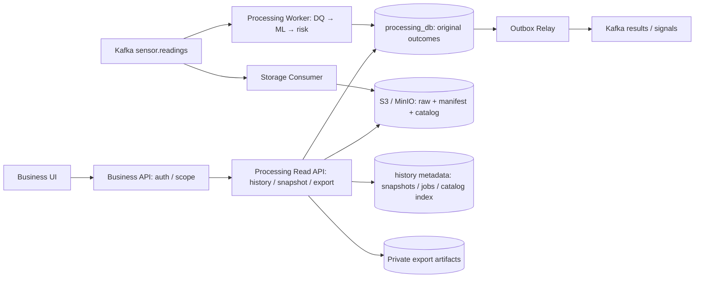

# M6-HISTORY-01 — Chốt kiến trúc xem lịch sử, snapshot và export

Ngày quyết định: **29/10/2026**. Revision **1.0.0**. Chủ dự án chốt theo phương án
được cung cấp trong cuộc trao đổi. Đây là **quyết định thiết kế đã duyệt**, chưa
phải báo cáo implementation hoặc bằng chứng chạy pipeline.

Quyết định này thay các điều khoản history mâu thuẫn trong System Contracts §36,
HISTORY-01, Guide và metadata kế thừa: Read API không còn SELECT-only với mọi bảng;
Worker không chạy export/archive; processed archive và xóa dữ liệu thật được hoãn.
System Contracts §44 và Guide §57 dẫn tới quyết định này. Kafka outcome vẫn1.4.0;
HTTP baseline1.3.2 và các migrations đang có chưa tự đổi theo việc cập nhật docs. Storage catalog0.2.0 có source riêng;
xem [implementation report](STORAGE_CATALOG_IMPLEMENTATION_REPORT.md), không suy
ra History API/UI M6 đã hoàn tất.

## 1. Phạm vi và ba Deployment của Processing

| Thành phần | Trách nhiệm M6 | Không thuộc trách nhiệm |
| --- | --- | --- |
| Processing Worker | Consume → DQ → ML → risk → durable outcome/outbox | Snapshot, export, processed archive, cleaner |
| Processing Read API | Status/evidence/history/chart; đọc raw qua catalog; tạo snapshot và export | Sửa source events, outcomes, risk, inbox hoặc outbox |
| Outbox Relay | Publish outcomes/signals theo ordered outbox hiện có | Query history hoặc export |
| Storage Consumer — Chiến/Người4 | Raw receipts → S3/MinIO; catalog và coverage | Ghi processing_db/business_db; archive processed history M6 |
| Business API — Người1 | Auth, machine scope, facade History/Export cho Main UI | SQL processing_db hoặc để browser đọc bucket trực tiếp |

Giữ Worker, Read API, Relay là **ba Deployment** hiện có của Processing. Không tạo
`processing-maintenance`, queue Kafka mới hoặc database thứ sáu cho M6. Background
export là module trong runtime Read API; cùng deployment không có nghĩa chạy trong
HTTP request hoặc dùng bộ nhớ làm nguồn trạng thái duy nhất.

Các node DB metadata/export là vùng dữ liệu của Processing, không phải workload
mới. Business Consumer vẫn cập nhật latest/alerts như trước; sơ đồ chỉ tập trung M6.

## 2. Xem trực tiếp và xuất file là hai chức năng

Người dùng xem bảng readings, outcomes và biểu đồ trực tiếp trên Business UI qua
JSON, bộ lọc và phân trang. CSV/Parquet là lựa chọn tải dữ liệu, không thay màn hình
lịch sử. Raw archive và file export cũng là hai loại object khác nhau.

M6 giữ original terminal outcomes trong `processing_db`, gồm COMPLETED, INVALID,
FAILED. Không tính lại model để dựng lịch sử; không suy risk_score từ probability.
Raw archive giữ từng Kafka receipt, kể cả duplicate/conflict, theo contract Storage.
M6 **chưa lưu processed outcomes xuống S3**, không triển khai fallback processed
cold-history và không xóa outcomes để ép DB về một hot window tùy ý.

## 3. Timestamp, thứ tự và cursor đã chốt

| Collection | Khóa giảm dần | Ý nghĩa |
| --- | --- | --- |
| Processing outcomes | `(processed_at, result_id)` | Kết quả hoàn tất gần nhất đứng trước |
| Raw sensor receipts | `(received_at, topic, partition, offset)` | Thời gian nguồn; Kafka locator phân biệt receipts trùng |

`processed_at` là tên logic/API cho **`processing_results.completed_at` hiện có**,
không thêm một đồng hồ thứ hai hoặc sửa timestamp khi export. Chỉ các rows terminal
đã commit mới được đưa vào snapshot. Đây là completion-time history, không phải
cam kết thứ tự phát reading hoặc thứ tự commit tuyệt đối của mọi transaction.

`received_at` của raw accepted receipt lấy từ envelope Sensor; owner index map với
`sensor_events.event_time` khi phù hợp. `server_accepted_at` được giữ riêng để đo
clock skew/source age và truy vết, không dùng thay khóa raw mà không thông báo.
Timestamp nguồn có thể lệch và không chứng minh completeness. Rejected/poison
thiếu timestamp hợp lệ không được bịa received_at: dùng collection quarantine có
thời gian tiếp nhận phía server, source/request filters và quyền riêng.

UTC RFC3339, giữ độ chính xác microsecond; `from` inclusive, `to` exclusive. Filter
thời gian dùng đúng clock của collection; khi overlay alert hoặc so raw/prediction,
UI hiển thị cả source time và processed time, không ghép theo completion time.
Latest/SSE vẫn dùng durable sequence_number từng máy, không chuyển sang timestamp.
IDs/locator là tie-breaker phân trang, không là nguồn xác định latest.

Cursor M6 là opaque token có xác thực, profile `M6-HISTORY-01/1.0.0`; ràng buộc
snapshot ID, collection, query hash, actor/machine scope, sort/last key, TTL và
key version. Mỗi trang vẫn kiểm tra quyền hiện tại. Không nhận bucket/key tùy ý
từ browser; Base64 đơn thuần không bảo vệ token hoặc che dữ liệu nhạy cảm.

Page mặc định100/max500. Snapshot TTL10 phút; query tương tác tối đa31 ngày và
100000 IDs/snapshot. Query vượt budget trả422 QUERY_TOO_LARGE, đề nghị thu hẹp hoặc
export. Cursor sai400; snapshot hết hạn410. Không dùng OFFSET cho history M6.
Cursor `before/before_event_id` của baseline không được âm thầm diễn giải theo
clock mới: PR M6 phải đồng bộ/version machine contracts, providers và UI; token
khác profile bị từ chối rõ ràng. Quyết định docs không tự đổi frozen baseline.

## 4. Snapshot và quyền ghi giới hạn của Read API

Read API sở hữu lifecycle snapshot, gồm immutable membership của rows đã commit
và catalog generation đã chọn. Snapshot pin raw object versions/manifests tới khi
hết hạn. Không giữ SQL transaction mở trong TTL; materialize bounded membership
bằng transaction ngắn hoặc copy immutable records. Late commits xuất hiện khi
refresh; không lọt vào trang sau của một snapshot cũ.

Owner migration tạo namespace metadata riêng, dự kiến **`history_meta`**:
`snapshots`, `snapshot_members`, `export_jobs`, `raw_catalog_entries`,
`raw_catalog_sync_state`. Tên vật lý được freeze trong migration M6, không giả định
các bảng đã tồn tại. Catalog index trong Processing là metadata tra cứu từ Storage,
không clone toàn bộ raw payload hoặc trao DB credential cho Storage.

| Credential/role | Quyền được cấp |
| --- | --- |
| `processing_ro` hiện có | SELECT các bảng Processing được duyệt; vẫn read-only |
| `processing_history_meta_rw` dự kiến, pool riêng của Read API | SELECT/INSERT/UPDATE/DELETE trên metadata được duyệt; không DDL/role inheritance vào Worker |
| Worker/Relay | Quyền hiện có theo owner; không được giao snapshot/export loop |
| Read API S3 identity | GET/LIST prefix raw/catalog được duyệt; GET/PUT prefix exports riêng; không sửa/xóa raw |

Đây là **hai pool/credentials trong một runtime**, giữ read repository với
`default_transaction_read_only=on`; không gỡ guard của pool đó để tiện ghi job.
Pool metadata không được cấp quyền ghi outcome/source/risk/inbox/outbox. Chỉ owner
migration thực hiện DDL/grants; runtime không tự migrate. Status/evidence M5 giữ
credential và behavior hiện có khi M6 chưa bật.

## 5. Export nhỏ, export lớn và recovery

| Operation | Behavior đã chốt |
| --- | --- |
| Export nhỏ CSV | Streaming HTTP sau auth và snapshot; chặn query vượt budget trước khi gửi headers |
| Export lớn CSV/Parquet | Durable job →202 + job_id/status_url → bounded runner trong Read API |
| GET job | Đọc trạng thái đã lưu; không chạy lại export |
| Download artifact | Kiểm tra quyền lại; private artifact, URL ký <=5 phút hoặc proxy có auth |

HTTP streaming chỉ cho CSV nhỏ, tối đa10000 rows/10 MiB và preflight <=10 giây;
đây là budgets khởi đầu cấu hình được, chưa phải số đo. Nếu vượt budget, chuyển
sang job trước khi bắt đầu response; lỗi sau khi gửi headers phải đóng stream và
client báo tải lỗi, không ghi file cắt cụt là thành công. Parquet dùng job để có
artifact hoàn chỉnh và checksum. Không giữ long-lived DB cursor/transaction cho
một client chậm. File vẫn UTF-8/CSV quoting an toàn, có policy chống spreadsheet
formula injection cho các field text do nguồn ngoài cung cấp.

Jobs: QUEUED → RUNNING → SUCCEEDED / FAILED / EXPIRED. POST chỉ trả202 sau durable
commit. Idempotency-Key gắn actor + canonical query + format + snapshot/scope;
cùng key khác body409. Ghi query clocks, schema/profile, source refs và checksum
output, không thay lineage gốc của prediction.

Ban đầu concurrency1/Pod với pool, bytes, rows, timeout và quota riêng. Nhiều API
replica claim job bằng lease/fencing + CAS completion; lease hết hạn được reclaim,
restart tiếp tục job và reconcile object đã upload. Shutdown ngừng claim, drain
có deadline. Không dùng tác vụ in-memory của HTTP framework làm durable executor;
không giữ lock/transaction DB khi đọc object hoặc upload. Orphan artifacts chỉ
được dọn có kiểm tra refs; download trước success409, artifact hết TTL410.

Export range tối đa365 ngày **trong phạm vi dữ liệu thực còn giữ**; không hứa đã có
365 ngày data. TTL artifact24h. Async budget30 phút là profile thiết kế. Chưa có
MinIO/S3 thì history DB vẫn chạy, còn export cần object artifact phải báo unavailable.

## 6. Storage handoff cho Chiến — Người4

Contract chi tiết tại [M6 Raw Archive Handoff](M6_RAW_ARCHIVE_HANDOFF.md). Chiến cung
cấp catalog generation bất biến, raw object refs/checksum và coverage theo từng
Kafka partition. Người1 có thể dùng fixture đúng contract để phát triển reader/UI
với publisher/reconciliation Storage0.2.0 đã có source; fixture không thay
bằng chứng provider thật.

M6 không bật `STORAGE_ARCHIVE_OUTCOMES`; raw accepted/rejected vẫn theo SDK0.3.0,
bundle2.0.0/raw-manifest1.0.0. Catalog là protocol bổ sung riêng, không sửa frozen
raw manifest, receipt identity hoặc SDK SQL001/002. Không thêm catalog HTTP service.

## 7. Hai mức demo local, không cần AWS S3

| Mức | Có thể chứng minh | Điều kiện |
| --- | --- | --- |
| History DB / export nhỏ | Xem kết quả xử lý, phân trang snapshot, chart outcomes, CSV nhỏ | PostgreSQL + các modules app tương ứng; không cần object store |
| Full M6 local | Raw history, catalog/coverage, raw chart, raw export, download job bền vững | MinIO versioned bucket + Storage catalog update + Read API integration |

Không cần upload lên **AWS S3** để demo trên k3d. Với full M6, Storage vẫn phải
upload raw vào **MinIO local**, dùng cùng S3 API; Read API đọc đúng dữ liệu đó.
Nếu không dùng object store, raw routes/export artifact trả503/HISTORY_UNAVAILABLE
hoặc capability unavailable, không trả empty200 giả đầy đủ. Live UI/processing
có thể chạy độc lập raw archive nhưng đó chưa phải demo đầy đủ M6.

Secrets/MinIO buckets/roles/policies và app enable thuộc hai repo platform hiện
có; docs ở app không tự provision hoặc cập nhật các quyền đó. Không dùng URL
localhost của host cho Pod. Export signed URL phải truy cập được từ browser hoặc
được Business/Read API proxy; không trả internal MinIO DNS cho người dùng.

## 8. Retention và phần hoãn sau M6

`retention_enabled=false`, `cleaner_dry_run=true` là trạng thái thiết kế mặc định;
đây chưa phải biến đã được runtime hiện tại đọc. M6 không xóa processing outcomes,
raw evidence hay model/policy artifacts; không chạy processed archive trong Worker.
Dry-run nằm cùng codebase Read API, chỉ báo candidates, pins/holds và lý do chặn.
Hết snapshot TTL chỉ giải phóng metadata/pins, không xóa source data. Export TTL
chỉ hết quyền tải; dọn file riêng phải kiểm refs và policy cho phép.

Hot30d/raw365d/processed365d là profile tương lai chưa được kích hoạt. Chưa có
processed archive verified thì không bật cleaner dữ liệu gốc. Cần xét cả evidence
alert/signal backlog, backups, audit và model lineage trước một quyết định retention
mới. Việc hoãn cleanup đồng nghĩa DB/disk có thể tăng; demo theo dõi dung lượng,
không hứa lưu vô hạn hoặc production-ready.

## 9. Trình tự bàn giao và acceptance

1. Người1 freeze OpenAPI/schema/cursor + owner migration/grants M6 theo quyết định
   này; machine baseline hiện hành không bị đổi chỉ bởi docs.
2. Chiến bàn giao fixtures/catalog/coverage, layout và local access theo handoff;
   triển khai Storage catalog publisher/reconciliation, không sửa receipt archive.
3. Người1 triển khai range/history/snapshot/chart/export trong Read API + facade/UI;
   không đưa loop export vào Processing Worker.
4. Hai người nối provider thật trên MinIO local: duplicate receipts, missing object,
   checksum mismatch, catalog lag/gap, wrong scope và browser download URL.
5. Kiểm chứng timestamp trùng, late commit, hết snapshot, job restart/retry/two replicas,
   quyền SQL bị chặn, 200-empty/503-unavailable, giữ nguyên kết quả/live M1–M5.
6. Chỉ đánh dấu full M6 sau DB/Kafka/MinIO/provider integration; fixture tests và
   docs validation phải được báo tách biệt. Không cần AWS cho acceptance local.
