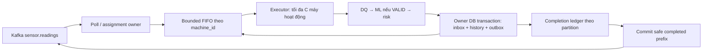

# PROC-ORDER-01 — Processing song song theo máy và bảo toàn thứ tự

**Decision revision:** `1.0.0`, ngày **2026-10-23**, bổ sung target System
Contracts `1.4.0` §42 và Implementation Guide §53. Thiết kế đã có
**SDK0.2.0/bundle1.1.0 implementation**; full app/runtime còn cần tích hợp. Quyết định có version
riêng; không tự tăng version HTTP/Kafka, sửa frozen SQL hoặc thêm Deployment.

Đọc cùng [System Contracts](MaintAI_System_Contracts_v1_4_DEPLOYMENT_PROVENANCE.md),
[Kafka Guide](KAFKA_DEVELOPMENT_GUIDE.md), [Runtime Dataflow](RUNTIME_DATAFLOW.md),
[Recovery](recovery-jobs-operations.md) và [readiness](implementation-readiness.md).

Nguồn trao đổi: [chat thiết kế23/10](https://chatgpt.com/s/t_6adac03f80e88191a825ee7eecc0202d).
Quyết định này chuẩn hóa nội dung theo contract của repo: sửa giả định sortable
epoch và phân biệt ordered dispatch với late physical duplicates. Câu chữ trong
chat không là bằng chứng implementation hoặc tự thay quy tắc ở System Contracts.

## 1. Vấn đề cần giải quyết và phạm vi

Một partition chứa readings của nhiều máy. Runner mặc định `ConsumerRunner` chỉ có **một record
in-flight trên toàn bộ assignment của runner**; inference chậm của máy A làm
máy B chờ ngay cả khi hai máy không phụ thuộc nhau. Target mới cho phép khác
máy chạy đồng thời, vẫn giữ tuần tự công việc của từng máy.

| Thành phần | Hiện có | Target của quyết định này |
| --- | --- | --- |
| Processing | SDK0.2 có keyed runner/coordinator/fenced handler; app callbacks còn skeleton | Bounded keyed scheduler + partition offset coordinator + assignment fencing |
| Outbox | SDK0.2 có OrderedOutboxRelay; legacy relay vẫn row-only | Thêm hàng đợi bền vững theo `(topic,machine_id)`, chỉ dispatch phần tử đầu |
| Business | SDK runner tuần tự; projections/lifecycle còn cần implement | Giữ runner đơn giản, inbox/CAS riêng từng projection và alert lifecycle |
| Storage | Runtime0.1.0 dùng runner hiện tại, microbatch1 | Không đổi sang keyed runner trong workstream này |
| Deployment | Worker, Relay, Read API tách runtime, cùng Processing owner | Giữ ba runtime, DB owner, image group và các topic hiện hành |

Bằng chứng source lúc soạn decision: [ConsumerRunner](../messaging/src/maintai_messaging/consumer.py)
có một handler thread; [OutboxRelay](../messaging/src/maintai_messaging/postgres.py)
legacy claim theo row. Đường opt-in mới ở
[keyed.py](../messaging/src/maintai_messaging/keyed.py) và
[ordering.py](../messaging/src/maintai_messaging/ordering.py). Commands và source
boundaries ở [implementation report](PROCESSING_ORDERING_IMPLEMENTATION_REPORT.md).

Đây là Processing scheduler, khác Sensor scheduler sinh readings. Các queues,
executor và coordinator ở **trong Processing Worker**, không là microservice,
Kafka group, database hoặc deployment mới. Read API vẫn chỉ phục vụ truy vấn.

## 2. Ba loại thứ tự và identity

1. **Nguồn:** `sequence_number` tăng bền vững theo `machine_id`, không reset
   khi Pause/Resume/restart/đổi `stream_epoch`. Epoch là lineage opaque, không
   sort UUID/chuỗi epoch, event ID hoặc timestamp để quyết định mới/cũ.
2. **Kafka:** offset chỉ so sánh trong cùng topic/partition. Key ổn định đưa
   readings cùng máy về cùng partition khi partition count/partitioner giữ
   nguyên; Kafka giữ thứ tự append, không tự sort source sequence.
3. **Nghiệp vụ:** latest telemetry, latest processing, latest valid prediction
   và alert lifecycle có guards/identity riêng. Không suy ra thứ tự tổng giữa
   `sensor.readings`, `inference.results`, `alert.signals` hoặc các group.

Keyed FIFO chỉ giữ **thứ tự đọc từ Kafka**. Producer phải giữ source order:
single-controller/one in-flight per machine, retry cùng ID/body trước reading
mới; Ingestion phải chờ ACK. Timeout có thể gây duplicate receipt đến muộn;
đối chiếu durable identity/hash trước khi coi sequence thấp là conflict.

- Same event ID + same canonical source body: duplicate; dùng outcome đã lưu,
  không tạo prediction/risk/signal mới. Giữ receipt coordinates cho audit theo
  retention policy; hash loại ingress receipt timestamps như quy tắc recovery.
- Same event ID + different source body, cùng sequence khác logical event, hoặc
  first-seen source sequence đi lùi: fail closed, giữ input chưa commit và
  chuyển vận hành reconciliation. Không tự gọi đó là DQ INVALID hoặc thêm kind
  chưa version. Chỉ chặn key bằng cơ chế được review; nếu chưa có isolation
  an toàn thì dừng runner/partition, không skip record cho dashboard trông mới.
- Sequence có thể có khoảng trống do local rejection/nguồn. Không chờ vô hạn
  `n+1`; chấp nhận sequence lớn hơn cursor sau khi qua identity/order checks.
  Thứ tự nguồn sai không được sửa bằng cách đoán từ timestamp.
- Thay số partition/partitioner hoặc cho nhiều source ghi cùng machine ID cần
  kế hoạch drain/fence/cutover riêng; không tăng partition live rồi giả định
  key luôn được một owner xử lý tuần tự xuyên các partition cũ/mới.

## 3. Các module nội bộ của Processing Worker

| Module đề xuất | Trách nhiệm |
| --- | --- |
| Poll/assignment loop | Sở hữu Kafka poll, pause/resume, callbacks và commit; không share consumer tùy tiện giữa handler threads |
| Keyed scheduler | FIFO từng máy; tối đa một active task/key; fair ready-key queue để một máy không chiếm toàn bộ executor |
| Handler/executor | DQ, bounded ML calls, transaction ngắn; không chờ HTTP trong transaction/row lock |
| Completion coordinator | Theo dõi mọi receipt đã giao, completion và generation, không chỉ offset lớn nhất |
| Ownership fence | Chặn stale worker ghi trạng thái nghiệp vụ sau khi partition đã chuyển owner |
| Supervisor | Backpressure, timeouts, readiness, drain và fatal-error handling |

Một record chỉ nhả key cho record tiếp theo khi owner transaction đã commit
hoặc durable duplicate receipt đã được xác minh. `INVALID` hoàn tất không gọi
ML; `INFERENCE_UNAVAILABLE` theo retry/failure policy hiện hành. DB rollback hay
unknown commit chưa phải completion; đọc reconcile inbox/outcome trước retry.
Retry của máy A giữ head của A, không đưa A's next reading chạy vượt. Máy B
tiếp tục nếu còn budget. Lỗi dependency chung có thể cần pause toàn runner.

Đây là **logic concurrency**, không bắt buộc CPU-bound Python threads tăng
throughput. Chọn async I/O hoặc thread pool sau khi kiểm dependencies; CPU DQ
nặng cần đo riêng. Chỉ handler I/O/CPU chạy ngoài poll owner; completion trả qua
queue thread-safe. Không dùng `max_workers` lớn với commit từng future tùy ý.

## 4. Offset coordinator — commit phần đầu đã hoàn tất

Commit Kafka là **offset tiếp theo sẽ đọc khi phục hồi**, không là ID nghiệp vụ.
Ví dụ một partition, ban đầu committed offset=500:

| Offset | Máy / source sequence | Thời gian xử lý minh họa |
| --- | --- | --- |
| 500 | A / 11 | 300 ms |
| 501 | B / 21 | 80 ms |
| 502 | A / 12 | INVALID, 10 ms sau A/11 |
| 503 | B / 22 | 70 ms sau B/21 |
| 504 | A / 13 | 130 ms sau A/12 |

B/21 xong ở80ms và B/22 ở150ms, nhưng offset500 chưa xong nên committed offset
vẫn500. A/11 commit DB ở300ms ⇒ có thể commit502 (500,501 đã durable). A/12
xong ở310ms ⇒ có thể commit504 (502,503 cũng durable). A/13 xong ở440ms ⇒
commit505. B được xử lý sớm, nhưng một lower-offset hole vẫn giữ recovery
frontier của cả partition. Các thời gian này chỉ là ví dụ, không benchmark.

Thuật toán cần đáp ứng:

1. Khi poll/admit, lưu ordered receipt ledger `(topic,partition,offset,
   assignment_generation,key,state)`; tính cả fetched-but-not-dispatched records.
2. Chỉ chuyển state sang durable sau DB commit/read-back xác minh hoặc exact
   duplicate đã durable. ML response, enqueue vào RAM và tạo outbox chưa commit
   không đủ điều kiện.
3. Theo từng partition, tiến frontier qua prefix các receipts đã durable;
   commit next offset của prefix đó. Không commit `max(completed_offsets)+1`.
   Offset Kafka có thể có gaps; không đòi mọi số nguyên phải xuất hiện.
4. Poll owner commit với assignment/generation còn hợp lệ. Commit failure hoặc
   ACK unknown không xóa durable identity; có thể replay và dedupe. Completion
   ledger vẫn được giữ tới khi commit/rebalance được xử lý an toàn.
5. Giới hạn số/bytes receipts chưa vượt frontier, kể cả records đã xử lý xong
   phía sau một hole. Không xóa chúng khỏi memory budget chỉ vì handler đã xong.

Không ghi inbox trước rồi chạy ML ngoài transaction như thể inbox đó đã là
terminal success. Nếu cần durable PROCESSING/claim, phải có state/lease riêng;
handler replay chỉ bỏ qua khi outcome + required outbox đã durable đầy đủ.

## 5. Rebalance, crash, timeout và shutdown

| Tình huống | Hành vi bắt buộc |
| --- | --- |
| Crash trước owner DB commit | Không completed/offset advance; replay reading |
| Crash sau DB commit, trước offset ACK | Replay, identity/hash match ⇒ dùng outcome cũ; không tạo signal mới |
| Offset501 xong,500 lỗi | Không vượt500; receipts phía sau có thể durable, giữ dedupe khi replay |
| Partition revoke | Dừng admission partition đó, drain theo budget, chỉ commit prefix được phép trong revoke; invalidate generation và bỏ queued work chưa chạy |
| Lost assignment | Không commit offset dưới owner cũ; completion stale không điều khiển scheduler/commit mới |
| ML timeout nhưng HTTP call cũ còn chạy | Timeout không hủy side effect remote; late result không được tự ghi outcome/nhả key lần nữa |
| DB commit timeout | Reconcile exact event/outcome trước retry; không đánh completed theo phỏng đoán |
| SIGTERM | Readiness false, stop admission, poll/drain theo client lifecycle, commit safe prefixes, close đúng thread ownership |

Generation trong RAM chỉ chặn **offset commit**, không fence DB writes từ handler
cũ. Implementation phải có durable ownership fence trước khi bật keyed mode:
ví dụ Processing-owned partition-lease/generation row. Owner mới nhận Kafka
assignment rồi chiếm generation bền vững; transaction kết quả kiểm generation
và khóa ngắn cần thiết atomically với cursor/inbox/history/outbox. Generation
stale phải rollback. Không giữ khóa/transaction suốt HTTP inference.

Trong chuyển owner, remote inference cũ và mới vẫn có thể cùng được gọi; không
hứa exactly-once ML execution. Durable unique identities, owner fencing và
transaction mới bảo đảm một logical outcome/risk side effect. Test cả old writer
hoàn thành muộn sau owner mới, không chỉ test callback revoke.

Không giữ cooperative rebalance callback chờ vô hạn. Nếu hết drain budget thì
unfinished receipts replay. `max.poll.interval`, heartbeat, HTTP/DB timeout,
drain budget và termination grace phải được tính/đo cùng nhau. Health endpoint
sống không chứng minh consumer vẫn poll hoặc frontier còn tiến.

## 6. Backpressure, cấu hình và sizing

Các tên dưới là **config đề xuất cho implementation**, chưa là env/CLI hiện có:

| Config | Đơn vị / ràng buộc |
| --- | --- |
| `max_active_keys` | Số máy đang chạy đồng thời/replica; một task/key |
| `max_pending_records`, `max_pending_bytes` | Tổng fetched/queued/in-flight/completed-behind-hole; có reserve cho fetch batch đã về |
| `max_pending_per_key` | Giới hạn RAM một hot key; đầy thì pause partition chứa key |
| `resume_low_watermark` | Hysteresis thấp hơn high watermark, tránh pause/resume liên tục |
| `max_uncommitted_per_partition` | Giới hạn ledger phía sau offset hole, tránh memory tăng vô hạn |
| `ml_concurrency`, `db_pool_size` | Trần downstream/replica và budget tổng các replicas |
| `handler_deadline`, `drain_timeout` | Hữu hạn, tương thích retry và Kafka/Pod lifecycle |

Queue đầy không drop reading, commit sớm hoặc trả NORMAL. Pause admission theo
partition, tiếp tục poll/heartbeat đúng client API; resume khi dưới low watermark.
Một hot key đầy có thể làm máy khác cùng partition chậm: chấp nhận tradeoff có
đo đạc. Không hứa key isolation tuyệt đối khi vẫn chia sẻ partition/DB/ML.

**Baseline100 máy×1 reading/s=100 readings/s. Kiến trúc Processing scale-ready:**
keyed concurrency và capacity từng stage có thể điều chỉnh khiX>100, giữ FIFO,
safe offsets và durable fences. Với12 partitions, bình quân8,33 readings/s/partition
nếu key đều;1 member nhận12 partitions, nếu3 members thì4 partitions/member và
khoảng33,33 readings/s/member. Phân phối thực có thể lệch. Số member không là số
máy;100 không là giới hạn cứng. Xem [cách tính scale/latency](design-basis/02_ASSUMPTIONS_AND_CAPACITY.md#11-scale-ready-tính-và-tối-ưu-latency-khi-x100).

Năng lực lý thuyết gần `replicas × active_keys / mean_handler_seconds`, còn bị
chặn bởi per-key sequential rate, ML/DB, tail latency, skew, memory và retry.
Không dùng công thức thay load test. Cần đo lag, oldest age, frontier stall,
queue wait, inference/DB time, visible-alert p95 và thời gian catch-up. Con số20
keys trong chat là minh họa; baseline100/s và mọiR=X×r khiX>100 cần đo cấu hình thực.

## 7. Ordered Outbox — từng topic, từng máy

Target: với một `(topic,machine_id)`, relay chỉ bắt đầu dispatch entry tiếp theo
sau khi entry trước đã có broker ACK được ghi nhận bền vững. Các máy khác vẫn
có thể được dispatch song song. Không có ordering tổng giữa hai output topics.

Outbox row cần durable order metadata và cursor/lease theo key, ví dụ
`dispatch_seq`, `source_sequence_number`, `message_key`, topic và producer identity.
`dispatch_seq` được cấp transactionally dưới per-key lock, cùng transaction
history/outcome/outbox; không lấy `created_at` hoặc timestamp làm thứ tự.
Đây là **đề xuất DB migration**, không là field wire mới đã được freeze.

- Unique `(topic,message_key,dispatch_seq)` cùng unique logical message identity.
  Dispatch sequence riêng từng topic; không chờ sequence nguồn không sinh signal.
- Claim chỉ **oldest unpublished entry của key**, kể cả entry đó đang backoff
  hoặc leased. `SKIP LOCKED` trên từng event không đủ: không cho claim entry sau
  chỉ vì head bị khóa, chưa due hoặc retry chậm.
- Một active dispatcher/key; có owner generation, lease heartbeat/renew và
  fencing khi finish/retry. Không nhả key lease giữa publish head và mark ACK
  rồi cho một relay khác chạy vượt.
- Head thất bại ⇒ backoff head; successor của cùng key/topic bị chặn. Permanent
  failure giữ key blocked và báo vận hành; không mark PUBLISHED/skip giả.
- ACK unknown/crash sau ACK trước mark ⇒ retry **cùng message ID/key/bytes**;
  không tạo result/signal mới hoặc chuyển cursor chỉ dựa trên producer enqueue.
- Topic key/partitioner phải ổn định. Nhiều producers, restart và lease fencing
  ở DB không tự thành Kafka producer fencing hoặc exactly-once end-to-end.

**Giới hạn bảo đảm:** dispatch/ACK progression theo logical entries có thứ tự;
Kafka log vẫn có thể thấy duplicate của entry cũ đến muộn do request/producer
cũ chưa kết thúc. Không cam kết mọi physical delivery luôn có sequence tăng
nghiêm ngặt. Nếu yêu cầu đó thay đổi, cần thiết kế broker-side fencing/transaction
riêng. Consumer vẫn phải inbox + sequence guard. `alert.signals` có thể đến
trước/sau prediction tương ứng dù từng topic đã ordered.

Relay legacy có lease/fencing **theo row**; OrderedOutboxRelay0.2.0 đã bổ sung
head-of-key/cursor semantics này. `ORDER BY created_at FOR UPDATE SKIP LOCKED` không chứng minh ordered relay.

## 8. Business và UI tiếp nhận thế nào?

- Giữ ba Business handlers/groups trong cùng Business Consumer Deployment.
  Runner hiện tại vẫn phù hợp làm baseline; không tự áp keyed mode cho Business.
- Telemetry CAS chỉ cập nhật latest telemetry nếu source sequence mới hơn.
  Prediction handler có CAS riêng cho latest processing và latest valid prediction.
  INVALID/UNAVAILABLE mới không xóa valid prediction cũ; giữ source/age/historical.
- Dùng durable sequence xuyên epochs. Same sequence khác event/body là conflict,
  không last-write-wins. Offset, completion time và opaque epoch không là source order.
- Alert handler dedupe/lifecycle trong owner transaction; không bỏ signal chỉ vì
  nó cũ hơn latest telemetry/prediction trên UI. Historical actionable signal xử
  lý theo policy/lifecycle đã freeze, không dùng latest-CAS để xóa audit/workflow.
- Commit DB rồi mới fan-out SSE tới mọi API replica. Frontend guards riêng từng
  projection; một stream SSE có thể cập nhật nhiều máy. REST snapshot để resync.
- Có thể coalesce telemetry cho render theo nhịp; không bỏ archive/history,
  terminal outcomes hoặc alert mutations để giảm tải màn hình.

Ví dụ A/11 có prediction HIGH, A/12 INVALID, A/13 NORMAL: latest processing có
thể đã tới13, nhưng alert sinh từ11 vẫn phải qua lifecycle/audit. INVALID12 không
xóa valid prediction11 trong khoảng trước khi13 hoàn tất. NORMAL13 không tự
resolve alert đã mở. ML prediction NORMAL/FAILURE khác risk HIGH/CRITICAL.

## 9. Metrics và bàn giao vận hành

Catalog bổ sung ở [OBS-01 §11](OBSERVABILITY_IMPLEMENTATION.md#11-proc-order-01--metrics-cho-keyed-processing-và-ordered-outbox).
Đo active keys, pending records/bytes, queue wait, uncommitted receipts, frontier
stall, paused partitions, outbox blocked keys và stale completion. Không label
machine/event IDs; Kafka lag thấp chưa chắc UI nhanh, metrics không thay inbox.

Người1 triển khai scheduler/coordinator/fences, Processing migrations, relay và
Business integration. Người2 thống nhất ML concurrency/timeout/model pinning.
Người4 thống nhất Kafka/pool/termination/retention budgets và provision dashboards
ở GitOps. Người3 giữ RAG ngoài critical path. Không chuyển Kafka cluster vào app.

## 10. Migration, release và nghiệm thu

1. Freeze decision, receipt/order/fence semantics và fixtures. Khảo sát bảng thật.
2. Thêm **migration mới** cho order/cursor/fence; không sửa frozen
   `contracts/kafka/migrations/001_messaging.sql` hoặc bundle1.0.0 tại chỗ.
   Nếu đổi SQL trong Kafka bundle, phát bundle/lock mới và cập nhật SDK pin.
3. Backfill ordering chỉ khi có source sequence/identity chứng minh được.
   `created_at` không đủ; thiếu bằng chứng ⇒ drain/reconcile boundary trước cutover.
4. Đổi relay cần stop/drain legacy dispatchers trước khi enable ordered mode;
   relay cũ không được claim successor qua row-only algorithm. DB capability/
   startup gate phải chặn mixed writers không hiểu cursor/fence mới.
5. Triển khai keyed runner opt-in cho Processing, giữ SDK baseline cho Storage/
   Business. Canary/cutover cần assignment fence và rollback tương thích DB;
   không bật song song old Worker không tuân fence trên cùng writable stream.
6. Đo load/failure/rolling rồi mới tăng concurrency/replicas. Rollback không xóa
   inbox/outbox/cursors; drain hoặc disable ordered writers theo runbook.

| Future test | Assertion tối thiểu |
| --- | --- |
| Cùng partition, A chậm/B nhanh | B hoàn tất sớm; A12 không bắt đầu trước A11 durable |
| Offset hole500, completed501/503 | Không commit vượt500; chỉ tiến prefix như §4 |
| Duplicate + conflict + sequence gap | Dedupe exact identity; conflict giữ offset; gap hợp lệ không chờ vô hạn |
| Crash/unknown DB commit | Replay dùng logical result cũ; không signal/risk trùng |
| Rebalance/SIGTERM/late handler | Old generation không commit offset hoặc stale DB mutation |
| Queue/head-of-line đầy | Memory/ledger hữu hạn, poll còn sống, pause/resume đúng |
| Hai relay, cùng key | Successor không dispatch khi head đang lease/backoff/unknown |
| ACK mất/lease hết hạn | Retry same bytes; duplicate muộn không làm UI lùi hoặc Alert trùng |
| Hai topic khác tốc độ | UI projections độc lập; Alert vẫn xử lý khi prediction đến muộn |
|Baseline100 readings/s; mở rộngR=X×r vớiX>100, giữ12 partition trước khi có cutover review | Tính/đo replica/concurrency/pools; báo throughput/p95/lag/catch-up/skew/memory và browser latency |

Tài liệu/sơ đồ/kiểm hash chỉ xác nhận đặc tả thống nhất. SDK0.2.0 đã có keyed
runner/coordinator/fence/ordered relay và migration002 với real broker/DB tests;
full app callbacks/images/deployment/load vẫn cần tích hợp. Xem
[implementation report](PROCESSING_ORDERING_IMPLEMENTATION_REPORT.md), Plan §K
và readiness §19. Initial legacy inbox cần reviewed cursor bootstrap riêng;
activation bản này fail closed, không tự backfill.
