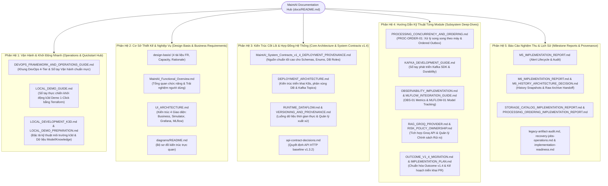

# MaintAI Docs — Hệ Thống Tài Liệu Kiến Trúc & Vận Hành (Target v1.4)

Cập nhật: **2026-11-04**. Toàn bộ tài liệu kỹ thuật của hệ thống **MaintAI (Predictive Maintenance Platform)** được chuẩn hóa và tổ chức thành **5 Phân Hệ Logic** nhằm phục vụ đa dạng đối tượng từ nhà phát triển, kỹ sư AI, kiến trúc sư đến kỹ sư DevOps/SRE.

---

## Sơ Đồ Cấu Trúc Tài Liệu MaintAI

---

## Lộ Trình Đọc Theo Từng Vai Trò (Reading Paths)

Tùy theo mục đích làm việc, bạn nên ưu tiên đọc tài liệu theo lộ trình sau:

| Vai trò của bạn | Mục tiêu | Thứ tự tài liệu khuyến nghị |
| :--- | :--- | :--- |
| **Kỹ sư muốn Chạy Demo ngay** | Khởi động cụm k3d local và xem ứng dụng chạy trong 5 phút | 1. [LOCAL_DEMO_GUIDE.md](operations/LOCAL_DEMO_GUIDE.md) 2. [DEVOPS_FRAMEWORK_AND_OPERATIONS_GUIDE.md](operations/DEVOPS_FRAMEWORK_AND_OPERATIONS_GUIDE.md) |
| **Kiến trúc sư / Tech Lead** | Hiểu toàn diện cơ sở thiết kế, hợp đồng dữ liệu và kiến trúc triển khai | 1. [design-basis/README.md](design-basis/README.md) 2. [MaintAI_System_Contracts_v1_4_DEPLOYMENT_PROVENANCE.md](architecture/MaintAI_System_Contracts_v1_4_DEPLOYMENT_PROVENANCE.md) 3. [DEPLOYMENT_ARCHITECTURE.md](architecture/DEPLOYMENT_ARCHITECTURE.md) 4. [RUNTIME_DATAFLOW.md](architecture/RUNTIME_DATAFLOW.md) |
| **Kỹ sư Backend & Stream Data** | Triển khai Processing Worker, Outbox Relay, Kafka và Database | 1. [PROCESSING_CONCURRENCY_AND_ORDERING.md](subsystems/PROCESSING_CONCURRENCY_AND_ORDERING.md) 2. [KAFKA_DEVELOPMENT_GUIDE.md](subsystems/KAFKA_DEVELOPMENT_GUIDE.md) 3. [OUTCOME_V1_4_MIGRATION.md](subsystems/OUTCOME_V1_4_MIGRATION.md) |
| **Kỹ sư AI / ML / RAG** | Phát triển mô hình ML, tích hợp MLflow, Copilot RAG với Groq API | 1. [MLFLOW_INTEGRATION_GUIDE.md](subsystems/MLFLOW_INTEGRATION_GUIDE.md) 2. [RAG_GROQ_PROVIDER.md](subsystems/RAG_GROQ_PROVIDER.md) 3. [RISK_POLICY_OWNERSHIP.md](subsystems/RISK_POLICY_OWNERSHIP.md) |
| **Kỹ sư DevOps / Platform / SRE** | Quản lý cụm K8s, GitOps Argo CD, Secrets, HPA, Prometheus & System Tests | 1. [DEVOPS_FRAMEWORK_AND_OPERATIONS_GUIDE.md](operations/DEVOPS_FRAMEWORK_AND_OPERATIONS_GUIDE.md) 2. [OBSERVABILITY_IMPLEMENTATION.md](subsystems/OBSERVABILITY_IMPLEMENTATION.md) 3. [LOCAL_DEMO_GUIDE.md](operations/LOCAL_DEMO_GUIDE.md) |

---

## Danh Mục Chi Tiết 5 Phân Hệ Tài Liệu

### Phân Hệ 1: Vận Hành Thực Chiến & Khởi Động Demo (Operations Hub)

Các tài liệu hướng dẫn thực hành triển khai và chạy hệ thống cục bộ:

| Tài liệu | Vai trò cốt lõi | Đối tượng |
| :--- | :--- | :--- |
| **[LOCAL_DEMO_GUIDE.md](operations/LOCAL_DEMO_GUIDE.md)** | **Sổ tay thực chiến khởi động hệ thống demo 1-click** bằng Terraform (`make tf-apply`), Argo CD tự động kéo images từ GHCR và kích hoạt PreSync Migration Hooks. | Tất cả thành viên |
| **[DEVOPS_FRAMEWORK_AND_OPERATIONS_GUIDE.md](operations/DEVOPS_FRAMEWORK_AND_OPERATIONS_GUIDE.md)** | **Khung chuẩn hóa DevOps toàn diện** cho hệ sinh thái 4-tier repos (`MaintAI`, `MaintAI-gitops`, `Maint-infrastructure`, `MaintAI-system-tests`), cơ chế LocalStack Secrets, Ingress ALB, HPA và Observability. | DevOps, SRE, Platform |
| **[LOCAL_DEVELOPMENT_K3D.md](operations/LOCAL_DEVELOPMENT_K3D.md)** | Đặc tả kỹ thuật nền tảng cụm k3d local, KRaft Kafka broker và các platform services. | DevOps, Platform |
| **[LOCAL_DEMO_PREPARATION.md](operations/LOCAL_DEMO_PREPARATION.md)** | Quy trình chuẩn bị dữ liệu mô hình (Model Identity) và seed tri thức vector (Knowledge embedding) cho môi trường demo. | AI Engineer, Platform |

---

### Phân Hệ 2: Cơ Sở Thiết Kế & Yêu Cầu Nghiệp Vụ (Design Basis & Requirements)

Tài liệu giải thích nguồn gốc và lý do hình thành kiến trúc:

| Tài liệu | Vai trò cốt lõi | Đối tượng |
| :--- | :--- | :--- |
| **[Cơ sở thiết kế](design-basis/README.md)** | Bộ 4 tài liệu dẫn dắt từ yêu cầu đề bài đến phân tích tải (baseline 100 máy $\times$ 1 reading/s), kiến trúc logic và biện luận các đánh đổi kỹ thuật. | Architect, Tech Lead |
| **[Functional Overview](architecture/MaintAI_Functional_Overview.md)** | Mô tả chức năng nghiệp vụ, trải nghiệm kỹ thuật viên và kịch bản vận hành thực tế. | Product Owner, Developers |
| **[UI-01 — Bốn giao diện](architecture/UI_ARCHITECTURE.md)** | Kiến trúc 4 frontend riêng biệt: Business UI, Simulator UI, Grafana Dashboards và MLflow UI. | Frontend, Platform |
| **[Bộ sơ đồ trực quan](diagrams/README.md)** | Toàn bộ sơ đồ Use Case, kiến trúc logic, deployment và data flow dưới dạng SVG/PNG/DOT. | Tất cả thành viên |

---

### Phân Hệ 3: Kiến Trúc Cốt Lõi & Hợp Đồng Hệ Thống (Core Architecture & System Contracts v1.4)

Các đặc tả chuẩn mực kỹ thuật bắt buộc phải tuân thủ:

| Tài liệu | Vai trò cốt lõi | Đối tượng |
| :--- | :--- | :--- |
| **[System Contracts v1.4](architecture/MaintAI_System_Contracts_v1_4_DEPLOYMENT_PROVENANCE.md)** | **Nguồn chuẩn tối cao** cho payloads, enums, database roles, Kafka topics, failure semantics và baseline 100 scale-ready. | Tất cả lập trình viên |
| **[Deployment Architecture](architecture/DEPLOYMENT_ARCHITECTURE.md)** | Bản vẽ triển khai Kubernetes Deployments/Services, ranh giới 2 DB owners (`processing_db`, `business_db`), Kafka partitions. | Architect, DevOps |
| **[Runtime Dataflow](architecture/RUNTIME_DATAFLOW.md)** | Luồng dữ liệu chi tiết: Accepted/rejected, DQ/inference/alerts, history và ranh giới phục hồi khi sập nguồn (crash boundaries). | Backend, Data Engineer |
| **[Versioning & Provenance](architecture/VERSIONING_AND_PROVENANCE.md)** | Truy vết xuất xứ dữ liệu, artifact hashes, model lineage, image digest signatures và quy tắc rollback an toàn. | Tech Lead, QA, SRE |
| **[API decisions](architecture/api-contract-decisions.md)** | Chi tiết các quyết định HTTP API của baseline 1.3.2 và lộ trình nâng cấp v1.4. | Backend, Frontend |

---

### Phân Hệ 4: Hướng Dẫn Kỹ Thuật Chuyên Sâu Từng Module (Subsystem Deep-Dives)

Tài liệu hướng dẫn triển khai chi tiết cho từng thành phần chuyên biệt:

| Tài liệu | Vai trò cốt lõi | Đối tượng |
| :--- | :--- | :--- |
| **[PROC-ORDER-01 — Concurrency & Ordering](subsystems/PROCESSING_CONCURRENCY_AND_ORDERING.md)** | Thiết kế xử lý song song theo máy (Per-Machine Concurrency), bảo toàn thứ tự FIFO nghiêm ngặt, cơ chế Head-retry blocking và Ordered Outbox Relay. | Người 1 (Backend/Processing) |
| **[Kafka Development Guide](subsystems/KAFKA_DEVELOPMENT_GUIDE.md)** | Hướng dẫn phát triển với thư viện `maintai_messaging` SDK, contracts Kafka, inbox/outbox, idempotency và xử lý lỗi. | Người 1, Người 4 |
| **[OBS-01 — Metrics Implementation](subsystems/OBSERVABILITY_IMPLEMENTATION.md)** | Danh mục chuẩn hóa tên metrics, labels, types, units, buckets và hướng dẫn cào số liệu cho Prometheus/Grafana. | Người 4, SRE |
| **[MLFLOW-01 — Training Integration](subsystems/MLFLOW_INTEGRATION_GUIDE.md)** | Tích hợp vòng đời huấn luyện mô hình ML, logging metrics, model registry và quy chuẩn đóng gói artifacts. | Người 2 (ML Engineer) |
| **[RAG-GROQ-01 — Tích hợp Groq API](subsystems/RAG_GROQ_PROVIDER.md)** | Tích hợp Groq LLM API cho `rag-service`, semantic search với pgvector và trích dẫn tài liệu bảo trì. | Người 3 (RAG Engineer) |
| **[RISK-POLICY-01 — Quản lý Chính sách Rủi ro](subsystems/RISK_POLICY_OWNERSHIP.md)** | Quy định vị trí lưu trữ, schema và quy trình cập nhật các chính sách đánh giá rủi ro hỏng máy. | Người 1, Người 2 |
| **[OUTCOME-14-ONLY — Chuẩn hóa Outcome](subsystems/OUTCOME_V1_4_MIGRATION.md)** | Hướng dẫn loại bỏ legacy readers, chuẩn hóa outcome v1.4 duy nhất và quy tắc không suy diễn risk score. | Backend, Processing |
| **[Implementation Guide v1.4](subsystems/MaintAI_Implementation_Development_Guide_v1_4_DEPLOYMENT_PROVENANCE.md)** | Sổ tay chi tiết từng bước xây dựng các thành phần của hệ thống. | Tất cả lập trình viên |
| **[Implementation Plan](subsystems/IMPLEMENTATION_PLAN.md)** | Kế hoạch triển khai mã nguồn qua các Pull Requests từ PR 00 đến PR 10. | Quản lý dự án |

---

### Phân Hệ 5: Báo Cáo Nghiệm Thu & Lịch Sử Kiến Trúc (Milestone Reports & Provenance)

Hồ sơ bằng chứng kiểm thử và lịch sử tiến hóa kiến trúc:

| Tài liệu | Nội dung nghiệm thu & Bằng chứng kiểm thử |
| :--- | :--- |
| **[M5 Implementation Report](reports/M5_IMPLEMENTATION_REPORT.md)** | Nghiệm thu Mốc M5: Vòng đời Alert, Audit logs, Technician feedback, Deduplication 300s và kiểm chứng local. |
| **[M6 History Architecture Decision](reports/M6_HISTORY_ARCHITECTURE_DECISION.md)** | Quyết định kiến trúc Mốc M6: 3 Deployments Processing, Processing Read API facade, trì hoãn dọn dẹp dữ liệu gốc. |
| **[M6 Raw Archive Handoff](reports/M6_RAW_ARCHIVE_HANDOFF.md)** | Giao thức bàn giao dữ liệu thô sang MinIO/S3 và quản lý catalog coverage theo partition. |
| **[M6 Implementation Report](reports/M6_IMPLEMENTATION_REPORT.md)** | Nghiệm thu Mốc M6: Lịch sử xử lý, Export jobs, API Facade và kiểm thử tích hợp. |
| **[Processing Ordering Report](reports/PROCESSING_ORDERING_IMPLEMENTATION_REPORT.md)** | Bằng chứng kiểm thử 87 test cases của Keyed Runner, Offset Coordinator và Ordered Outbox Relay. |
| **[Storage Catalog Report](reports/STORAGE_CATALOG_IMPLEMENTATION_REPORT.md)** | Báo cáo kiểm chứng triển khai Storage Consumer và MinIO catalog. |
| **[Sensor Implementation Report](reports/SENSOR_IMPLEMENTATION_REPORT.md)** | Báo cáo kiểm chứng Sensor v0.3.0, SQLite spooling và 5 Control APIs. |
| **[Tài liệu kiểm toán & Kế thừa](reports/legacy-artifact-audit.md)** | Hồ sơ kiểm toán các tài liệu cũ đã retire; tham chiếu [history-storage-contract.md](architecture/history-storage-contract.md), [recovery-jobs-operations.md](architecture/recovery-jobs-operations.md), [implementation-readiness.md](architecture/implementation-readiness.md) và [repository-layout.md](architecture/repository-layout.md). |

---

## Thứ Tự Ưu Tiên Áp Dụng (Precedence Rules)

Khi có sự khác biệt giữa các tài liệu, áp dụng theo thứ tự ưu tiên nghiêm ngặt sau:

1. **Yêu cầu người dùng và các quyết định dự án còn hiệu lực tại mục dưới.** **`M6-HISTORY-01`** ưu tiên các mô tả cũ về history clocks/cursor, SELECT-only toàn Read API, maintenance loop ở Worker, processed archive và retention M6.
2. **`System Contracts v1.4` §34–43, `UI-01` và các điều khoản Deployment/Dataflow/Provenance tương ứng.**
   * §41 ủy quyền catalog `OBS-01/1.0.0` và workflow `MLFLOW-01/1.0.0` làm chi tiết chuẩn, thay thế các tên ngắn hoặc mã drift cũ.
   * §42 ủy quyền `PROC-ORDER-01/1.0.0` và metrics extension `OBS-01 §11`; ưu tiên khuyến nghị Processing tuần tự/row-only relay cũ.
3. **Các chương kế thừa và Guide**; đặc tả chi tiết history/recovery/API bổ sung những phần chưa bị thay thế.
4. **Source code, runtime metadata và machine contracts** là bằng chứng trạng thái đang có, không tự chứng minh đã thực hiện yêu cầu v1.4.

---

## Các Quyết Định Dự Án Còn Hiệu Lực (Active Project Decisions)

- **RAG-GROQ-01 (30/10/2026):** RAG generation gọi Groq API, không dùng Ollama/Qwen local; embedding MiniLM và pgvector vẫn giữ nguyên. Credential truyền qua Secret, JSON schema và citations bắt buộc kiểm tra. Lỗi RAG không được phép chặn luồng tạo Alert. Chi tiết tại [RAG_GROQ_PROVIDER.md](subsystems/RAG_GROQ_PROVIDER.md).
- **RISK-POLICY-01 (30/10/2026):** Nội dung/schema/catalog policy thuộc `processing/config/risk-policies/` trong repo ứng dụng. GitOps khóa app commit + policy version/hash để tạo ConfigMap. Chi tiết tại [RISK_POLICY_OWNERSHIP.md](subsystems/RISK_POLICY_OWNERSHIP.md).
- **M6-HISTORY-01 (29/10/2026):** Ba Deployments Processing (`worker`, `outbox-relay`, `read-api`). Read API có pool read-only đọc dữ liệu gốc và pool quyền hẹp ghi metadata; snapshot/export thực thi trong Read API. Dữ liệu processed history lưu trữ trong `processing_db`, hoãn cơ chế cleanup sau M6. Chi tiết tại [M6_HISTORY_ARCHITECTURE_DECISION.md](reports/M6_HISTORY_ARCHITECTURE_DECISION.md).
- **OUTCOME-14-ONLY (28/10/2026):** Kafka reader/writer và HTTP outcome chỉ dùng schema 1.4.0. Business giữ nguyên risk_score do Processing phát, loại bỏ hoàn toàn legacy compatibility 2.0 và không backfill. Chi tiết tại [OUTCOME_V1_4_MIGRATION.md](subsystems/OUTCOME_V1_4_MIGRATION.md).
- **CAPACITY-BASE100-01 (23/10/2026):** Thiết kế giả định ban đầu 100 máy $\times$ 1 reading/s = 100 readings/s. Hệ thống scale-ready ở cấp kiến trúc: khi $X > 100$ sẽ tính toán lại capacity và tối ưu latency theo ngân sách. Chi tiết tại [Capacity §11](design-basis/02_ASSUMPTIONS_AND_CAPACITY.md#11-scale-ready-tính-và-tối-ưu-latency-khi-x100).
- **PROC-ORDER-01 (23/10/2026):** Processing Worker sử dụng bounded keyed FIFO: cùng máy đi tuần tự, khác máy đi song song. Commit safe completed prefix theo từng partition; Ordered Outbox Relay phân phối bản tin theo thứ tự `dispatch_seq` với cơ chế Head-retry blocking. Chi tiết tại [PROCESSING_CONCURRENCY_AND_ORDERING.md](subsystems/PROCESSING_CONCURRENCY_AND_ORDERING.md).
- **MLFLOW-IMAGE-01 (21/10/2026):** Dockerfile và mã nguồn đóng gói MLflow server đặt tại `ml-service/mlflow/` trong repo ứng dụng; tách biệt hoàn toàn với training/inference images. GitOps quản lý deployment và config. Chi tiết tại [MLFLOW_INTEGRATION_GUIDE.md](subsystems/MLFLOW_INTEGRATION_GUIDE.md).
- **Phân Công Nhóm 4 Người:**
  * **Người 1:** Backend + Main Frontend + Ingestion API + toàn bộ Processing (Worker, Outbox Relay, Read API).
  * **Người 2:** ML Training, Inference Service và MLflow integration.
  * **Người 3:** RAG Service, Vector Store và Knowledge Ingestion.
  * **Người 4:** Platform / MLOps, Sensor Simulator UI, Drift Worker, Storage Consumer, GitOps và Infrastructure.
- **UI-01 — Bốn Giao Diện Chính:** Business UI và Simulator UI là hai frontend độc lập có image, deployment và vòng phát hành riêng; Grafana và MLflow sử dụng UI công cụ do platform quản lý. Chi tiết tại [UI_ARCHITECTURE.md](architecture/UI_ARCHITECTURE.md).
