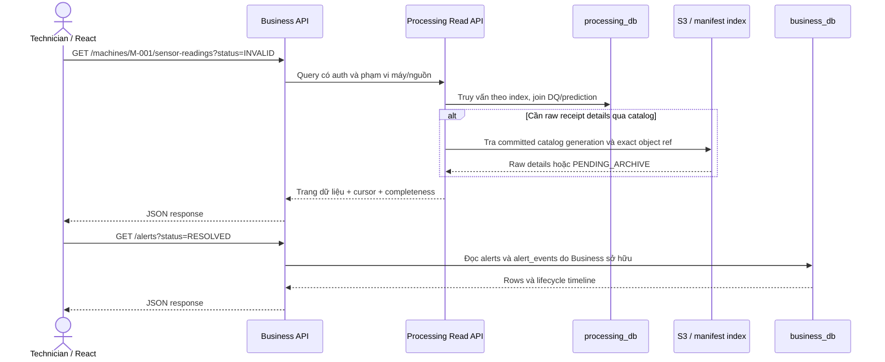

> **Source update23/10 — SDK0.2.0/bundle1.1.0:** keyed runner/coordinator,
> durable handler/DB fence, ordered relay, migration002 và transport wrappers đã
> có source/tests. Full app callbacks/probes/images/deployment còn cần tích hợp.
> [Implementation report](PROCESSING_ORDERING_IMPLEMENTATION_REPORT.md) và
> readiness §19 ghi bằng chứng, commands và giới hạn; các snapshot cũ đọc theo ngày.

> **Tích hợp MaintAI — 2026-10-19:** Tài liệu thiết kế mục tiêu v1.4, chưa xác nhận code/DB/GitOps đã migrate. Đọc [docs index](README.md) để áp dụng quyết định nhóm 4 người, Simulator UI riêng và thứ tự ưu tiên; [readiness](implementation-readiness.md) ghi các schema/scaffold chưa được cung cấp.

# MaintAI v1.4 — Luồng dữ liệu lúc chạy và các bất biến bắt buộc

**M6-HISTORY-01,29/10:** [Decision](M6_HISTORY_ARCHITECTURE_DECISION.md) ưu tiên
history cũ: processed outcomes đọc DB, raw đọc catalog S3/MinIO; Read API ghi
metadata snapshot/export quyền hẹp và chạy export nền. Không đưa maintenance vào
Worker, không processed archive/cleanup thật. Catalog contract ở
[M6-RAW-01](M6_RAW_ARCHIVE_HANDOFF.md); chưa có publisher chỉ bởi cập nhật docs.

Đọc cùng [Kiến trúc Deployment](DEPLOYMENT_ARCHITECTURE.md) để hiểu ranh giới runtime, và [Quy chuẩn Versioning & Provenance](VERSIONING_AND_PROVENANCE.md) để hiểu các định danh bất biến.

## 0. Điểm vào của bốn UI — UI-01, 2026-10-20

| UI | Luồng request/data | Bất biến |
| --- | --- | --- |
| Business | Browser → Business REST/SSE → projections/history/RAG/drift facade | Không gọi Sensor Control, ML/RAG/Kafka/DB trực tiếp |
| Simulator | Browser → Sensor Control → durable state/scheduler/spool → Ingestion | Browser không phát readings hoặc mutate Alert; không qua Business proxy |
| Grafana | Browser → Grafana server → Prometheus/exporters + approved report datasource | Không tính lại detector hoặc sửa risk; metrics không thay report DB |
| MLflow | Browser → MLflow Server → mlflow_db/artifact store | UI tracking/registry không tự promote inference release |

Sensor backend chạy độc lập browser/UI rollout; đóng hoặc deploy lại Simulator UI
không tự Pause máy. Business UI deploy riêng cũng không restart Sensor. Grafana
hoặc MLflow UI lỗi không tự chặn Business query/Alert path; phụ thuộc lúc model
startup/training phải đánh giá riêng. Xem [UI Architecture](UI_ARCHITECTURE.md).

Control mutation dùng Idempotency-Key + expected_control_version; ACK200 sau
persist,409/timeout cần GET reconcile. API hiện chỉ list/read/pause/resume/scenario;
rate/counters/preview ở HTML cần contract bổ sung trước khi nối thật.

Business summary/drift APIs vẫn tồn tại cho main user, trong khi Grafana chuyên
điều tra kỹ thuật. Report detail datasource ở Grafana cần owner-approved interface
hoặc read-only views/grants, không thêm Drift HTTP server chỉ để sao chép mock.
Các server giữ credential riêng; frontend runtime config và Portal chỉ có public
URLs/capabilities. Grafana/MLflow chưa Ready phải báo rõ, không dựng số liệu giả.

## 1. Nhận dữ liệu, archive, inference và cập nhật Frontend

```mermaid
sequenceDiagram
  participant S as Simulator
  participant I as Ingestion
  participant K as Kafka
  participant A as Storage Consumer
  participant W as Processing Worker / keyed scheduler
  participant C as Offset coordinator (trong Worker)
  participant M as ML Service
  participant P as processing_db + Outbox
  participant R as Outbox Relay
  participant B as Business Consumer
  participant D as business_db
  participant U as Business API / SSE
  S->>I: POST /sensor-readings (event_id và sequence ổn định)
  I->>K: sensor.readings (acks=all)
  K-->>I: Broker ACK
  I-->>S: 202 ACCEPTED, PENDING
  par Ba consumer groups độc lập
    K->>A: sensor.readings
    A->>A: Lưu S3 batch bất biến + manifest
    A->>K: Commit offset sau archive bền vững
  and
    K->>B: sensor.readings (live group)
    B->>D: CAS latest telemetry + inbox
    D-->>U: Thông báo sau khi commit
  and
    K->>W: sensor.readings
    W->>W: FIFO theo máy; máy khác được chạy song song
    W->>W: Data Quality
    alt VALID
      W->>M: predict (model release đã pin)
      M-->>W: prediction + model version thực tế
      W->>W: Áp dụng Risk Policy
    else INVALID
      W->>W: Không gọi ML, lưu validation errors
    end
    W->>P: Outcome + Outbox trong cùng transaction
    W->>C: Durable completion + assignment generation
    C->>K: Commit safe completed prefix từng partition
    P->>R: Lấy head unpublished theo topic/máy
    R->>K: inference.results và alert.signals nếu có
    K->>B: Outcome / Alert Signal
    B->>D: Ghi prediction/alert + inbox
    D-->>U: Thông báo sau khi commit
  end
```

**Không được nhầm:** HTTP `202` chỉ chứng minh Kafka đã ACK, **không** chứng minh inference hoặc S3 archive đã xong. Archive có thể hoàn tất trước hoặc sau prediction. Kafka không bảo đảm thứ tự tổng giữa các topic; latest projections phải so sánh ordering token ổn định theo máy. React nhận SSE thông qua Business API, không phải HTTP response gửi ngược cho Sensor.

Sơ đồ là target có bổ sung **PROC-ORDER-01 ngày23/10**: một event đại diện,
không mô tả Worker phải chờ toàn bộ event trước mới nhận máy khác. Keyed
scheduler/coordinator/ordered relay đã có trong SDK0.2.0; owner callbacks và
full app còn thiếu. Chi tiết §10 và implementation report.

## 2. Trường hợp sai schema ở Ingestion

```mermaid
sequenceDiagram
  participant S as Simulator
  participant I as Ingestion
  participant K as Kafka
  participant A as Storage Consumer
  participant O as S3
  S->>I: Payload sai cấu trúc nhưng có auth, đúng size limit
  I->>I: Tạo rejection_id và sanitize
  I->>K: sensor.rejected (acks=all)
  alt Broker ACK thành công
    K-->>I: ACK
    I-->>S: 400/422 không retry mù; ghi local rejected log
    K->>A: sensor.rejected
    A->>O: Lưu rejected object + checksum
    A->>K: Commit offset
  else Kafka unavailable
    I-->>S: 503/504 có thể retry, trạng thái nhận có thể chưa chắc chắn
  end
```

Payload không xác thực, độc hại hoặc vượt giới hạn có thể bị từ chối mà **không** lưu raw body. Schema rejection khác với Data Quality INVALID: `DATA_INVALID` do Worker đánh giá trên reading đã đi qua `sensor.readings`.

## 3. Luồng truy vấn lịch sử reading và Alert



Không được quét toàn bộ S3 bucket để phục vụ mỗi truy vấn browser. Hot-history cần index phù hợp trên `machine_id`, `server_accepted_at`, `event_id`, DQ status và vị trí Kafka. Có thể giữ JSON features kích thước giới hạn trong DB trong hot window, không nhân bản raw vô hạn. Cold-history có thể dùng (a) batch manifests có partition/date pruning; (b) Athena/Trino/DuckDB/Parquet query engine nếu dung lượng đủ lớn. **Không cần tạo `history_db` chỉ vì đã có Deployment Read API riêng**.

Trong M6, history kết quả sort `(processed_at,result_id)`, processed_at map
completed_at hiện có; raw sort `(received_at,topic,partition,offset)`. Sơ đồ trên
được hiểu là đọc raw catalog khi cần raw details, không fallback processed archive.
Snapshot chốt membership/committed catalog generation; late commits chỉ xuất hiện
khi refresh. Export nhỏ CSV streaming; export lớn durable job →202, runner Read API
→ private artifact → authorized download. DB read pool vẫn SELECT-only; metadata
pool có quyền hẹp riêng. Kafka locator/sequence ordering realtime không đổi.

## 4. Vòng đời dữ liệu và trạng thái

| Lớp | Ví dụ trạng thái | Owner | Hệ quả |
|---|---|---|---|
| HTTP/Kafka | `ACCEPTED`, `REJECTED`, `PUBLISH_UNAVAILABLE` | Ingestion | Mới xác nhận khả năng tiếp nhận tại broker |
| Archive | `PENDING_ARCHIVE`, `ARCHIVED`, `FAILED_ARCHIVE` | Storage | Khả năng truy xuất bản sao bền vững từ S3 |
| DQ | `VALID`, `INVALID` | Processing | INVALID không chạy ML, raw vẫn được giữ |
| Processing | `PENDING`, `PROCESSING`, `RETRYING`, `COMPLETED`, `INVALID`, `FAILED` | Processing | Lỗi không được thay bằng NORMAL giả |
| ML | `NORMAL`, `FAILURE` + xác suất | ML | Chỉ là prediction, không phải severity |
| Risk | `NORMAL`, `WATCH`, `HIGH`, `CRITICAL`, `INVALID`, `UNKNOWN` | Processing | Kết quả áp dụng risk policy |
| Alert | `OPEN`, `ACKNOWLEDGED`, `IN_PROGRESS`, `ESCALATED`, `RESOLVED`, `FALSE_ALERT` | Business | Trạng thái công việc kỹ thuật viên |
| Simulator | `RUNNING`, `PAUSED` | Simulator | Dừng/tạo readings mới, không tự đóng Alert |

## 5. Chống trùng và bảo toàn thứ tự

- `event_id` phải giữ nguyên qua retry. `rejection_id`/request identity phải cho phép chống trùng quarantine khi thích hợp. Vị trí `topic/partition/offset` lưu riêng với business IDs.
- Transaction Processing lưu event/hash/outcome/risk/outbox; unique constraints
  và durable assignment fence ngăn duplicate/stale writes. Target keyed mode
  commit offset theo safe completed prefix từng partition sau commit DB;
  không commit offset lớn nhất trong các task đã xong.
- Business Consumer dùng inbox idempotent theo `signal_id`/`result_id` trong cùng transaction cập nhật projection/Alert. Dedupe Alert theo policy + machine + window, không chỉ theo timestamp.
- Latest telemetry, latest processing outcome và latest successful prediction là **ba projections khác nhau**. Dùng sequence tăng đơn điệu theo máy để không bị rollback do out-of-order. Reading INVALID mới không xóa last valid prediction cũ; UI cần nhãn STALE/historical.
- History pagination dùng cặp `(server_accepted_at,event_id)` hoặc cursor contract đã freeze; không dùng thứ tự chuỗi event_id để xác định reading mới nhất.
- Outcome event có `schema_version`, `event_id`, `result_id`, `producer_git_sha`, `dq_ruleset_version`, model/policy version nếu có, thời gian và nguồn gốc reading.

## 6. Ma trận kiểm thử chịu lỗi

| Kịch bản | Dữ liệu bền vững cần có | Hành vi người dùng/vận hành |
|---|---|---|
| Kafka ngắt ở Ingestion | Không trả ACK giả, Sensor retry spool | UI stale; metrics publish error |
| Sai schema hợp lệ cho quarantine | `sensor.rejected` eventual archive | Tra theo source/request/time, không đòi machine_id |
| Feature DQ INVALID | Raw được archive; `DATA_INVALID`; ML call = 0 | Hiển thị lý do; giữ last valid prediction lịch sử |
| Worker crash sau DB commit nhưng trước event publish | Pending outbox được gửi sau phục hồi | Eventual outcome, không Alert trùng |
| Storage crash | Kafka giữ backlog đến retention | Cảnh báo archive lag, Processing vẫn chạy |
| Business Consumer replay | Inbox ngăn trùng Alert/action | Chỉ một Alert logic |
| History API tăng tải | History query có thể chậm, Worker replicas độc lập | Timeout/pagination; lưu ý DB contention |
| RAG down | Alert và technician actions không bị rollback | Copilot `UNAVAILABLE` |
| Model/Drift reference mismatch | Report `ERROR` lưu đúng versions | Không tự đổi machine risk |
| Model rollback | Pin manifest/artifact release cũ | Prediction mới ghi model cũ thực tế; Alert cũ không đổi |

## 7. Những phần chưa hoàn thành ở code thật

Kafka wire, raw manifest microbatch1, topic/ACL và compatibility reader đã được
code riêng trong [SDK/hướng dẫn Kafka](KAFKA_DEVELOPMENT_GUIDE.md). Chưa xác nhận
real broker/S3 integration hoặc deployment. Còn cần hot/cold query, curated archive
membership, migrations/app callbacks, endpoint prediction history nếu UI cần tab
chi tiết và benchmark. SDK không hoàn tất toàn luồng trong sơ đồ này.

## 8. Observability/tracking — OBS-01 và MLFLOW-01

App metrics được đo tại boundary thật: broker ACK, owner DB/outbox commit,
archive verification, ML/RAG completion; Prometheus/Grafana không tạo business
success thay runtime. Retry/inbox duplicate không tăng committed business event
lần nữa. Histograms cross-service dùng đúng accepted timestamp; Alert Signal1.0
hiện thiếu field này, cần exact-event owner lookup hoặc reviewed schema migration,
không lấy latest telemetry/received_at để đo p95 giả.

Training có durable operation intents trước create-run/version, frozen artifacts,
real selected run/registry identity và verified result trước release dispatch.
MLflow create timeout/5xx có thể đã commit, nên không blind retry theo tag search.
Dispatch ACK khác deploy success; metrics/logging outage không được làm rollback
Alert hoặc đổi risk. Chi tiết source/gate/SDK/recovery ở
[OBS-01](OBSERVABILITY_IMPLEMENTATION.md) và [MLFLOW-01](MLFLOW_INTEGRATION_GUIDE.md).


## 9. Sensor provider đã implement

Sensor0.3.0 lưu reading+sequence/cursor vào SQLite spool trước HTTP; sender chỉ
xóa sau ACK202 đúng identity. Lỗi/mất response giữ same event/payload cho retry.
Control state/version/receipt/audit commit trước200, Pause không xóa backlog.
Scheduler và sender ở cùng Sensor Deployment, independent browser. Bằng chứng
HTTP/browser/TLS fixtures và giới hạn deployment ở [readiness §15](implementation-readiness.md#15-sensor030--providerdurable-runtime2010).

## 10. PROC-ORDER-01 — đọc, xử lý, commit và publish có thứ tự

Nguồn chi tiết: [Processing concurrency/ordering](PROCESSING_CONCURRENCY_AND_ORDERING.md).
Chuỗi trong Worker:

```text
Kafka poll/assignment → bounded FIFO theo machine_id → tối đa C active máy
  → DQ → ML nếu VALID → risk → transaction inbox/history/cursor/outbox
  → durable completion → partition coordinator → safe offset commit
```

Cùng máy chờ outcome trước durable; khác máy cùng partition có thể hoàn tất
trước. Offset500 của A còn chạy và501 của B đã commit DB ⇒ committed offset
vẫn500. Khi cả500/501 durable mới được commit502. B không phải chờ A để chạy,
nhưng crash có thể replay cả B vì frontier còn bị A giữ. Inbox chống effect trùng.

Relay chọn head theo `(topic,machine_id,dispatch_seq)`. Head đang retry/unknown
ACK chặn successor cùng key/topic, máy khác tiếp tục. Dispatch order không là
strict order của mọi physical receipt: old duplicate có thể đến muộn. Các topic
results/signals vẫn độc lập; UI thấy HIGH chưa chắc alert đã được Business tạo.

Latest telemetry, latest processing và latest valid prediction có guards riêng
theo durable source sequence, không `(opaque epoch,sequence)` hoặc completed_at.
Không bỏ historical signal chỉ vì UI có reading mới. INVALID giữ valid snapshot
cũ; NORMAL mới không tự resolve Alert. Coalescing telemetry không giảm records
phải lưu/xử lý; SSE sau Business commit và REST snapshot phục hồi.

Revoke/lost/timeout phải fence late DB write lẫn offset commit, bounded drain
và replay phần chưa xong. Queue/full hoặc completed-behind-hole đạt budget ⇒
pause admission partition, tiếp tục poll; không skip. Read API/Storage không
tham gia coordinator của Processing và có offsets/commit boundary riêng.

## Phụ lục capacity:100 máy ban đầu, scale-ready choX>100

Baseline100 máy×1 reading/s. Hệ thống scale-ready qua các stage riêng, nhưng khiX
đổi phải tínhR=X×r và đo từ ingest tới browser, bao gồm queue/outbox/Business/SSE.
Giữ cùng source ID cho mẫu latency, không cộng p95 các stage hay dùng202 làm kết
quả inference. Đo/tối ưu bottleneck theo [Capacity §11](design-basis/02_ASSUMPTIONS_AND_CAPACITY.md#11-scale-ready-tính-và-tối-ưu-latency-khi-x100),
không đổi ordering/durability hoặc bỏ history/alerts để giảm thời gian giả.
