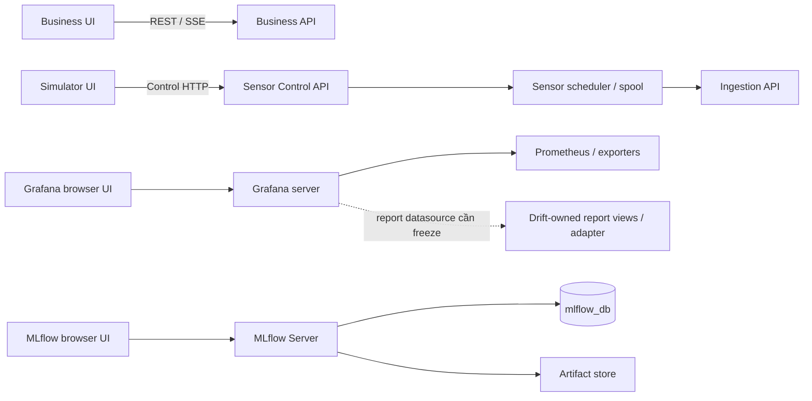

# UI-01 — Bốn giao diện và phát hành độc lập

**Quyết định dự án:** chốt ngày 2026-10-20, revision UI-01 `1.0.0`, bổ sung cho
thiết kế hệ thống v1.4. Đây là đặc tả mục tiêu. Lượt cập nhật này chỉ sửa docs;
không tự tạo frontend, API, image, dashboard provisioning hoặc deployment.
**Implementation tiếp theo20/10:** đã có [Simulator UI0.1.0](../sensor-simulator-UI/README.md)
với demo/live client, OIDC, recovery và checks. Sensor0.3.0 đã có provider và
browser/provider HTTP tests; image/deployment và production IdP/Kafka E2E còn thiếu. Các điều khoản dưới vẫn là yêu cầu mục tiêu.

Đọc cùng [System Contracts §40](MaintAI_System_Contracts_v1_4_DEPLOYMENT_PROVENANCE.md#40-ui-01--bốn-giao-diện-và-ranh-giới-phát-hành),
[Implementation Guide §48](MaintAI_Implementation_Development_Guide_v1_4_DEPLOYMENT_PROVENANCE.md#48-ui-01--hướng-dẫn-triển-khai-bốn-giao-diện)
và [Deployment Architecture](DEPLOYMENT_ARCHITECTURE.md). Khi ví dụ HTML khác API,
schema/contract đang freeze quyết định request/response; không tự suy ra API từ nút demo.

## 1. Quyết định và cách đếm

MaintAI có **4 UI chính**: Business, Sensor Simulator, Grafana và MLflow.
Business và Simulator là hai frontend do nhóm phát triển. Grafana và MLflow dùng
UI của công cụ, được cấu hình/vận hành trong platform. Mỗi UI có vòng cập nhật
riêng; một người có thể được cấp quyền vào nhiều UI theo nhiệm vụ.

| UI | Người dùng chính | Nguồn dữ liệu/giao tiếp | Owner |
| --- | --- | --- | --- |
| Business | VIEWER, TECHNICIAN, ADMIN có business scope | Business REST/SSE; Business làm history/Copilot/drift facade | Người1 |
| Sensor Simulator | SIMULATOR_OPERATOR, ADMIN có simulator scope | Sensor Control API, không qua Business proxy | Người4 |
| Grafana | DevOps/MLOps | Prometheus/exporters; report datasource được Drift owner duyệt | Người4, phối hợp Người2 về model/drift |
| MLflow | ML Engineer/MLOps | MLflow Server, tracking store và artifact store do server quản lý | Người2 phụ trách nội dung ML; Người4 vận hành |

Các quyền Grafana/MLflow là quyền platform riêng, không tự suy ra từ business
ADMIN. Các console như Argo CD/MinIO/Prometheus không được tính thành UI nghiệp vụ
trong bộ bốn này; việc cấp truy cập chúng thuộc phạm vi platform.

`index.html` của ZIP là **Portal điều hướng tùy chọn** tới bốn UI. Không bắt buộc
thêm portal service/DB/API hoặc một runtime thứ năm. `grafana_drift.html` và
`grafana.html` là cùng Grafana demo với tab mở đầu khác nhau, không phải hai UI.
Năm dashboard bên trong Grafana cũng không phải năm frontend.

## 2. Phạm vi và trải nghiệm của từng UI

### 2.1. Business UI

- Theo dõi fleet, chi tiết máy, Live Telemetry, Latest Valid Prediction,
  Latest Processing, tuổi dữ liệu và active alerts.
- Xem history/chart/export theo machine scope qua Business facade; xử lý
  ACK/START/ESCALATE/RESOLVE/FALSE_ALERT, audit, feedback và Copilot/citations.
- Giữ monitoring/drift summary và list/detail APIs hiện có cho người dùng được
  phép; có thể gắn link sang Grafana để điều tra sâu. Tách Grafana không xóa
  Business drift catalog hoặc các endpoint đang có contract.
- Điều khiển simulator thuộc UI riêng. Pause simulator không phải RESOLVE alert,
  và kết luận drift không tự đổi severity của máy.

Bố cục demo có ba menu chính **Tổng quan, Thiết bị, Cảnh báo**. Đây là tham chiếu
UX: history, brief, feedback và summary có thể nằm ở trang con/tab/banner, không
được bỏ chức năng đã chốt chỉ để giữ đúng số menu. UI không tự tính risk/PSI.

### 2.2. Sensor Simulator UI

- Liệt kê các máy giả lập và xem control state, RUNNING/PAUSED, scenario,
  control version, thời điểm/actor cập nhật gần nhất theo quyền.
- Pause/Resume từng máy, đổi scenario; hiển thị pending command, kết quả ACK,
  conflict, unknown outcome và thời điểm state được đọc thành công gần nhất.
- Các thông số tốc độ, retry/reject counters, queue size và preview reading chỉ
  hiện như dữ liệu live khi backend có DTO thật tương ứng. Không biến mock thành
  live telemetry hoặc prediction.
- Browser chỉ gửi control HTTP. Sensor backend sở hữu scheduler, reading IDs,
  durable sequence/spool và việc gửi readings tới Ingestion.

Luồng sử dụng: tải danh sách → đọc control state → gửi command có identity/version
→ nhận state đã persist hoặc lỗi → reconcile bằng GET khi kết quả chưa chắc chắn.
Lỗi tải state phải hiện `UNAVAILABLE/STALE` ở lớp UI, không tự đổi domain enum
RUNNING/PAUSED hoặc coi request timeout là controller đã dừng.

### 2.3. Grafana

Dùng Grafana thật với dashboard/datasource provisioning, không chuyển HTML
Grafana demo thành một ứng dụng React production. Năm nhóm dashboard tham chiếu:

| Dashboard | Câu hỏi cần trả lời |
| --- | --- |
| MLOps Overview | Các dịch vụ và pipeline có hoạt động, dữ liệu có mới không? |
| ML Inference | QPS, latency/error/timeout, model đang phục vụ và rollout có bất thường không? |
| Kafka & Processing | Producer errors, consumer lag, processing/outbox/archive có tồn đọng không? |
| Infrastructure | CPU/memory/disk/network/DB pool và dependency có bão hòa không? |
| Drift Monitoring | PSI/trend, model/reference/window, worker freshness và saved report nói gì? |

Prometheus nhận metrics từ services/exporters; Drift one-shot đẩy qua Pushgateway.
Instrumentation/catalog và handoff theo [OBS-01](OBSERVABILITY_IMPLEMENTATION.md).
Grafana hiển thị kết quả đã tính. Detector vẫn thuộc Drift Worker, không chạy lại
PSI hay retraining/promote chỉ vì người xem mở dashboard.

Chi tiết report và histogram Reference/Current cần dữ liệu có cấu trúc ngoài
metrics. ZIP đề xuất đọc `drift_db` bằng SELECT hạn chế; đây **chưa phải grant
đang tồn tại**. Nếu chọn datasource PostgreSQL, Drift owner phải công bố views
read-only và migration/grants, dùng credential riêng cho Grafana server, giới
hạn query/time range/pool và chỉ đọc drift reports. Nếu dùng report catalog/S3
adapter, phải freeze interface và auth tương ứng. Chưa có datasource được triển
khai thì panel báo unavailable; không cấp Drift writer hoặc Business DB credential.

Không đưa event/request/report ID tùy ý vào metric labels để mô phỏng report DB.
Phải phân biệt report status với worker freshness, input watermark và thời điểm
computed; thiếu/cũ dữ liệu không thành STABLE hay metric0 giả.

### 2.4. MLflow

Dùng UI thật của MLflow Server để xem experiments/runs, params, validation/test
metrics, artifacts, dataset/split lineage, registered model version và release
evidence được liên kết. MLflow Server sở hữu `mlflow_db` và artifact-store access;
browser không giữ DB/S3 credentials.

App training tạo nội dung theo [MLFLOW-01](MLFLOW_INTEGRATION_GUIDE.md): SDK,
frozen artifacts, selected run/version, durable retry/unknown checkpoints; dùng
UI có sẵn không tự tạo các evidence này. Platform server/config vẫn ở GitOps.

Một run train thành công hoặc alias mới không chứng minh model đã được deploy.
Model đang phục vụ được xác định bằng approved release, model/artifact/image
digests; chỉ luồng release PR GitOps được duyệt mới thay inference deployment.
Business vẫn hiển thị model/policy nguồn của prediction/alert theo business scope.

## 3. Ranh giới mạng, API và xác thực

- Business/Sensor APIs kiểm tra identity, role và machine scope trên từng request.
  Shared deployment bắt buộc auth; local anonymous chỉ explicit cho localhost.
- Browser OIDC dùng Authorization Code + PKCE; SSO có thể dùng cùng IdP nhưng
  audience/scopes và phiên truy cập từng UI vẫn phải được kiểm tra độc lập.
- Business, Simulator và platform UI dùng origins/routes được cấu hình rõ. Ingress
  cùng origin có thể route API tới provider, nhưng không biến Business thành
  simulator proxy hoặc gộp hai frontend vào chung image/Deployment.
- Backend providers nội bộ giữ auth/ACL. Grafana/MLflow truy cập qua management
  ingress/VPN/auth proxy phù hợp; không public database hoặc control endpoint thẳng.
- Frontend runtime config chỉ chứa public URLs/client IDs/feature capabilities;
  không có client secret, service token, SASL password, DB DSN hay S3 key.
- Link giữa các UI lấy từ cấu hình đã duyệt. Portal/link không cấp thêm quyền,
  không gửi bearer token qua URL/localStorage dùng chung giữa ứng dụng.
- SSE giữ chính sách auth của Business; không đặt access token trong query string.

## 4. API Simulator: phần đã đặc tả và khoảng cách với demo

Nguồn máy đọc được: [Simulator OpenAPI](../contracts/v1.3/openapi/openapi-simulator.yaml),
baseline1.3.2; provider Sensor0.3.0 đã implement baseline này và được kiểm HTTP local;
không phải deployment production. Xem [Sensor README](../sensor/README.md).

| Chức năng | Interface hiện có trong baseline |
| --- | --- |
| Danh sách máy | `GET /api/v1/simulator/machines` |
| Đọc control state | `GET /api/v1/simulator/machines/{machine_id}/control` |
| Pause | `POST /api/v1/simulator/machines/{machine_id}/pause` |
| Resume | `POST /api/v1/simulator/machines/{machine_id}/resume` |
| Đổi scenario | `PUT /api/v1/simulator/machines/{machine_id}/scenario` |

Role hiện có: SIMULATOR_OPERATOR/ADMIN với scope đúng máy. Mutation yêu cầu
`Idempotency-Key` và body có `expected_control_version`; scenario thêm `scenario`.
Success200 phản ánh state đã persist, không phải mutation nhận vào bộ nhớ tạm.
409 cần đọc lại state trước ý định mới; timeout/503/504 có thể là unknown outcome,
giữ nguyên idempotency key/body cho cùng command và GET reconcile theo contract.
401/403 không retry mù. Pause chỉ dừng sinh reading mới, không xóa spool/backlog.

`ControlState` hiện có machine_id, stream_state, scenario, control_version,
updated_at, last_controlled_by và source. **Chưa có rate mutation/field, counters,
queue/ACK detail, preview reading, control SSE, batch Pause All hoặc toggle RAG.**
Không thêm chúng vào JSON một cách tùy tiện: schema hiện cấm additionalProperties.

Trước khi bật tính năng demo còn thiếu: freeze request/response/error/permissions,
desired-vs-effective rate và CAS/idempotency/persistence semantics; version API/DTO
phù hợp rồi implement Sensor/provider + UI cùng fixtures. UI thiếu capability phải
ẩn/disable thao tác và giải thích nguồn chưa hỗ trợ. Không tự phát minh endpoint
`/rate` hoặc gọi Business để lấy control data. Lượt docs này không sửa OpenAPI.

## 5. Source, image, Deployment và cấu hình

| Component | App source/status hiện có | Artifact và runtime mục tiêu |
| --- | --- | --- |
| Business UI | `frontend/` skeleton; Người1 | Image frontend riêng → Deployment/Service `frontend` |
| Simulator UI | `sensor-simulator-UI/` React client/demo, live adapter/OIDC/recovery; Người4 | Dockerfile/image group riêng → Deployment/Service `simulator-ui`; chưa build image/deploy |
| Sensor backend | `sensor/`0.3.0: durable scheduler/spool, scoped Control API, metrics | Image/Deployment Sensor riêng với state/scheduler/spool |
| Grafana | Platform/GitOps; HTML chỉ là mẫu | Grafana workload riêng + versioned dashboard/datasource config |
| MLflow | Platform/GitOps; Người2 phối hợp Người4 | MLflow Server workload/image/config riêng |
| Portal | Chỉ HTML demo, tùy chọn | Static launcher; không thêm runtime bắt buộc |

`frontend` vẫn là Business UI, không rename runtime/image group đang có. App hiện
có14 runtime descriptors baseline1.3.2, gồm Simulator UI mới,
trong [runtime map](../architecture/runtime-map.json). Descriptor mới được thêm
cùng source implementation, không do đếm số UI. Không đưa Grafana/MLflow vào app source. Hạ tầng, ingress,
dashboard provisioning và release overlays tiếp tục ở các repo platform riêng.

Hai frontend có thể ở cùng monorepo và chia sẻ component library. Chúng vẫn cần
entrypoint/build output/image/runtime config riêng, có thể rollback riêng.
Tách folder nhưng build chung một image và phát hành chung chưa đạt UI-01.

## 6. CI/CD và versioning độc lập

| Loại thay đổi | Build/check cần thiết | Phần phát hành |
| --- | --- | --- |
| Chỉ Business UI | Frontend unit/build/API compatibility | Image/config `frontend` |
| Chỉ Simulator UI | Simulator UI unit/build/Control API compatibility | Image/config `simulator-ui` |
| Chỉ scheduler/spool/control backend | Sensor tests, control persistence/compatibility | Image/config Sensor; UI chỉ đổi khi cần |
| Dashboard/query Grafana | Dashboard/datasource config validation, query/auth checks | Grafana provisioning config; reload/rollout theo cơ chế platform |
| MLflow server/config | Version/config compatibility và integration phù hợp | MLflow workload/config |
| Shared UI library/toolchain | Check các frontend thực sự bị ảnh hưởng | Các images có dependency/output thay đổi |
| Breaking provider API | Provider + consumer compatibility/migration tests | Rollout expand/contract có phối hợp |

CI chọn affected components theo paths và dependency graph. Check tổng hợp
`CI / required` vẫn phải hoạt động; job không liên quan có thể skip theo policy
được thiết kế, nhưng job được yêu cầu hoặc path chưa phân loại không được mất gate.
CI hiện có job Simulator UI bắt buộc qua required gate; chưa chọn lọc frontend
images hoặc publish/deploy theo component, đây là yêu cầu cho PR sau.

GitOps PR thay đúng image digest/config hash của component; template các workloads
không liên quan giữ nguyên. Render chung không được tự ghi timestamp/global hash
vào mọi Pod template làm chúng rollout cùng nhau. Hai UI có thể dùng cùng Git
SHA monorepo, nhưng image digests/releases độc lập; không bịa repo/source SHA riêng.

Release ghi component, source SHA, OCI digest, public runtime-config digest,
contract baseline tương thích và GitOps revision. Grafana ghi dashboard UID/revision
và datasource-config digest; MLflow ghi server image/config/plugin versions thực.
UI/demo version1.6 không đổi model version, API baseline1.3.2 hoặc Kafka versions.
Không đổi schema runtime config đã freeze chỉ để thêm nhãn UI.

API nên hỗ trợ UI cũ còn mở trong browser qua rollout; breaking changes cần
consumer-first/expand-contract. Rollback một UI không rollback DB/model hoặc
triệt tiêu commands đã persist. Source/library change ảnh hưởng cả hai UI thì
release cả hai là lựa chọn có lý do, không phải nghĩa vụ do cùng repo.

## 7. Lỗi, tính độc lập và giới hạn

| Tình huống | Hành vi cần đạt |
| --- | --- |
| Business UI rollout/lỗi tải assets | Simulator UI vẫn tải và gọi Sensor; người dùng Business có trạng thái reconnect/resync phù hợp |
| Simulator UI rollout/offline | Sensor backend đang chạy vẫn phát/retry; không tự Pause hoặc đóng Alert |
| Sensor backend dừng/đổi image | Simulator UI hiện unavailable/reconcile; Business vẫn phục vụ history/alerts đã lưu, telemetry có thể stale |
| Grafana unavailable | Luồng ingest/inference/Alert và các UI ứng dụng tiếp tục; link monitoring báo unavailable |
| MLflow UI/server unavailable | Không chặn luồng UI nghiệp vụ; training/tracking bị ảnh hưởng; inference đang Ready dùng artifact đã pin/local không cần live tracking API |
| Cùng cluster/Ingress/IdP/DB gặp lỗi | Có thể ảnh hưởng nhiều UI; tách releases không tự tạo HA hoặc cô lập mọi dependency |

Replica startup cần ML artifact chưa tải mà S3/registry unavailable vẫn có thể
không Ready. Không khẳng định mọi model startup đều hoạt động khi MLflow outage.
Sensor frontend và backend tách lifecycle; browser đóng không đồng nghĩa simulator
process phải dừng. Quyền/budgets/query limits vẫn áp dụng khi người dùng mở nhiều UI.

## 8. Phân công và nghiệm thu cho các PR implementation sau

- Người1: Business React, Business REST/SSE/auth/projections; giữ behavior
  lifecycle/history/Copilot, phối hợp UI/provider compatibility.
- Người2: MLflow experiments/model lineage, reference/artifact evidence; phối hợp
  Người4 về dashboard ML/drift và version server thực.
- Người3: RAG API/evidence/citations; không tạo UI riêng chỉ vì là một service.
- Người4: Simulator UI + Sensor Control, Grafana/MLflow platform access/provisioning,
  per-component CI/GitOps release cùng owners. Frontend không chứa platform secrets.

Tiêu chí nghiệm thu phải có bằng chứng ở runtime khi triển khai, không tick do viết docs:

1. Thay image Business UI: image/config/Pod template của Simulator và Sensor giữ nguyên.
2. Thay Simulator UI: Business frontend/API không rollout; simulator đang chạy giữ state.
3. Pause M-001 có idempotency/version guard; M-002 tiếp tục phát; backlog cũ được xử lý.
4. Timeout command rồi reload UI reconcile đúng state bền vững; không hiển thị ACK giả.
5. Hai tab/operator xung đột có409 và reload state; chưa hỗ trợ rate/counters thì UI báo rõ.
6. Business nhận INVALID/ML_UNAVAILABLE không xóa latest valid prediction hoặc auto-resolve Alert.
7. Grafana drift panel phân biệt stale/insufficient/error; report details khớp model/reference;
   datasource giới hạn quyền, browser không đọc SQL hoặc giữ credentials.
8. MLflow run/alias thay đổi không tự promote inference; historical Alert còn truy được lineage.
9. Mỗi UI kiểm tra auth/scopes; link/SSO không làm lộ tokens hoặc vượt quyền.
10. Rollback từng UI giữ API compatibility, không đổi model/policy/DB hoặc workload khác.

## 9. Nguồn prototype và trạng thái

Tham chiếu `MaintAI_UI_Suite_v1_6_FIXED.zip` do người dùng cung cấp; SHA-256:
`1fd6b649e6a9ccab9e040ac03e8ff05391d032ff8abc43c75e234ceaa5149040`.
ZIP vẫn ở Downloads, chưa nhập assets/HTML vào repo. README/TEST_REPORT của ZIP
là thông tin nguồn; lượt cập nhật này chỉ đọc chúng, không chạy lại báo cáo test.

Đây là mẫu UX offline dùng mock: bốn UI chức năng, Portal và entry Grafana Drift.
Không có live Kafka/Prometheus/PostgreSQL/S3/ML trong browser. Chức năng prototype
chưa có contract được liệt kê ở §4; mẫu DB datasource cần review ở §2.3.
Tài liệu target tiếp tục1.4, UI-01 có revision riêng; không đổi tên cả bộ docs
thành1.6 hoặc gắn nhãn implementation complete. Khoảng cách triển khai theo dõi
tại [readiness](implementation-readiness.md) và [implementation plan](IMPLEMENTATION_PLAN.md).
