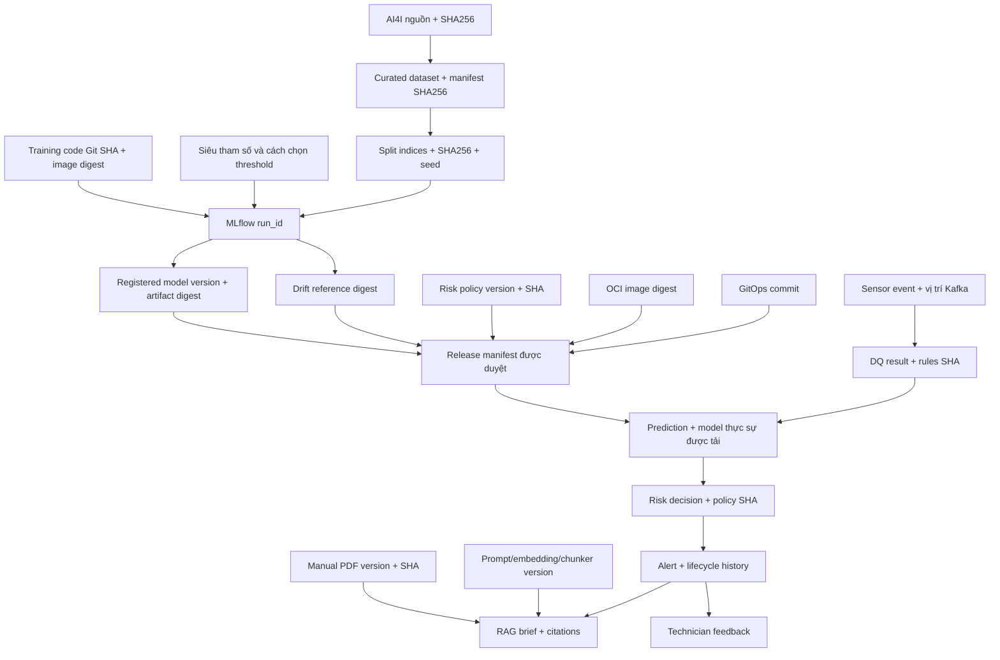

> **Source update23/10 — SDK0.2.0/bundle1.1.0:** keyed runner/coordinator,
> durable handler/DB fence, ordered relay, migration002 và transport wrappers đã
> có source/tests. Full app callbacks/probes/images/deployment còn cần tích hợp.
> [Implementation report](PROCESSING_ORDERING_IMPLEMENTATION_REPORT.md) và
> readiness §19 ghi bằng chứng, commands và giới hạn; các snapshot cũ đọc theo ngày.

> **Tích hợp MaintAI — 2026-10-19:** Tài liệu thiết kế mục tiêu v1.4, chưa xác nhận code/DB/GitOps đã migrate. Đọc [docs index](README.md) để áp dụng quyết định nhóm 4 người, Simulator UI riêng và thứ tự ưu tiên; [readiness](implementation-readiness.md) ghi các schema/scaffold chưa được cung cấp.

# MaintAI v1.4 — Quy chuẩn quản lý phiên bản và truy vết nguồn gốc (Versioning & Provenance)

**Trạng thái:** Quy chuẩn thiết kế mục tiêu, ngày 19/10/2026. Các phiên bản trước đã đề cập đến version, metadata ML, tài liệu bảo trì bất biến, audit cảnh báo, offset Kafka và Git SHA. Tài liệu này thống nhất chúng thành hợp đồng chung. **Không được hiểu rằng mã nguồn MaintAI hiện đã thực hiện đầy đủ các yêu cầu bên dưới.**

## 0. Mục tiêu, giới hạn và thuật ngữ

**Mục tiêu:** Đối với một cảnh báo bất kỳ, hệ thống phải trả lời được: reading gốc nào, bộ quy tắc Data Quality nào, dataset và code huấn luyện nào, MLflow run nào, model/preprocessor nào, container image nào, risk policy nào, phiên bản prompt/tài liệu nào và thao tác của người dùng nào đã dẫn tới cảnh báo đó. Các thành phần được nối bằng định danh bền vững, bất biến; **không** dựa riêng vào alias có thể thay đổi hoặc timestamp.

| Thuật ngữ | Giải thích |
|---|---|
| Version | Nhãn phiên bản phục vụ con người, ví dụ `maintai-1.4.0`, `model_version=3`, `dq-rules-v2`. |
| Digest / checksum | Định danh nội dung bất biến, ví dụ `sha256:<64 ký tự hex viết thường>`. Thay đổi byte sẽ thay đổi digest. SHA không tự chứng minh tính xác thực; cần registry đáng tin cậy, IAM/chữ ký khi có yêu cầu an ninh. |
| Provenance / lineage | Chuỗi quan hệ có thể kiểm chứng giữa input, quá trình xử lý và output, kèm phiên bản, thời gian, thành phần thực hiện. |
| Release | Tập phiên bản/digest **đã được phê duyệt** gồm image, model, contract và policy. Không dùng `champion`/`latest` làm danh tính duy nhất khi audit. |
| Governance | Quy định chủ sở hữu, phê duyệt, phân quyền, thời hạn lưu trữ, quản lý thay đổi, mức đầy đủ của lineage và rollback. |

**Giới hạn AI4I:** Mỗi dòng AI4I 2020 không phải một bản ghi liên tiếp của máy công nghiệp thật. Việc gán `machine_id`, thời gian, scenario suy giảm/hồi phục trong Simulator chỉ mang tính **mô phỏng**. Dự đoán ML là ước lượng nguy cơ; kết luận bảo trì thực tế cần bằng chứng của kỹ thuật viên.

**Ngoài phạm vi MVP:** catalog dữ liệu doanh nghiệp, tự retrain khi S3 xuất hiện raw mới, điều khiển PLC, chẩn đoán chắc chắn nguyên nhân hỏng, tự suy ra ground truth từ prediction và hạ tầng chứng thực mật mã phức tạp.

## 1. Hệ thống định danh phiên bản và tính bất biến

| Đối tượng | Trường version/ID | Danh tính bất biến cần giữ | Chủ sở hữu |
|---|---|---|---|
| AI4I gốc | `source_dataset_id` | SHA256 file gốc + source URI | Data |
| Curated dataset | `dataset_version` | SHA256 manifest và từng shard | Data |
| Chia tập train/val/test | `split_version` | SHA256 danh sách indices + seed | ML |
| Feature schema | `feature_schema_version` | SHA256 JSON Schema | ML + Contract |
| Bộ quy tắc DQ | `dq_ruleset_version` | SHA256 cấu hình/rules | Processing |
| Training pipeline | `training_code_git_sha` | Commit + lockfile digest + image digest | ML |
| Lần train | `mlflow_run_id` | ID run thực tế + tags/artifacts | ML/MLflow |
| Model đăng ký | `model_name`, `model_version` | Model/preprocessor artifact SHA256 | ML |
| Threshold | `threshold_version` | Threshold + bằng chứng chọn threshold | ML |
| Drift reference | `reference_version` | SHA256 `drift_reference.json` | ML/Drift |
| Risk policy | `policy_version` | SHA256 chính sách được canonicalize | Processing + chủ sở hữu policy |
| Kafka event schema | `schema_version` | SHA256 schema/commit | Contract |
| Service release | `service_release` | OCI image `@sha256:...` + source Git SHA | MLOps |
| Manual | `document_id`, `document_version` | SHA256 PDF nguồn | RAG |
| Chunks/index | `ingestion_pipeline_version`, `chunker_version` | Chunk checksum + index revision | RAG |
| Embedding | `embedding_model_version` | Provider/model/revision thực tế | RAG |
| Prompt | `prompt_version` | SHA256 template | RAG |
| Brief | `brief_id` | Phiên bản prompt/manual/citations/model LLM | RAG + Business |
| Alert/action | `alert_id`, `alert_event_id` | Liên kết event/prediction/risk/model/policy | Business |

**Bất biến:** Không được dùng cùng một version ID cho hai nội dung khác nhau. Trường nào không thể xác minh digest phải ghi `NOT_AVAILABLE`, cùng lý do, thay vì tạo giá trị giả. Các Git SHA của repo khác nhau phải ghi riêng; không ghép thành một SHA tự chế.

## 2. Đồ thị nguồn gốc dữ liệu



**Diễn giải:** Không phải prediction nào cũng tạo Alert. DQ INVALID không sinh prediction. MLflow run và release inference là hai đối tượng **khác nhau**: ghi log một run không chứng minh model đã được triển khai. Muốn xác định model thực tế phải có `release_id`, version và digest được resolve tại thời điểm startup/inference.

## 3. Versioning của dataset gốc và curated dataset

### 3.1. Bảo quản dataset nguồn

Ghi lại nguồn tải, giấy phép, thời gian lấy (UTC), kích thước byte, SHA256 file chính xác, số dòng/cột và kết quả kiểm tra chất lượng. Không sửa trực tiếp file AI4I đã tải. Mọi biến đổi/cleaning tạo **curated dataset mới** với manifest mới.

### 3.2. Chọn DVC hoặc immutable manifest, không tuyên bố đã dùng cả hai

**Ưu tiên:** DVC tracking curated dataset, lưu remote S3 và version pointers `.dvc` trong Git. **Phương án MVP hợp lệ:** Lưu dataset bất biến trên S3 kèm manifest chứa SHA256 **từng shard**, commit của data-prep pipeline, phiên bản schema, tham số transform và nguồn gốc. Nếu repo chưa có DVC thì **không ghi là DVC đã triển khai**.

```text
s3://maintai-data/
  raw-sensor/topic=sensor.readings/partition=.../...
  curated-datasets/dataset_version=ai4i-v2/
    manifest.json                  # file SHA256, transform và lineage
    features.parquet
    labels.parquet                 # chỉ phục vụ training, KHÔNG gửi vào inference
    split_indices.json            # cố định train/validation/test
  drift-references/model_version=3/reference-sha256-....json
```

`ai4i-v2` là nhãn bất biến, **không** phải hash. Manifest cần có stable record IDs, feature allowlist, nguồn gốc label, quy tắc loại trừ/chống trùng và split indices. Không dùng held-out test set để chọn threshold hoặc tạo drift reference. Báo cáo recall, precision, PR-AUC, confusion matrix kèm phiên bản dataset.

### 3.3. Raw runtime không tự động biến thành ground truth

Nhãn AI4I chỉ là ground truth của dataset tĩnh cho thí nghiệm, không chứng minh M-001 đã thực sự hỏng theo timeline của Simulator. Raw Kafka lưu ở S3 là **ứng viên** cho Data Preparation, không tự động chạy retraining. Technician feedback phản ánh một lần kiểm tra, không mặc nhiên là nhãn cho mọi sensor reading.

## 4. Tái lập Training với MLflow

Quy trình SDK/ledger/unknown recovery theo
[MLFLOW_INTEGRATION_GUIDE.md](MLFLOW_INTEGRATION_GUIDE.md) MLFLOW-01/1.0.0,
System Contracts §41. Numeric registry version, logical MaintAI model_version,
MLflow run_id và serving artifact digests là các danh tính riêng cần liên kết.

Training Job **phải** ghi `dataset_version`, manifest SHA, `split_version`/split hash, `training_code_git_sha`, training image digest, lockfile SHA, feature schema version/hash, seed, hyperparameters, thuật toán, tên experiment, `mlflow_run_id`, metrics validation/test, phương pháp và dataset chọn threshold, threshold cuối và calibration (nếu dùng). Model package phải chứa model, preprocessor, metadata, feature schema, threshold và `drift_reference.json` tương thích.

### 4.1. Cổng kiểm soát đăng ký và phát hành model

1. **Train candidate:** Train và log MLflow run/artifacts; kiểm tra metric đầy đủ, split có thể tái lập.
2. **Đánh giá:** Kiểm tra leakage, schema, load artifact, test held-out, ranh giới threshold, reference compatibility, mục tiêu metric và giới hạn quan sát. Tài liệu này không tự thay đổi ngưỡng nghiệm thu định lượng của dự án.
3. **Register:** Tạo numeric model version trong MLflow; lưu run_id, source URI,
   registry payload SHA và read-back verification. Tính bất biến của nội dung
   dựa vào frozen bytes/VersionId/SHA/ACL, không chỉ version number hoặc tags.
4. **Approve:** Reviewer duyệt release manifest trong PR/ADR/release record; lưu danh tính người duyệt và thời gian UTC.
5. **Deploy:** GitOps chỉ định version/digest cụ thể. Alias `candidate`/`champion` có thể phục vụ workflow lựa chọn nhưng **phải resolve thành model version bất biến khi phê duyệt**.
6. **Verify:** Startup kiểm tra checksum model/preprocessor/reference, schema và release; mismatch thì readiness thất bại, không âm thầm dùng model mới nhất.

### 4.2. Danh tính model tại runtime

Một response inference phải mang model version **thực sự đã tải**, threshold thực dùng và tương quan với `release_id`. Không suy diễn model từ tên image hoặc alias đang trỏ tới đâu vào thời điểm truy vấn sau này. Khi rollback, các prediction cũ vẫn trỏ đúng model ban đầu.

### 4.3. Retry, artifact checkpoints và schema mapping

Training_id/run_key và owner-generation intent được lưu bền vững trước create;
remote create timeout giữ UNKNOWN, không get-or-create bằng tags hoặc tự tạo
run/version mới. Cùng metrics/artifact publication retry giữ ID, timestamp,
keys/paths/bytes và verify partial writes. Lease hết hạn không fence in-flight
MLflow calls; cần triage/serialized create và ledger migration theo MLFLOW-01 §6–7.

Registry payload đóng băng trước registration; serving metadata finalize sau khi
có version thật để tránh vòng hash. Internal receipt không tự thêm fields vào
platform model-result/HTTP/Kafka closed schemas. Target release-manifest schema
và registry field mappings còn cần source/contract PR; xem MLFLOW-01 §8.

Metrics contract OBS-01 có revision riêng: change type/label/buckets phải phối
hợp producer/queries và migration window, không bump model/API chỉ vì sửa panel.

## 5. Provenance của Sensor → Data Quality → Prediction → Risk → Alert

### 5.1. Sensor event và Kafka

Reading giữ `event_id` ổn định qua retry; `machine_id` và `sequence_number` tăng đơn điệu theo máy qua Pause/Resume/restart. Lưu nguồn/sự kiện ở Kafka bằng `topic`, `partition`, `offset`, schema version, source identity, server accepted time và correlation ID. Không dùng thứ tự chữ của `event_id` để suy ra reading mới hơn.

### 5.2. Data Quality

Lưu `dq_status`, mã lỗi, `dq_ruleset_version` và digest. `SCHEMA_REJECTED` ở Ingestion khác `DATA_INVALID` ở Processing: nguồn có thể bị reject trước khi có `machine_id`; dữ liệu này chỉ được archive sau quy tắc auth/kích thước/quarantine. DQ INVALID không gọi ML, nhưng raw đã được Storage Consumer giữ độc lập.

### 5.3. Prediction và Risk

Mỗi prediction liên kết `event_id`, `prediction_id`, model/preprocessor version + digest, threshold, inference image/release, thời gian xử lý. Risk decision liên kết `prediction_id`, `risk_decision_id`, `policy_version` + digest và timestamp. Trong cùng transaction với outcome cần tạo outbox để publish; Kafka delivery có thể lặp nên consumer phải idempotent.

### 5.4. Lịch sử Alert

Business giữ bản ghi Alert và mọi thay đổi vòng đời (`alert_events` append-only): actor, trạng thái cũ/mới, note, thời gian, event/prediction/risk IDs, model/policy versions. Giữ `source_event_at`, `decision_at`, `alert_created_at` để đo cảnh báo đến trễ. `PAUSED` của Simulator hoặc prediction NORMAL sau đó **không tự đóng Alert**. Feedback có ID riêng, không mặc nhiên đổi lifecycle hay kích hoạt retrain.

## 6. Nguồn gốc RAG, tài liệu và kiểm chứng citations

PDF gốc lưu bất biến trên S3 theo `document_id`, `document_version`, checksum; bảo toàn trang, mục, chunk ID và phiên bản parser/chunker. Re-ingest tạo phiên bản mới, không ghi đè chunk đã được Brief cũ trích dẫn. Mỗi Brief lưu Alert, ngữ cảnh reading/prediction, revision index, embedding model, prompt version/digest, thông tin LLM khi có, các chunks được retrieve/chọn, citation IDs, document versions, kết quả grounding và thời gian tạo.

Nếu `INSUFFICIENT_EVIDENCE` hoặc `VALIDATION_FAILED`, không sinh checklist hành động thiếu căn cứ. Không ghi secret hoặc nội dung manual nhạy cảm vào structured logs.

## 7. Provenance của Drift và đồng bộ model/reference

Mỗi report có model release cụ thể, checksum của `drift_reference.json`, detector/policy version, nguồn/cửa sổ dữ liệu VALID, watermark/checkpoint, số mẫu, PSI config/ngưỡng và thời gian tính. Model/reference không khớp => `ERROR`, dùng `DRIFT_REFERENCE_NOT_FOUND` khi phù hợp; **không tự regenerate reference từ current data**. Drift không tự đổi machine risk hay kích hoạt retrain.

## 8. Đồ thị phiên bản Git, CI/CD và GitOps

Lưu riêng source Git SHA của các repo thực sự dùng (`processing`, `business`, `ml`, `rag`, `simulator`, `drift`, `contracts`, infrastructure), OCI digest của từng container, event/API schema versions, Alembic revision từng DB, MLflow run và registered version, dataset/split hashes, policy digest, GitOps commit, release checksum và thông tin người duyệt.

Tham chiếu `contracts/provenance/release_manifest.schema.json` cùng `examples/release_manifest.example.json`. Manifest sau phê duyệt là bất biến; mỗi môi trường có `release_id` đang dùng. Overlay Kubernetes thực tế dùng `image: registry/name@sha256:...`, không dùng tag `latest` như nguồn sự thật. Health/diagnostic được phân quyền trả về danh tính release/model hiệu lực.

### 8.1. CI/CD gates đề xuất

`Pull Request → lint/unit tests/JSON Schema → kiểm tra tương thích contract → build image + security scan → kiểm tra provenance đầy đủ → integration/failure tests → duyệt release manifest → cập nhật GitOps → rollout → readiness/smoke/observability → promote thủ công hoặc rollback`.

Không tự động promote model chỉ vì MLflow có candidate hoặc metric drift thay đổi. Đánh giá Train/Test khác với phê duyệt Deploy.

### 8.2. Database migrations và backward compatibility

Mỗi DB owner có Alembic migration riêng. Với thay đổi không tương thích, ưu tiên `expand → deploy code chấp nhận cả hai schema → backfill → contract`. Release manifest lưu Alembic revision mỗi DB. Rollback image **không** tự rollback migration phá hủy dữ liệu. Kafka consumers mới phải xử lý message schema cũ tồn tại trong retention hoặc có chiến lược migrate version rõ ràng.

### 8.3. UI-01 — Version độc lập cho bốn UI

[UI Architecture](UI_ARCHITECTURE.md) chốt Business và Simulator frontend có
release riêng, Grafana/MLflow là platform UI. Các danh tính cần ghi khi triển khai:

| Component | Provenance cần có |
| --- | --- |
| Business frontend | App Git SHA, OCI digest frontend, build/lockfile identity, public config digest, Business API baseline tương thích, GitOps revision |
| Simulator frontend | App Git SHA, OCI digest simulator-ui, build/lockfile identity, public config digest, Control API baseline/capabilities, GitOps revision |
| Sensor backend | Image/config digest riêng, Control API version và durable state migration identity nếu có |
| Grafana | Server/chart/image version theo platform pin, dashboard UID/revision + JSON/config digests, datasource/plugin/config identities được duyệt |
| MLflow | App source SHA/Dockerfile/adapter lock, upstream server patch/base digest, app-signed image digest; GitOps config/plugin/tracking/artifact identity; model/run/release có versions riêng |

Đây là yêu cầu metadata của release, chưa thêm field vào JSON Schema immutable.
Quyết định MLFLOW-IMAGE-01 chuyển producer image sang app nhưng giữ production
workload/config ở GitOps. Receiver pin exact app signer workflow/issuer/source
annotations và actor, không nhận signer GitOps cũ cho group mlflow. Existing
workload-release1.0.0 envelope không đổi; không tự bật service sau image PR.
Nếu runtime config/release schema hiện cấm field mới, cần publish schema version
mới và compatibility PR trước khi ghi chúng. Digest của secret value không nằm
trong public frontend config hoặc logs; ghi tham chiếu secret/config theo policy.

Hai frontend cùng monorepo có thể có cùng source SHA nhưng image digests khác.
Không bịa repository/SHA riêng cho mỗi folder. UI Suite HTML1.6 chỉ là prototype
revision; không nâng toàn hệ thống, API1.3.2, Kafka bundle hoặc model thành1.6.
UI-01 revision1.0.0 độc lập target docs1.4 và bất kỳ release executable nào.

### 8.4. Scoped release, compatibility và rollback UI

1. CI xác định components bị ảnh hưởng theo source/dependency/API, chạy các checks
   tương ứng và giữ check tổng hợp bắt buộc. Shared library/toolchain có thể ảnh
   hưởng cả hai frontend; chưa có implementation selection trong lượt docs này.
2. Build/pin image và public config của đúng component. GitOps PR chỉ cập nhật
   component cần release; không thay timestamp/global config hash của Pod templates
   khác khiến chúng rollout cùng nhau.
3. Ghi before/after digests/config/template hashes của Business và Simulator; sửa
   một UI phải chứng minh UI kia và Sensor backend không bị rollout ngoài kế hoạch.
4. Khi đổi API, xét cả browser bundle cũ đang mở. Giữ compatible provider hoặc dùng
   expand/consumer-first rollout; tách deployment không làm breaking API an toàn.
5. Rollback từng UI/config theo immutable identities đã duyệt. Không tự rollback
   database, model/policy, Alert history hoặc các control commands đã persist.

Grafana dashboard provisioning có revision riêng; chọn reload/rollout phù hợp
plugin/platform, không bắt redeploy hai frontend ứng dụng. MLflow registry changes
vẫn không tự đổi inference release. Thay frontend không làm thay historical
prediction provenance; Operator/Sensor audit vẫn phải xác định actor/API state.

## 9. Retention, bảo mật, phân quyền và audit

**M6-HISTORY-01,29/10:** Read API giữ SELECT cho original data, được ghi metadata
snapshot/export/catalog bằng credential quyền hẹp riêng theo
[quyết định M6](M6_HISTORY_ARCHITECTURE_DECISION.md). M6 chưa archive processed
outcomes hoặc xóa source data; cleaner chỉ dry-run. Raw/cold ở S3/MinIO không đồng
nghĩa processed history đã có bản archive. Không áp dụng hot30d để xóa outcomes.
Export ghi snapshot/query clocks/profile/schema, source refs và output checksum;
không thay model/risk lineage gốc. Catalog/coverage theo
[M6-RAW-01](M6_RAW_ARCHIVE_HANDOFF.md) có version riêng, không sửa raw-manifest1.0.0.

| Loại dữ liệu | Nơi lưu nguồn | Chiến lược cần cấu hình |
|---|---|---|
| Raw/schema-rejected sensor | S3 object bất biến | Lưu theo yêu cầu audit/chi phí/quyền riêng tư, độc lập retention Kafka |
| Kafka event log | Kafka partitions | Window đủ cho outage, recovery + safety margin |
| DQ/prediction/risk history đang dùng | `processing_db` | Hot query retention/index và kế hoạch archive |
| Alert, actions, feedback | `business_db` | Giữ cả Alert RESOLVED/FALSE_ALERT theo yêu cầu audit |
| MLflow metadata/artifacts | `mlflow_db` + S3 | Giữ run/model đã được release tham chiếu |
| Release, policy và Git SHA | Git + immutable artifacts | Giữ release lịch sử/rollback candidate |
| Manual, chunks, briefs | S3 + `knowledge_db` + `business_db` | Không mất các version đã được citations tham chiếu |
| Drift reports | `drift_db` + S3 | Hot period và long-term export được cấu hình |

Chưa chốt thời hạn lưu cụ thể khi chưa có yêu cầu thực về dữ liệu, quyền riêng tư và ngân sách. Bắt buộc phân quyền DB/Kafka/S3/History API, bảo vệ secrets, giảm dữ liệu nhạy cảm trong logs. Audit nên append-only; chỉnh sửa phải để lại event hiệu chỉnh. Backup DB, bucket versioning/lifecycle, restore drill và kiểm thử quyền truy cập là các công việc **khác** với `schema_version`.

## 10. Backfill, replay và khôi phục sự cố

- **Replay raw S3:** Chọn batch manifest bất biến, xác minh checksum và nguồn Kafka `topic/partition/offset`; chống trùng theo event IDs; phân biệt chạy lại lịch sử qua `replay_run_id` với kết quả gốc.
- **Xây lại projection:** Dùng outcome history và release được duyệt. Recompute bằng model/policy khác phải tạo kết quả mới, không ghi đè prediction/Alert cũ.
- **Business:** Có thể replay Kafka trong retention; ngoài retention phải có snapshot/backfill procedure. `business_db` là source of truth cho lifecycle; tuyệt đối không tái tạo technician action bằng inference.
- **Rollback model:** Triển khai lại manifest bất biến được duyệt trước đó; các kết quả cũ vẫn liên kết release gốc.
- **Rollback manual:** Chọn document/index version cũ cho Brief mới, không phá citations lịch sử.

## 11. Tiêu chí nghiệm thu cụ thể cho AI coding tool

Các schemas/examples và mã Python tại `implementation/` chỉ là tham chiếu để test offline. Không sao chép placeholder thành cấu hình thật.

1. Training run ghi đủ dataset SHA, split SHA, code Git SHA, image digest, run_id; hash model đăng ký được xác minh.
2. ML inference chạy với release pin cố định và trả đúng threshold/model artifact thực tế đã load.
3. Processing lưu chuỗi reading → DQ rules digest → prediction → policy version; outbox đảm bảo công bố outcome và Alert signal bền vững.
4. Business replay Kafka không tạo Alert trùng; giữ toàn bộ actor/status/history kể cả RESOLVED.
5. RAG citations resolve được đúng document/chunk/version; thiếu bằng chứng thì không đưa checklist giả.
6. Drift report chỉ dùng reference đúng model release và ghi lại window provenance.
7. Retry sau HTTP ACK không rõ kết quả không tạo prediction/Alert trùng; schema reject đúng policy được Kafka archive bền vững.
8. CI từ chối manifest thiếu image/model/dataset digest hoặc thiếu liên kết model ↔ MLflow run.
9. Rollback trở về release cũ và bảo toàn dữ liệu đã tạo bằng release mới; migration tương thích.
10. Có thể truy vết event → DQ → prediction → risk → Alert → Brief → feedback mà không truy cập trực tiếp SQL DB thuộc service khác.

## 12. Ownership và kiểm soát thay đổi

| Người/phần việc | Trách nhiệm |
|---|---|
| Processing | Event/DQ identifiers, risk-policy consumption, Processing provenance, outbox |
| ML | Dataset/splits, MLflow run, model/reference digest, bằng chứng threshold |
| Business | Alert/Feedback audit, read projections, REST/SSE |
| RAG | Manual/chunk/prompt/embedding versions, citations và grounding |
| MLOps/Integration | OCI registry, GitOps release, Kafka/S3 availability, retention, backup, E2E/failure/load tests, release approval |

Thay đổi breaking event/API schema: cập nhật JSON Schema, migration notes, producer/consumer tests, examples, version map và ADR **trước khi merge**. Coding tool không được đoán cấu trúc repo/DB chưa được khảo sát hoặc nói đã deploy khi mới sửa Markdown.

## 13. Quyết định kế thừa và bổ sung trong v1.4

**Giữ từ v1.3.1:** 5 logical DB, Processing Read API, DQ tại Worker, Business giữ latest snapshots + Alerts, Business API/Consumer tách Deployment, Kafka outbox/inbox, raw archive S3, Drift CronJob độc lập, manual RAG có version, MLflow + reference profile, không auto-retrain.

**Bổ sung/chốt tại v1.4:** `processing-read-api` thành Deployment riêng; M6 đọc original data read-only, ghi metadata quyền hẹp; Kafka quarantine `sensor.rejected` theo chính sách auth/kích thước; giữ `inference.results` và có thể archive outcome; release manifest bất biến; exact model/preprocessor/dataset/split digests gắn MLflow run; provenance tests; quy tắc History Query nóng/lạnh và restore/retention. **Các mục mới chỉ được xem là đã triển khai khi source, migration, contract và E2E tests thực tế được cập nhật.**

## 14. PROC-ORDER-01 — source order, dispatch order và migration identity

[Decision1.0.0 ngày23/10](PROCESSING_CONCURRENCY_AND_ORDERING.md) bổ sung behavior
cho target1.4.0. Không đổi wire schema chỉ để đồng bộ revision của Markdown.

- `sequence_number` là order nguồn bền vững per machine xuyên restart/epoch;
  `stream_epoch` chỉ lineage. Không sort chuỗi epoch hoặc completed_at để chọn latest.
- Kafka `(topic,partition,offset)` nhận diện receipt; cùng logical event có nhiều
  receipt khi retry. Inbox/hash giữ canonical identity, history không đổi model/
  policy/result ID vì một delivery khác. Processing keyed completion có thể
  khác arrival order giữa máy; lưu cả source locator và completed_at.
- `dispatch_seq` là DB order riêng `(topic,machine_id)`, không phải source
  sequence, model version, Kafka offset hoặc field wire mới. Signal chỉ sinh ở
  một số readings nên không đòi signal source sequences liên tiếp.
- Durable partition ownership generation và key-lease generation phục vụ fencing;
  không dùng chúng thay `stream_epoch` hoặc công bố như new business result version.
- Frozen `001_messaging.sql` và bundle1.0.0 giữ nguyên. SQL cần thêm thì tạo
  migration mới; đổi bundle SQL phải publish bundle/hash lock mới và SDK pin.
  Backfill order cần source evidence, không bịa dispatch order từ created_at.
- Release record cho source PR sau này phải ghi app/SDK/bundle/migration revision,
  decision revision, mode/config hash và ML/DB concurrency budgets trong release
  metadata được review; không thêm field vào closed release envelope tại chỗ.
  Drain/gate old writers/relays trước enable; rollback không undo side effects.

Docs manifest lưu local amendment và decision; upstream imported hashes tiếp tục
bảo toàn nguồn gốc. Diagrams revision1.2.0 mô tả target, không image/deploy proof.
