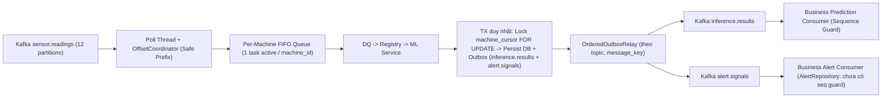
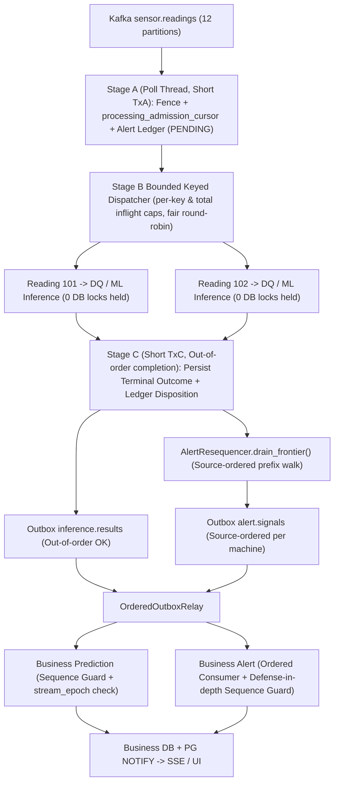

# ADR-002: Hybrid Ordering Architecture (`Keyed Parallel Scheduling`)

- **Trạng thái:** Proposed / Phase 0 Approved Architecture
- **Ngày:** 2026-11-23
- **Baseline Commit:** `MaintAI@57169209bd959156e1c923c79b672b4d98a871ce` · `MaintAI-gitops@09a382b03b87900b2859c8d0de56cb6a97dfafac`
- **Tài liệu liên quan:** [PROC-ORDER-01](../subsystems/PROCESSING_CONCURRENCY_AND_ORDERING.md) · [Implementation Report](../reports/PROCESSING_ORDERING_IMPLEMENTATION_REPORT.md) · [Local 50-Machine Baseline Report](../reports/LOCAL_BASELINE_50_MACHINES_REPORT.md)

---

## 1. Bối cảnh và Mục tiêu

Ở baseline (`PROC-ORDER-01`, `SDK 0.3.1`), `KeyedConsumerRunner` giới hạn **tối đa 1 task đang chạy cho mỗi `machine_id`**. Khi một reading đầu hàng (`M-001` seq `101`) gặp tail latency ở ML Service hoặc gặp burst từ một máy nóng (hot machine), toàn bộ readings kế tiếp của máy đó (`102`, `103`, ...) bị chặn head-of-line dù kết quả `inference.results` đã có sequence guard ở Business Projection Consumer.

Kiến trúc mục tiêu áp dụng **Keyed Parallel Scheduling (Hybrid Ordering)** — **không chuyển sang Global Parallel Processing**:

- Giữ `KeyedConsumerRunner` điều phối công bằng theo `machine_id`, có giới hạn song song trên từng key (`PROCESSING_MAX_INFLIGHT_PER_KEY`) và giới hạn tổng theo worker (`PROCESSING_MAX_TOTAL_INFLIGHT`).
- Cho phép nhiều readings của **cùng một `machine_id`** chạy DQ / Registry lookup / ML inference đồng thời.
- Cho phép **Prediction path** (`sensor_events`, `predictions`, `risk_decisions`, `processing_results`, outbox `inference.results`) persist và publish **out-of-order**, dựa vào sequence-aware projector tại Business Consumer để bảo vệ `latest_valid_prediction`.
- Bắt buộc **Alert path** (`alert.signals`) phát **đúng source admission order** của từng máy thông qua Durable Admission Ledger + Alert Resequencer, đồng thời bổ sung defense-in-depth sequence guard trong Business Alert Repository.
- Giữ nguyên Kafka safe-prefix offset commit (`OffsetCoordinator`), `maintai_kafka_inbox`, `maintai_kafka_outbox` (`OrderedOutboxRelay`), ownership generation fencing và các wire contracts hiện hành (`sensor.readings` `1.3.0`, `inference.results` `1.4.0`, `alert.signals` `1.0.0`, `bundle 2.0.0`).

---

## 2. Sơ đồ Kiến trúc Trước và Sau

### 2.1. Trước (`Baseline` — `max_inflight_per_key = 1`)



### 2.2. Sau (`Hybrid Ordering` — `max_inflight_per_key >= 1`)



---

## 3. Năm Điểm Thiết kế Bắt buộc Đã Giải quyết

### 3.1. Transaction Boundary & Call Flow của `KeyedTransactionalHandler`

Thiết kế **chứng minh tuyệt đối không giữ khóa `FOR UPDATE` trên `maintai_processing_machine_cursor` trong lúc inference**:

```mermaid
sequenceDiagram
    participant Poll as "Poll Thread (KeyedConsumerRunner)"
    participant Worker as "Executor Thread Pool"
    participant ML as "Registry / ML HTTP"
    participant DB as "PostgreSQL processing_db"

    Note over Poll,DB: "Stage A - Durable Admission (TxA ngắn ~1ms trên poll thread theo đúng offset order)"
    Poll->>DB: "BEGIN; _fence(assignments FOR SHARE)"
    DB->>DB: "LOCK processing_admission_cursor(group, machine_id) FOR UPDATE"
    DB->>DB: "Idempotent inbox/ledger check; Reject seq <= last_admitted_sequence"
    DB->>DB: "INSERT processing_alert_ledger(..., disposition='PENDING'); UPDATE admission cursor"
    DB-->>Poll: "COMMIT & RELEASE ALL CONNECTIONS (100% trước dispatch)"

    Note over Poll,Worker: "Stage B - Parallel Execution (0 DB connection, 0 SQL row lock)"
    Poll->>Worker: "Dispatch fair round-robin (active_keys <= K, per_key <= P, total <= T)"
    Worker->>ML: "DQ -> Business Registry HTTP (<=3s) -> ML Service /predict (<=2s x2)"
    ML-->>Worker: "PredictionResponse / DATA_INVALID / INFERENCE_UNAVAILABLE"

    Note over Worker,DB: "Stage C - Out-of-order Persistence + Frontier Alert Resequencer (TxC ngắn)"
    Worker->>DB: "BEGIN; _fence(assignments FOR SHARE)"
    DB->>DB: "LOCK processing_admission_cursor FOR UPDATE (Lock #1)"
    DB->>DB: "Persist sensor_events, predictions, risk_decisions, processing_results, maintai_kafka_inbox"
    DB->>DB: "OrderedOutbox.enqueue('inference.results', outcome) [Out-of-order allowed]"
    DB->>DB: "UPDATE processing_alert_ledger SET disposition=SIGNAL_READY|NO_SIGNAL|BLOCKED"
    DB->>DB: "AlertResequencer.drain_frontier(): walk PENDING/SIGNAL_READY/NO_SIGNAL theo admission_seq ASC"
    DB->>DB: "Enqueued alert.signals + advance frontier + maintai_processing_machine_cursor + processing_source_cursor"
    DB-->>Worker: "COMMIT TxC; trả DurableReceipt cho Poll Thread advance safe-prefix Kafka offset"
```

**Thứ tự khóa chống deadlock (Canonical Lock Ordering):**
Mọi transaction trong Processing Worker phải tuân thủ nghiêm ngặt thứ tự khóa từ ngoài vào trong:
1. `maintai_processing_assignments` (`FOR SHARE` — ownership fence)
2. `processing_admission_cursor` (`FOR UPDATE` — per `(consumer_group, machine_id)`)
3. `maintai_processing_machine_cursor` (`FOR UPDATE` — chỉ khóa trong TxC ở **tầng frontier**, không bao giờ khóa ở Stage B hay trước khi vào frontier)
4. `processing_source_cursor` (`FOR UPDATE` — chỉ khóa trong TxC khi advance completed frontier)
5. `maintai_outbox_keys` (`FOR UPDATE` — per `(topic, message_key)`)

**Tại sao tách `processing_admission_cursor` khỏi `maintai_processing_machine_cursor` và `processing_source_cursor`?**
- Nếu cập nhật `maintai_processing_machine_cursor.last_sequence = 104` ngay khi `104` xong trước `101`, sau đó pod crash trước khi `101` commit và vận hành **rollback** về `hybrid=false`, baseline worker replay lại `101` sẽ so sánh `101 <= 104` và bắn `IdentityConflict`!
- Khi giữ `maintai_processing_machine_cursor` và `processing_source_cursor` biểu diễn **Contiguous Completed Source Frontier** (chỉ tiến khi toàn bộ readings có `admission_seq <= k` đã có terminal disposition và resolved alert path), rollback từ bất kỳ trạng thái nào cũng replay `101` an toàn mà không xung đột cursor!

---

### 3.2. Terminal Disposition Mapping Matrix

Không tự động biến `INFERENCE_UNAVAILABLE` hoặc lỗi tạm thời thành `NO_SIGNAL` hay `NORMAL`. Bảng ánh xạ chuẩn trên `processing_alert_ledger`:

| Nguồn / Kết quả xử lý | Terminal Outcome (`inference.results`) | Trạng thái `processing_alert_ledger` ban đầu | Sau Resequencer (`drain_frontier`) | Phát `alert.signals`? | Có chặn Alert Frontier? | Hành vi nếu lỗi / replay |
|---|---|---|---|---|---|---|
| `PREDICTION_COMPLETED` & `risk.should_create_alert = True` (`HIGH` / `CRITICAL` theo `demo-risk-v1`) | `PREDICTION_COMPLETED` (`VALID`, `COMPLETED`) | `SIGNAL_READY` (`disposition_reason='POLICY_ALERT_REQUIRED'`) | `EMITTED` | **Có** (đúng `admission_seq` order) | Chỉ chặn readings **sau** khi nó chưa xong; xong là enqueue & nhả frontier | Retry dùng nguyên bytes bất biến từ ledger/outbox |
| `PREDICTION_COMPLETED` & `risk.should_create_alert = False` (`NORMAL` hoặc `WATCH`) | `PREDICTION_COMPLETED` (`VALID`, `COMPLETED`) | `NO_SIGNAL` (`disposition_reason='POLICY_NON_ALERTING'`) | `RESOLVED_NO_SIGNAL` | **Không** | Không (tiến frontier ngay khi tới đầu hàng) | Không bao giờ phát signal giả |
| `DATA_INVALID` (DQ lỗi features hoặc `MACHINE_NOT_FOUND`) | `DATA_INVALID` (`INVALID`, `INVALID`) | `NO_SIGNAL` (`disposition_reason='DATA_INVALID_NON_ALERTING'`) | `RESOLVED_NO_SIGNAL` | **Không** | Không (tiến frontier; tách biệt rõ với `NORMAL` trong `outcome_kind`) | Không gọi ML, không che giấu `INVALID` thành `NORMAL` |
| `INFERENCE_UNAVAILABLE` (ML timeout/5xx/invalid response sau hết 2 attempts) — **Mặc định an toàn (`PROCESSING_UNAVAILABLE_ALERT_DISPOSITION=BLOCKED`)** | `INFERENCE_UNAVAILABLE` (`VALID`, `FAILED`) → vẫn persist & publish lên `inference.results` để UI hiện stale telemetry warning | **`BLOCKED`** (`disposition_reason='INFERENCE_UNAVAILABLE'`) | **Giữ nguyên `BLOCKED`** (không tự giải phóng) | Tạm giữ | **Có** — chặn alert frontier của riêng `machine_id` đó, tăng metric `maintai_processing_alert_frontier_stalled_seconds` để vận hành quyết định reconcile/skip có chủ đích | Chuyển trạng thái qua reconciliation API/tool có audit, không im lặng bỏ qua cảnh báo tiềm ẩn |
| `INFERENCE_UNAVAILABLE` (khi vận hành cấu hình tường minh `PROCESSING_UNAVAILABLE_ALERT_DISPOSITION=NO_SIGNAL`) | `INFERENCE_UNAVAILABLE` (`VALID`, `FAILED`) | `NO_SIGNAL` (`disposition_reason='UNAVAILABLE_OPT_IN_NO_SIGNAL'`) | `RESOLVED_NO_SIGNAL` | **Không** | Không | Chỉ dùng nếu chính sách vận hành chấp nhận mất cảnh báo khi ML gián đoạn |
| Lỗi tạm thời trước terminal (`RegistryUnavailable`, PG lock/timeout, `LeaseLost`, Worker crash/OOM) | Không có (TxC rollback) | Vẫn là `PENDING` | Dừng tại `PENDING` | Chưa | **Có** — chặn tuyệt đối không để reading sau vượt mặt | Offset không commit → Kafka replay & xử lý lại |
| `IdentityConflict` (cùng `event_id`/seq nhưng khác canonical body hoặc seq lùi) | Không có (audit `processing_conflicts`) | Không tạo / fail closed | Không vượt qua | Không | Dừng partition / key fail closed theo contract | Cần đối soát vận hành, không tự skip |

---

### 3.3. Resource Concurrency Budget (Per-Worker vs Toàn Cluster)

Tất cả các tham số `KeyedSettings` là **giới hạn trên mỗi `processing-worker` replica**, được tính tổng trên quy mô cụm baseline hiện hành (`MaintAI-gitops@09a382b0`):

- **Processing Worker:** `6` replicas (KEDA `min=6, max=6`), mỗi pod `100m CPU req / no CPU limit` (`128Mi–1Gi RAM`).
- **ML Service:** `2` replicas (`ml-service`, HPA `min=2, max=2`), `uvicorn local_baseline:app --workers 1`, `OMP_NUM_THREADS=1`, `OPENBLAS_NUM_THREADS=1`, đi qua 1 pod `ml-service-mirror` (Nginx `keepalive 64`, mirror `5%` sang 1 replica `ml-service-shadow`).
- **PostgreSQL (`postgres-0`):** `max_connections = 300`; các dịch vụ khác giữ tối đa `76` pool connections (`relay: 2×4=8`, `business-consumer: 4×8=32`, `business-api: 2×12=24`, `read-api: 1×12=12`). Còn trống `224` connections cho `6` workers + admin/monitoring.

**Công thức:**
- `effective_total_inflight = min(PROCESSING_MAX_TOTAL_INFLIGHT or (max_active_keys * max_inflight_per_key), max_pending_records)`
- Cluster max simultaneous ML HTTP calls = `worker_replicas (6) × effective_total_inflight`
- Per-worker DB `ConnectionPool` size = `max(12, min(32, effective_total_inflight + 4))` *(giới hạn trần 32/pod để tổng 6 pods tối đa `192 + 76 = 268 < 300`, dù worker cũng không giữ connection trong Stage B HTTP!)*

| Cấu hình | `HYBRID_ENABLED` | `MAX_ACTIVE_KEYS` | `MAX_INFLIGHT_PER_KEY` | `MAX_TOTAL_INFLIGHT` (per worker) | Cluster In-flight Tối đa (`×6` workers) | Tải đồng thời / Pod ML (`÷2` ML pods) | Pool DB Worker (`6×pod_pool + 76`) | Đánh giá Rủi ro |
|---|---:|---:|---:|---:|---:|---:|---:|---|
| **Baseline (Default)** | `false` | `8` | `1` | `8` | `48` | `24` | `6×12 + 76 = 148 / 300` | An toàn mặc định; bị head-of-line mỗi key |
| **Candidate A (Cân bằng)** | `true` | `8` | `2` | `16` *(hoặc `12`)* | `72–96` | `36–48` | `6×20 + 76 = 196 / 300` | Dư >100 DB conns; ML `def predict` sync threadpool AnyIO (~40 threads/pod) tải vừa |
| **Candidate B (Stress/Thận trọng)** | `true` | `8` | `4` | `24` *(tối đa `32`)* | `144–192` | `72–96` | `6×28 + 76 = 244 / 300` | Có nguy cơ **vượt AnyIO default 40 worker threads trên `ml-service` sync endpoint (`def predict`)** & gây queueing/CPU throttling → **Không bao giờ bật mặc định khi chưa pass benchmark** |

*Lưu ý quan trọng:* Ở `ml-service/inference/api/local_baseline.py`, hàm `def predict(...)` là sync FastAPI route chạy trên AnyIO threadpool mặc định (40 threads/pod × 2 pods = **80 concurrent ML executions** toàn cụm). Vì vậy `Cluster In-flight > 80` sẽ bắt đầu xếp hàng tại FastAPI/Nginx nếu inference không đủ nhanh — đó là lý do bắt buộc phải benchmark `per_key = 1, 2, 4` trước khi chọn cấu hình đề xuất.

---

### 3.4. Durability (`synchronous_commit=off`) & Migration Compatibility

1. **Đánh giá `synchronous_commit=off` trong `MaintAI-gitops/local/platform/postgres.yaml`:**
   - Trong [postgres.yaml](file:///home/chienqt/Dev/newBTL/MaintAI-gitops/local/platform/postgres.yaml#L47-L57), `postgres-0` cấu hình `synchronous_commit=off` và `wal_writer_delay=20ms` để tối ưu SSD local.
   - **Với worker crash / OOMKilled / Kafka rebalance (PostgreSQL vẫn sống):** `postgres` đã ghi nhận transaction trong shared buffers + backend memory, các worker mới đọc thấy 100% trạng thái đã commit ngay lập tức → **An toàn**.
   - **Với PostgreSQL crash / mất điện đột ngột (`SIGKILL` DB / node kernel panic):** Có cửa sổ tối đa ~`20–60 ms` transaction đã báo `COMMIT` thành công về Worker nhưng WAL chưa flush xuống đĩa. Nếu Worker nhận ACK từ PG rồi **commit Kafka offset trước khi WAL xuống đĩa**, khi cả PG và host chết cùng lúc, dòng dữ liệu trong `processing_alert_ledger` / `processing_results` / `maintai_kafka_outbox` của ~20–60ms cuối có thể biến mất trong khi Kafka offset đã tiến qua → **vi phạm strict durability**.
   - **Quyết định:**
     - **Giữ nguyên** `local/platform/postgres.yaml` của bạn (không tự ý sửa thay đổi local).
     - **Bắt buộc `synchronous_commit=on`** trên mọi môi trường cần strict durability (AWS RDS Production và Compose integration tests `postgres:17`). Tài liệu hóa rõ điểm đánh đổi này trong ADR và Benchmark Report.

2. **Xử lý Alert đang `OPEN` trước migration & Tính tương thích Backward-Compatible:**
   - Mọi migration đều theo mô hình **expand-contract**, chỉ thêm bảng mới hoặc cột **nullable**, tuyệt đối không `DROP`/`DELETE`/`TRUNCATE`, không sửa byte nào của [001_messaging.sql](file:///home/chienqt/Dev/newBTL/MaintAI/contracts/kafka/migrations/001_messaging.sql) và [002_processing_ordering.sql](file:///home/chienqt/Dev/newBTL/MaintAI/contracts/kafka/migrations/002_processing_ordering.sql), không đổi wire schema `alert.signals v1.0.0`.
   - **Business `AlertRepository` lấy `(sequence_number, stream_epoch)` từ `evidence["outcome"]` đã xác thực 1-1** theo [domain.py](file:///home/chienqt/Dev/newBTL/MaintAI/backend/shared/alerts/domain.py#L46-L67).
   - **Đối với các Alert đã tồn tại trước khi chạy `business_0008_alert_sequence_guard`:**
     - Các bảng cũ có `alerts.latest_source_sequence = NULL`, `alerts.latest_source_stream_epoch = NULL`.
     - Khi có signal mới rơi vào cửa sổ dedupe `300s` của một Alert `OPEN` đang có `latest_source_sequence IS NULL`:
       1. Tra cứu `business_source_inbox` theo `source_event_id` của alert cũ (nếu có) để xác định `existing_seq`.
       2. Nếu vẫn `NULL` (ví dụ alert tạo trước migration chưa có dòng inbox khớp), xem đây là **legacy unsequenced active alert**: cho phép dedupe & bootstrap `latest_source_sequence = incoming_seq`, `latest_source_stream_epoch = incoming_epoch` ở lần cập nhật đầu tiên mà không đoán từ timestamp.
     - Với Alert đã `RESOLVED`/`FALSE_ALERT` mà `latest_source_sequence IS NULL`: vì không có bằng chứng source sequence lịch sử, không thể kết luận signal mới là cũ hơn → chỉ chặn `STALE_AFTER_TERMINAL` với các alert có `latest_source_sequence > incoming_seq` (hoặc `latest_source_sequence = incoming_seq` nhưng `source_event_id != incoming_event_id` → `IdentityConflict`).

---

### 3.5. Admission Recovery & Ordering Invariants

| Tình huống sự cố | Cơ chế phục hồi & Bất biến bảo toàn |
|---|---|
| **Crash sau Stage A (Admission TxA commit) nhưng trước khi Worker thread bắt đầu Stage B** | Vì Kafka safe-prefix offset **chưa được commit**, worker mới nhận rebalance sẽ poll lại record đó. `admit()` thấy `(consumer_group, topic, message_id)` đã nằm trong `processing_alert_ledger` với cùng `identity_sha256` → **idempotent admission**: trả lại nguyên `admission_seq` cũ, giữ `PENDING`, và dispatch lại Stage B bình thường. Không bao giờ kẹt `PENDING` mãi mãi nếu còn được consumer đọc lại. |
| **Crash sau Stage C (Processing DB TxC commit) nhưng trước khi Kafka offset commit** | Kafka poll lại record → Stage A thấy đã terminal trong `processing_results`/`maintai_kafka_inbox` với `identity_sha256` khớp → Stage B bỏ qua ML (`_durable_replay`), không tốn ML call thứ hai; `AlertResequencer.drain_frontier()` chạy lại idempotently kiểm tra xem sau nó còn dòng nào đang chờ frontier không, xác nhận `inference.results` (và `alert.signals` nếu resolved) có mặt trong outbox rồi trả `DurableReceipt` cho poll thread commit offset. |
| **Duplicate delivery ở một Kafka offset mới hơn** | Dù `record.offset` mới lớn hơn `last_admitted_offset`, Stage A phát hiện `identity_sha256` trùng với `event_id` đã admit trong ledger/inbox → tái sử dụng kết quả/admission cũ, **không** đánh lỗi `IdentityConflict` nhầm vì sequence đã xử lý trước đó. Ngược lại nếu cùng `event_id` nhưng `identity_sha256` khác, hoặc `event_id` chưa từng thấy mà `sequence_number <= last_admitted_sequence` → **fail closed (`IdentityConflict`)** và ghi `processing_conflicts`. |
| **Worker rebalance / stale worker hoàn thành ML muộn** | Partition revoke set `token.cancelled` trong RAM ngay lập tức và hạ `active=FALSE`; owner mới tăng `maintai_processing_assignments.generation` trong DB. Dù stale worker giữ HTTP response cũ cố chạy TxC, `_fence()` kiểm `(owner, generation)` bằng `FOR SHARE` thấy không khớp → raise `LeaseLost`, TxC rollback sạch, offset cũ không bao giờ được commit. |
| **Sequence gaps & `stream_epoch` thay đổi** | Gap giữa `101` và `105` (do rejection ở Ingestion hoặc source gap) là **hoàn toàn hợp lệ**: `processing_alert_ledger` đánh số nguồn liên tục theo **`admission_seq`** (thứ tự nhận từ Kafka partition: `1, 2, 3...`), không phụ thuộc `sequence_number + 1`. `AlertResequencer` mở frontier theo `admission_seq`, không bao giờ đợi `102, 103, 104`. Mọi so sánh thứ tự dùng `NUMERIC sequence_number` (tăng bền vững qua các `stream_epoch`); `stream_epoch` chỉ là opaque lineage, **không bao giờ** sort theo chuỗi UUID hay timestamp. |
