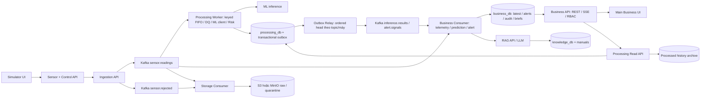

# 03 — Kiến trúc suy ra từ yêu cầu và giả định vận hành

**Phiên bản:** 1.2.0 — 23/10/2026. Phần này sử dụng
[yêu cầu của đề](01_REQUIREMENTS.md) và
[giả định về tải](02_ASSUMPTIONS_AND_CAPACITY.md) để giải thích cấu trúc hệ thống.

Kiến trúc được trình bày theo trách nhiệm, luồng dữ liệu và cách triển khai,
không theo cây thư mục mã nguồn. Các quy tắc quan trọng được giải thích ngay
trong phần này: dữ liệu chỉ đi vào ML sau DQ, cùng máy giữ thứ tự, kết quả được
lưu bền vững trước khi xác nhận tiến độ và UI phân biệt dữ liệu mới/cũ.

Đây là thiết kế mục tiêu. Mục 8 trình bày phạm vi đã triển khai riêng và những
phần cần hoàn thiện trước khi đánh giá toàn bộ ứng dụng.

Giả định khởi đầu là **100 máy × 1 reading/s = 100 readings/s**. Thiết kế hướng
tới **scale-ready**: khi X > 100, đo và tăng năng lực ở đúng thành phần gây chậm,
giữ các quy tắc về thứ tự và dữ liệu. Cách tính nằm ở
[phần 02, mục 11](02_ASSUMPTIONS_AND_CAPACITY.md#11-scale-ready-tính-và-tối-ưu-latency-khi-x100).

## 1. Từ yêu cầu đến cấu trúc hệ thống

| Đầu vào thiết kế | Nhu cầu phát sinh | Cách tổ chức được chọn |
| --- | --- | --- |
| FR-01/02 và QR-04 yêu cầu DQ trước ML. | Phải chặn dữ liệu không hợp lệ trước inference, đồng thời phân biệt tiếp nhận với xử lý xong. | Ingestion kiểm auth/envelope; Worker làm DQ sâu và chỉ gọi ML khi VALID. |
| FR-03/08 và QR-05 yêu cầu alert độc lập với LLM. | Tạo cảnh báo không được chờ phần sinh hướng dẫn. | Processing phát risk signal; Business quản lý alert; brief được tạo bằng tác vụ riêng. |
| FR-04/09 cần dashboard, lịch sử truy vết; A-UI giả định có nhiều người xem. | Đọc trạng thái mới nhất và truy vấn nhiều dữ liệu quá khứ có nhu cầu khác nhau. | Business giữ dữ liệu phục vụ UI; Processing cung cấp lịch sử qua Read API và archive. |
| LOAD-N100 có nhiều nhánh xử lý và có thể có burst. | Cần phân phối cùng dữ liệu cho các nhánh, cho phép từng nhánh có tiến độ và năng lực riêng. | Kafka có các consumer group độc lập; Worker, Relay, Storage và Business Consumer chạy riêng. |
| FR-05/09 yêu cầu chống trùng và truy vết qua sự cố. | Một kết quả đã ghi DB không được mất ý định phát event; event đọc lại không được tạo hiệu ứng nghiệp vụ trùng. | Dùng Outbox, Inbox, định danh ổn định và kiểm tra thứ tự cập nhật. |
| QR-09 đặt mục tiêu alert p95 ≤ 2 giây. | Giữ đường online ngắn, giới hạn số việc chờ và đo đến browser. | Training, Drift và RAG nằm ngoài đường tạo alert; lỗi hoặc trễ có trạng thái rõ. |
| ML/KB cần tái hiện được kết quả theo phiên bản. | Phải biết đúng model, preprocessing, policy và manual đã dùng. | Gắn ID/mã băm vào các artifact và bản phát hành; dùng MLflow cho tracking/registry. |
| FR-10 và các nhóm người dùng có công việc khác nhau. | Cần kiểm quyền theo chức năng và phạm vi máy. | Dùng IdP, kiểm quyền ở từng provider và tách bốn UI. |
| Nhóm có 4 người, ưu tiên chạy laptop trước. | Cần chia trách nhiệm nhưng hạn chế viết lại hạ tầng client. | Dùng chung Python Kafka SDK; giữ local k3d/CLI và blueprint cloud riêng. |

Bảng giải thích cách nhóm đáp ứng yêu cầu. Riêng con số 100 máy không đủ để
chứng minh bắt buộc phải dùng Kafka, đúng 12 partition hay một số Deployment cố
định. Những lựa chọn và chi phí tương ứng được phân tích trong file 04.

## 2. Sơ đồ logic rút gọn

Mũi tên diễn tả hướng chuyển dữ liệu hoặc gọi API. RAG chỉ được gọi khi business
workflow cần tạo brief, không được gọi cho mọi Kafka event. Alert được ghi trước
mà không chờ brief. Processed history do các job archive/export của Processing
quản lý; Storage raw không ghi thay phần này.

Sơ đồ tập trung vào luồng online: đọc số đo, tính kết quả, tạo alert và phục vụ
người dùng. Luồng huấn luyện/cập nhật model và Drift được giải thích ở mục 4.3;
nguồn dữ liệu của bốn UI và môi trường triển khai nằm ở mục 6–7. Vì vậy người
đọc có thể theo dõi các nhánh còn lại ngay trong báo cáo này.

## 3. Phân biệt module, runtime, image và quyền sở hữu dữ liệu

**Module** là phần code thực hiện một trách nhiệm, chẳng hạn kiểm DQ hoặc tính
risk. **Runtime** là tiến trình chạy công việc đó. **Image** là gói phần mềm để
khởi động runtime; cùng một image có thể chạy các entrypoint khác nhau.
**Deployment** quản lý các replica của một workload trên Kubernetes. Vì vậy,
một nhóm chức năng có thể dùng chung mã nguồn nhưng chạy thành nhiều runtime.

Ví dụ, Processing gồm Worker, Read API và Outbox Relay. Ba thành phần có thể
dùng chung nhóm image nhưng khởi động bằng lệnh khác nhau và được triển khai
riêng. Bộ lập lịch theo máy và bộ điều phối offset là module bên trong Worker.
Chúng dùng chung vòng đời tiến trình Worker, không cần hai Deployment bổ sung.

Các thuật ngữ lưu bền vững trong bảng dưới được hiểu như sau:

- **Transaction DB** là nhóm thao tác được ghi nhận cùng nhau: hoặc tất cả
  thành công, hoặc không thao tác nào trong nhóm được commit.
- **Inbox** lưu dấu event đã áp dụng để đọc lại không tạo thêm cùng một hiệu
  ứng nghiệp vụ. **Outbox** lưu event cần phát đi cùng transaction với kết quả.
- **Cursor** là mốc tiến độ được lưu bền vững để biết đã xử lý hoặc gửi đến đâu.
  **CAS** là cập nhật có điều kiện: chỉ đổi dữ liệu khi điều kiện về phiên bản
  hoặc thứ tự hiện tại vẫn đúng, tránh kết quả cũ ghi đè kết quả mới.

### 3.1. Tiếp nhận và xử lý dữ liệu

| Thành phần chạy độc lập | Trách nhiệm | Dữ liệu và thành phần phụ thuộc |
| --- | --- | --- |
| Sensor | Sinh dữ liệu theo từng máy/scenario, giữ ID và sequence, lưu spool, cung cấp Control API. | Trạng thái SQLite trên volume, dataset chỉ đọc; gửi HTTPS có auth tới Ingestion. |
| Ingestion | Kiểm auth/envelope/giới hạn request, publish accepted hoặc rejected đủ điều kiện và chờ broker ACK. | Dùng Kafka producer; không ghi operational DB hoặc chạy inference. |
| Worker | DQ, gọi ML, tính risk, lưu outcome/history và ý định gửi event. | Quản lý `processing_db`; gọi ML qua HTTP. |
| Read API | Cung cấp trạng thái xử lý, lịch sử và cửa sổ dữ liệu VALID theo giới hạn truy vấn đã thống nhất. | Đọc dữ liệu bền vững của Processing bằng role chỉ đọc và đọc archive; không hỏi bộ nhớ Worker. |
| Relay | Lấy event đang chờ theo thứ tự topic/máy, gửi Kafka và ghi tiến độ sau ACK. | Đọc/ghi Outbox của Processing và sử dụng Kafka producer. |
| Storage | Lưu accepted/rejected receipts thành object có manifest, mã băm và phiên bản trước khi xác nhận offset. | Quản lý raw/quarantine archive; không tạo prediction hoặc alert. |

### 3.2. Nghiệp vụ và giao diện ứng dụng

| Thành phần chạy độc lập | Trách nhiệm | Dữ liệu và thành phần phụ thuộc |
| --- | --- | --- |
| Business Consumer | Cập nhật số đo/kết quả mới nhất, tạo hoặc cập nhật alert và chạy các tác vụ nghiệp vụ nền. | Ghi `business_db`, dùng Inbox và kiểm thứ tự; điều phối các job RAG khi cần. |
| Business API | REST/SSE, kiểm quyền, thao tác alert, feedback, truy vấn lịch sử và brief cho UI. | Dùng `business_db`, gọi Processing Read API hoặc RAG theo workflow; không chạy inference. |
| Main UI | Hiển thị toàn bộ máy, chi tiết, lịch sử, alert và Copilot, kèm trạng thái lỗi/độ mới. | Chỉ gọi Business REST/SSE. |
| Simulator UI | Cho người có quyền xem và thay đổi trạng thái phát dữ liệu demo. | Chỉ gọi Sensor Control API, không đi qua Business. |

Business API và Business Consumer cùng owner và nhóm mã nguồn nhưng chạy riêng. Các
handler telemetry, prediction và alert của Consumer là những module xử lý trong
nhóm mã nguồn đó; chúng không mặc nhiên là ba microservice độc lập.

### 3.3. ML, RAG và giám sát model

| Thành phần chạy độc lập | Trách nhiệm | Dữ liệu và thành phần phụ thuộc |
| --- | --- | --- |
| ML inference | Nạp model/preprocessor đã pin và trả phân loại nhị phân, score, phiên bản. | Dùng model bundle; không tạo Business alert hoặc gọi LLM. |
| Training | Chuẩn bị dữ liệu, huấn luyện, so sánh baseline, đánh giá và tạo candidate/reference. | Dùng dataset/split đã duyệt, MLflow HTTP và artifact có phiên bản. |
| MLflow | Cung cấp Tracking/Registry Server và UI có sẵn, quản lý truy cập artifact. | Dùng `mlflow_db` và kho artifact; cấu hình triển khai do phần quản lý hạ tầng/phát hành phụ trách. |
| RAG | Nhập manual, truy xuất nội dung và sinh brief/checklist có citation. | Dùng `knowledge_db`/pgvector, manual có phiên bản và LLM provider. |
| Drift | So sánh cửa sổ dữ liệu với reference, ghi report/checkpoint và xuất metrics theo lịch. | Dùng `drift_db`, Processing Read API hoặc curated objects; nằm ngoài luồng alert online. |

Training, inference và MLflow có image riêng vì thư viện, tài nguyên và vòng
đời chạy khác nhau. Các dịch vụ dùng chung thư viện Kafka để thống nhất việc
gửi/nhận, retry và xác nhận tiến độ; thư viện được đóng gói vào image của dịch
vụ sử dụng nó. Kafka broker là runtime hạ tầng thực sự lưu và phân phối event,
khác với thư viện client chạy bên trong ứng dụng.

## 4. Các luồng chính và ý nghĩa từng mốc thành công

### 4.1. Từ một reading đến số đo và cảnh báo trên UI

Xét máy giả lập `M-001` đang tạo reading có sequence 101. Sequence là số thứ tự
của reading trong luồng riêng của máy; nó giúp phân biệt input mới với dữ liệu
cũ hoặc bản gửi lại. Các bước dưới đây mô tả hành trình của reading này.

1. **Sensor lưu dữ liệu trước khi gửi.** Sensor cấp ID, giữ thứ tự theo máy và
   ghi spool để có thể gửi lại sau restart. Retry giữ nguyên identity và body.
   Pause dừng sinh dữ liệu mới nhưng không xóa hoặc chặn gửi lại backlog.
2. **Ingestion tiếp nhận vào Kafka.** API kiểm token, envelope và giới hạn. Sau
   khi broker xác nhận nhận event, Ingestion trả HTTP 202. Mốc này chưa khẳng
   định S3 đã lưu, DQ đã hợp lệ hoặc ML đã dự đoán xong.
3. **Ba nhánh đọc cùng reading.** Processing phân tích, Storage archive raw và
   Business telemetry cập nhật số đo. Mỗi group có offset riêng nên một nhánh
   chậm không tự khiến các nhánh khác phải dừng ngay.
4. **Processing kiểm tra và tính kết quả.** Reading INVALID không gọi ML.
   Reading VALID được đưa tới model đã pin rồi áp dụng policy. Lời gọi HTTP ML
   có timeout và nằm ngoài transaction DB cuối, tránh giữ transaction suốt lúc
   chờ mạng. Các máy khác có thể được xử lý song song trong giới hạn concurrency.
5. **Processing ghi kết quả bền vững.** Transaction cuối ghi history, outcome,
   Inbox, mốc tiến độ nguồn và Outbox cùng nhau. Cơ chế fence kiểm quyền xử lý hiện
   tại để worker cũ không ghi đè sau khi Kafka đã phân công lại partition.
   Offset chỉ được commit qua dãy record đã hoàn tất liên tiếp của partition.
6. **Relay chuyển kết quả sang Kafka.** Relay gửi result/signal theo đầu hàng
   đợi của từng topic/máy. Sau broker ACK, nó cập nhật tiến độ bền vững. Mất ACK
   vẫn có thể làm event được gửi lại, nên bên nhận phải chống trùng và kiểm thứ tự.
7. **Business ghi dữ liệu nghiệp vụ rồi thông báo UI.** Consumer cập nhật
   projection hoặc alert theo transaction, sau đó mới phát thông báo. Các API
   replica nhận fan-out, gửi SSE đúng phạm vi người dùng. Nếu kết nối mất,
   trình duyệt dùng REST snapshot để đồng bộ lại rồi tiếp tục nhận thay đổi.

Số đo raw của sequence 101 có thể xuất hiện trước prediction. Trong lúc chờ,
UI cần ghi rõ chưa kiểm tra hoặc đang xử lý. Nếu 101 bị lỗi, prediction hợp lệ
của sequence 100 có thể vẫn được giữ, nhưng phải có định danh input và tuổi riêng.
Không được trình bày prediction của 100 như kết quả tính từ số đo 101.

Sequence tiếp theo của `M-001` phải tuân thứ tự theo máy. Các máy khác vẫn có
thể tiến triển; không có yêu cầu mọi máy trên dashboard cùng cập nhật một lúc.

### 4.2. Từ thao tác của kỹ thuật viên đến lịch sử và Copilot

Main UI gửi request tới Business API. API kiểm danh tính, role và phạm vi máy
trước khi cho đọc hoặc thao tác. Các lệnh ACK, xử lý, chuyển cấp, giải quyết và
feedback được lưu trong `business_db` cùng audit. Xem lịch sử alert cũng đọc
Business, vì đây là lịch sử nghiệp vụ do Business quản lý.

Khi xem lịch sử xử lý reading, Business gọi Processing Read API. Read API truy
vấn dữ liệu đã lưu trong `processing_db` và archive qua index/manifest phù hợp.
Nó không hỏi một Worker “task trong RAM đang thế nào”, và Business không truy
vấn SQL trực tiếp vào DB của Processing. Worker restart không làm mất lịch sử
đã commit; Read API chỉ đọc, không tự chạy inference lại cho mỗi lần xem.

Khi yêu cầu brief, Business tạo hoặc tiếp tục công việc bền vững, lấy context
và gọi RAG. RAG tìm đúng phiên bản manual rồi trả nội dung có citation, hoặc
báo không đủ bằng chứng/không khả dụng. Business lưu kết quả theo identity của
reading gốc, alert và brief. Người dùng quyết định hành động; feedback không tự giải
quyết alert hoặc tự huấn luyện lại model.

### 4.3. Từ dataset mới đến model được phát hành và báo cáo Drift

Dataset có manifest và split được duyệt mới đi vào training batch. Training
chạy baseline, model so sánh và đánh giá; lưu MLflow run, candidate và mã băm của
model/preprocessor/reference. Model chỉ được đưa vào bản phát hành sau review;
production rollout qua PR GitOps và pin định danh cụ thể. Sensor phát dữ liệu
không đồng nghĩa nó trực tiếp kích hoạt retrain cho từng reading.

Drift chạy riêng theo lịch, đọc cửa sổ VALID và reference khớp model/dataset.
Kết quả là report, checkpoint và metrics để đánh giá thay đổi phân bố. Có drift
không tự chứng minh accuracy đã giảm khi chưa có nhãn thực tế; Drift không tự
đổi risk policy, severity hoặc promote model.

## 5. Năm database và các lớp lưu trữ

Thiết kế dùng một PostgreSQL instance với năm logical database:
`processing_db`, `business_db`, `drift_db`, `knowledge_db` và `mlflow_db`.
Mỗi owner có role/quyền tương ứng. Đây là phân chia trách nhiệm và truy cập;
năm DB trên cùng instance vẫn có thể cùng bị ảnh hưởng khi instance hoặc volume hỏng.

| Loại dữ liệu | Nơi quản lý/lưu | Vì sao đặt ở đó? |
| --- | --- | --- |
| Latest telemetry/prediction/status, alert, actions, notes và brief | `business_db` | Phục vụ màn hình và transaction nghiệp vụ theo máy, quyền và vòng đời alert. |
| Outcome/history gần, Inbox, cursor và Outbox | `processing_db` | Giữ kết quả xử lý và các mốc bền vững của Processing trong cùng ranh giới transaction. |
| Accepted raw và rejected receipts đủ điều kiện | Object storage raw/quarantine | Giữ bằng chứng đầu vào để archive, audit hoặc replay; không thay kết quả inference gốc. |
| Lịch sử xử lý dài hạn | Object archive có index/manifest và thông tin bản ghi thuộc archive | Giảm dữ liệu nóng trong DB, phục vụ truy vấn quá khứ và export có thể kiểm tra độ đầy đủ. |
| Model, manual và drift reference | Object có phiên bản và catalog tương ứng | Liên kết kết quả với đúng artifact bất biến đã dùng. |

Kafka giữ event để truyền và đọc lại trong retention hữu hạn. Nó không thay kho
lịch sử dài hạn. Processing Read API chịu trách nhiệm ghép cách đọc lịch sử gần
ở DB và lịch sử cũ đã archive, đồng thời chỉ rõ phạm vi dữ liệu trả về.
Browser vẫn chỉ gọi Business, không tự truy cập DB hoặc bucket.

## 6. Bốn UI và cách kiểm quyền

| UI | Người dùng và mục đích | Backend/nguồn chính |
| --- | --- | --- |
| Business UI | Kỹ thuật viên và quản lý theo dõi máy, xử lý alert, xem history/Copilot. | Business REST/SSE. |
| Simulator UI | Người demo điều khiển luồng giả lập. | Sensor Control API. |
| Grafana | Người vận hành theo dõi hệ thống, Kafka, ML và Drift. | Metrics/datasource do platform cấu hình; dùng UI có sẵn của Grafana. |
| MLflow UI | Người làm ML/MLOps xem training run, artifact và registry. | Tracking/Registry Server; dùng UI có sẵn của MLflow. |

Grafana không thay màn hình ACK/resolve/feedback của sản phẩm. MinIO console là
tiện ích quản trị storage khi cần, không được tính thành UI nghiệp vụ thứ năm.

IdP cấp danh tính; từng provider kiểm token, role và phạm vi được phép. Không
cần tự viết một auth service để mọi request hỏi credential đồng bộ. Quyền admin
nghiệp vụ cũng không tự cấp quyền quản trị Grafana/MLflow hoặc điều khiển Simulator.
Sensor trong Pod bind `0.0.0.0` vẫn cần JWT, HTTPS và trust phù hợp; ngoại lệ cho
localhost ẩn danh không tự áp dụng vào mạng cluster.

## 7. Hai môi trường triển khai và cách quản lý phiên bản

Nhóm chọn phát triển, tích hợp và chạy demo trên laptop trước, sau đó mới xem
xét triển khai cloud. Local dùng k3d để tạo Kubernetes nhẹ trong container.
Các bước chuẩn bị cluster, dịch vụ hạ tầng và ứng dụng được quản lý cùng nhau
để giảm số thao tác khi bắt đầu một phiên thử nghiệm.

| Khía cạnh | Local trên laptop | Mục tiêu cloud |
| --- | --- | --- |
| Mục đích | Phát triển, tích hợp và kiểm tra demo trước khi sử dụng cloud. | Vận hành bằng hạ tầng và cấu hình phát hành được kiểm soát. |
| Nền tảng | Một k3s node thông qua k3d; nhiều workload chia sẻ cùng laptop. | Thiết kế AWS với Kubernetes EKS và dịch vụ hạ tầng phù hợp. |
| Kafka | Một broker, replication 1/minISR 1; giữ 12 partition/topic cho logic phân công consumer. | Baseline RF3/minISR2 để có các bản sao dữ liệu trên nhiều broker. |
| DB và object storage | PostgreSQL, MinIO và monitoring cùng môi trường local. | Thiết kế dịch vụ PostgreSQL, S3, quyền truy cập và giám sát cloud. |
| Cách triển khai | Người phát triển chạy CLI để áp dụng manifests vào cluster. | Desired state lưu trong Git và được đồng bộ qua quy trình GitOps. |
| Khả năng chịu lỗi | Laptop là điểm lỗi chung, chưa có HA nhiều máy. | Cần triển khai và thử lỗi mới đánh giá được mức sẵn sàng thực tế. |

RF là số bản sao Kafka của dữ liệu; minISR là số replica đồng bộ tối thiểu được
cấu hình để bảo vệ việc ghi. Các con số cloud là thiết kế dự kiến, không phải
bằng chứng một môi trường AWS đã được tạo và chạy thành công.

**GitOps** là cách quản lý trạng thái triển khai mong muốn trong Git, có bộ điều
khiển so sánh và đồng bộ với cluster. Local hiện dùng lệnh apply tường minh,
chưa có Argo CD thực hiện cơ chế đồng bộ này. Sự phân biệt đó giúp tránh đồng
nhất “có cấu hình Kubernetes” với “đã vận hành GitOps”.

Mã nguồn ứng dụng, cấu hình môi trường local, trạng thái phát hành cloud và hạ
tầng AWS có vòng đời quản lý riêng. Phiên bản phát hành cần ghi được image,
model, preprocessing, policy và cấu hình nào được dùng cùng nhau. Model/manual/
reference được gắn ID và mã băm để truy lại đúng artifact, thay vì chỉ dùng tên
có thể đổi như `latest`.

Manifest chỉ yêu cầu tài nguyên; nó không chứng minh laptop thực sự đủ CPU,
RAM, dung lượng và I/O cho baseline 100/s hoặc X > 100. Điều kiện chạy và số đo
phải được ghi cùng kết quả đánh giá như phần 02 đã trình bày.

## 8. Phạm vi hiện thực và kế hoạch kiểm chứng

Tại thời điểm lập báo cáo, bộ giả lập Sensor và giao diện điều khiển riêng,
Storage Consumer cùng thư viện Kafka đã có phần triển khai và kiểm thử độc lập.
Cơ chế xử lý đồng thời/giữ thứ tự của thư viện Kafka đã được thử với Kafka và
PostgreSQL thật trong môi trường kiểm thử riêng. Kết quả ở mức này chưa thay
thế phép đo ứng dụng tích hợp từ đầu vào tới browser.

| Nhóm công việc | Phạm vi hiện có và phần cần hoàn thiện |
| --- | --- |
| Tiếp nhận và xử lý | Còn cần hoàn thiện Ingestion HTTP, DQ/ML/risk nghiệp vụ, lưu lịch sử và Read API của Processing. |
| Nghiệp vụ và UI | Còn các phần chính của Business REST/SSE, projection, Main UI, ML và RAG cần hoàn thiện/tích hợp; giao tiếp accept/reject khuyến nghị cần chốt. |
| Giám sát và phiên bản | Drift chưa hoàn thiện theo toàn bộ thiết kế mới; phiên bản và tương thích MLflow cần được lựa chọn, kiểm tra. |
| Môi trường local | Đã có cấu hình và kiểm tra offline; chưa xác nhận tạo cluster, build toàn bộ image hoặc chạy ứng dụng xuyên suốt. Còn thiếu phần triển khai Training Job, Drift theo lịch và cấu hình danh tính/TLS. |
| Đánh giá toàn hệ thống | Chưa xác nhận baseline 100 readings/s, p95 alert tới browser hoặc toàn bộ tiêu chí chất lượng ML/RAG trên ứng dụng tích hợp. |

Kế hoạch tiếp theo bắt đầu bằng một lát cắt nhỏ nhưng xuyên suốt: đưa một
reading VALID và một reading INVALID qua tiếp nhận, lưu kết quả bền vững,
projection và REST/SSE. Sau đó kiểm alert lifecycle, phân quyền, RAG khi lỗi,
archive/history và phục hồi. Khi luồng đã đúng mới đo LOAD-D5, LOAD-N100 và các
mức LOAD-X. Mỗi kết quả cần ghi rõ input, phiên bản, môi trường và lần chạy để
người đọc biết phần nào là mục tiêu thiết kế và phần nào đã được xác nhận.
