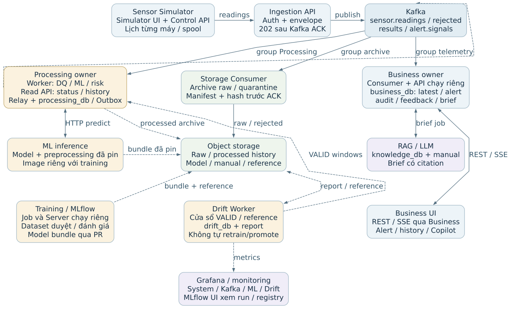
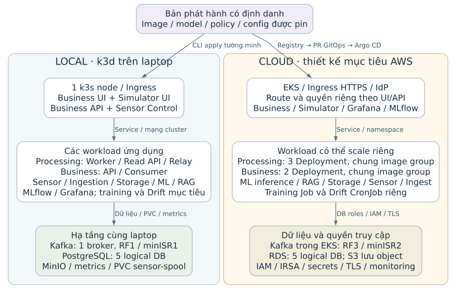

# MaintAI — Thiết kế kiến trúc

Chủ đề 3 · Predictive Maintenance & Technician Copilot · 24/10/2026

**Nhóm 8 — Danh sách thành viên**

| Mã sinh viên | Họ và tên |
| --- | --- |
| 24021486 | Nguyễn Công Huy Hoàng |
| 24021482 | Nguyễn Duy Hòa |
| 24021414 | Lại Tuấn Đức |
| 23021490 | Bùi Anh Chiến |

## 1. Từ bài toán bảo trì đến các yêu cầu thiết kế

MaintAI hỗ trợ kỹ thuật viên theo dõi thiết bị, nhận biết nguy cơ hỏng và tra cứu hướng dẫn bảo trì. Dữ liệu cảm biến được kiểm tra trước khi đưa vào mô hình học máy (ML). Kết quả dự đoán kết hợp với chính sách rủi ro để xác định nhu cầu cảnh báo. Công cụ tra cứu tài liệu bằng RAG/LLM bổ sung hướng dẫn có nguồn; quyết định kiểm tra và bảo trì vẫn thuộc về con người.

**Phạm vi:** dùng dữ liệu AI4I và các máy giả lập để chứng minh quy trình phần mềm. Hệ thống không điều khiển PLC, tự dừng máy hoặc tự sửa thiết bị; kết quả mô phỏng chưa chứng minh hiệu quả tại nhà máy thực tế.

### 1.1. Những yêu cầu trực tiếp chi phối kiến trúc

| Yêu cầu từ đề | Hệ quả cần đáp ứng trong thiết kế |
| --- | --- |
| FR-01/02: kiểm dữ liệu rồi dự đoán Normal/Failure, có score và phiên bản model. | Phải phân biệt tiếp nhận với xử lý; chỉ dữ liệu hợp lệ được gọi ML và kết quả phải gắn đúng đầu vào. |
| FR-03/08: cảnh báo độc lập LLM; lỗi không được biến thành kết luận bình thường. | Luồng cảnh báo cần vận hành khi RAG lỗi; dữ liệu sai, thiếu kết quả và dịch vụ không khả dụng phải có trạng thái riêng. |
| FR-04/05: dashboard và vòng đời cảnh báo. | Cần dữ liệu mới nhất để hiển thị, cập nhật realtime, chống trùng, ACK, xử lý, chuyển cấp và giải quyết có kiểm soát. |
| FR-06/07: hướng dẫn có nguồn và phản hồi kỹ thuật viên. | Cần kho tri thức, tác vụ sinh brief và dữ liệu ghi nhận chấp nhận/từ chối, ghi chú, kết quả kiểm tra. |
| FR-09/10: truy vết và phân quyền. | Phải biết input/model/policy/manual đã dùng; kiểm danh tính, quyền thao tác và phạm vi máy ở API. |

### 1.2. Tiêu chí chất lượng và cách hiểu đúng

Mục tiêu độ trễ là **p95 ≤ 2 giây từ lúc nhận reading hợp lệ đến khi alert hiển thị trên trình duyệt**, không gồm thời gian sinh hướng dẫn. Ít nhất 95% mẫu thuộc phạm vi đo cần nằm trong mốc này; timeout và thiếu alert phải được báo riêng.

Về ML, mục tiêu là Recall của lớp Failure ≥ 0,85 và Precision ≥ 0,50; đánh giá cùng baseline trên test split độc lập. Về RAG, mọi checklist có hướng dẫn hành động phải có nguồn kiểm tra được; mục tiêu ít nhất 90% khuyến nghị có căn cứ và phù hợp. Các số này là tiêu chí đánh giá, chưa phải kết quả đã đạt.

> Suy luận thiết kế: hệ thống phải đồng thời bảo vệ tính đúng của dữ liệu, độ trễ cảnh báo và khả năng truy vết. Tăng số service chỉ có ý nghĩa khi giúp giải quyết một nhu cầu cụ thể trong ba nhóm này.

<!-- PAGEBREAK -->

## 2. Đặt giả định vận hành rồi tính nhu cầu xử lý

Đề bài không ấn định số máy hay công nghệ. Nhóm chọn **100 máy giả lập, mỗi máy gửi 1 reading/giây** làm baseline ban đầu. AI4I không có lịch sử của 100 máy vật lý; bộ giả lập bổ sung định danh máy, thời gian và thứ tự. Loại sản phẩm L/M/H là đặc trưng dữ liệu, không phải định danh máy.

| Giả định phân tích | Giá trị và mục đích |
| --- | --- |
| Tải cảm biến | 100 × 1 = 100 readings/s; 5 phút tạo mục tiêu 30.000 bản ghi. Profile 5 máy chỉ dùng chạy thử nhỏ. |
| Tình huống đến dồn | 100 reading đến trong 100 ms mỗi giây: trung bình vẫn 100/s, tức thời khoảng 1.000/s trong cửa sổ 0,1 giây. |
| Tải ML | Giả sử toàn bộ reading hợp lệ để tính mức tối đa 100 lần inference/s, chưa tính retry. |
| Người xem | 10 trình duyệt; mỗi người xem tối đa 50 máy hoặc chi tiết một máy. Latest telemetry hiển thị khoảng 1 lần/giây/máy. |
| Kích thước và dự phòng | Raw trung bình 1 KiB, outcome 2 KiB; lập kế hoạch ở 70% năng lực lý thuyết. Đây là số giả định cần thay bằng số đo. |

### 2.1. Vì sao cần tính cả hàng đợi và dependency?

Với n replica Worker, mỗi replica có c máy được xử lý đồng thời và thời gian task trung bình T giây, ước lượng sơ bộ là:

```formula
Năng lực lý thuyết μ ≈ n × c / T
Tải lập kế hoạch ≈ 0,7 × n × c / T
```

Ví dụ n = 1, c = 8 và T = 20 ms cho μ ≈ 400/s, mức lập kế hoạch khoảng 280/s. Nếu T tăng lên 100 ms, mức đó chỉ còn 56/s. Vì vậy, cùng 100 máy nhưng model, DB hoặc mạng chậm hơn sẽ tạo nhu cầu tài nguyên khác. Công thức không bảo đảm p95; ML, DB, Relay, Business và Storage vẫn phải được đo riêng.

### 2.2. Từ quy mô suy ra nhu cầu lưu trữ và cập nhật UI

Chạy 100/s liên tục tạo **8,64 triệu reading/ngày**: khoảng 8,24 GiB raw và 16,48 GiB outcome/ngày trước nén, metadata, chỉ mục và các bản sao. Lưu toàn bộ lượng này trong DB phục vụ UI sẽ tăng chi phí đọc/ghi và dọn dữ liệu. Thiết kế vì thế phân biệt trạng thái mới nhất, lịch sử xử lý và archive dài hạn.

UI không cần render mọi bản ghi trung gian. Giả định 10 người × 50 máy × 1 lần/s tạo tối đa 500 lượt cập nhật đối tượng/s; có thể gom nhiều lượt trong một SSE message. Việc giảm nhịp hiển thị không được bỏ reading cần xử lý/lưu hoặc gộp mất thay đổi vòng đời alert.

> Hệ quả: cần xử lý có giới hạn đồng thời, hấp thụ burst, tách nhánh lưu trữ và giữ dữ liệu đọc UI gọn. Riêng con số 100 máy chưa bắt buộc dùng Kafka, đúng 12 partition hay một số service cố định.

<!-- PAGEBREAK -->

## 3. Suy ra kiến trúc tiếp nhận, xử lý và phục vụ UI

Luồng online được tổ chức thành các trách nhiệm độc lập. Sơ đồ dưới tập trung vào đường đi của một reading; ML được gọi bởi Worker, còn RAG và training là các nhánh riêng được giải thích ở trang 5.

```diagram
online
```

### 3.1. Tiếp nhận nhẹ, xử lý sau khi đã lưu ở Kafka

Ingestion kiểm danh tính, lớp thông điệp bên ngoài và giới hạn request; chỉ trả **202 ACCEPTED sau Kafka ACK**. DQ sâu nằm ở Processing và luôn chạy trước ML. Cách chia này giúp việc tiếp nhận không giữ request chờ inference; đổi lại, 202 chỉ là đã tiếp nhận, UI phải thể hiện đang chờ, lỗi hoặc kết quả đến sau.

### 3.2. Một dữ liệu phục vụ ba nhu cầu khác nhau

Processing cần phân tích, Storage cần lưu raw, Business cần cập nhật telemetry. Ba consumer group đọc đầy đủ cùng topic theo tiến độ riêng. Storage chậm không buộc Worker chờ ghi S3 trong mỗi task; đổi lại, nhóm phải theo dõi lag, retention và phục hồi riêng từng nhánh. Kafka giữ dữ liệu trong thời gian hữu hạn, không thay archive lâu dài.

### 3.3. Tách quyết định risk khỏi quản lý alert

Worker gọi ML, áp policy và lưu kết quả. Business nhận result/signal để cập nhật dữ liệu mới nhất, chống trùng và quản lý vòng đời alert. Business API kiểm quyền, phục vụ REST/SSE; Main UI chỉ gọi API này. Dữ liệu raw có thể đến trước prediction, nên UI phải giữ định danh và độ mới riêng, tránh ghép số đo mới với dự đoán cũ như cùng một input.

<!-- PAGEBREAK -->

## 4. Yêu cầu truy vết và phục hồi dẫn tới cách giữ dữ liệu

### 4.1. Vì sao cần Outbox và Relay riêng?

Nếu Worker ghi DB thành công rồi chết trước khi gửi Kafka, Business sẽ không biết kết quả mới. Nếu gửi trước rồi DB thất bại, phía sau lại có event không tương ứng với kết quả đã lưu. Nhóm giải quyết bằng **transactional outbox**: ghi outcome, lịch sử và ý định gửi event trong cùng transaction DB; Relay gửi ý định đó sau.

Relay chỉ đánh dấu tiến độ sau broker ACK. Mất ACK vẫn có thể gây gửi lại, nên Business dùng **Inbox** để nhận biết event đã áp dụng và kiểm thứ tự trước khi cập nhật. Thiết kế bảo vệ hiệu ứng nghiệp vụ, không cam kết mỗi event chỉ truyền đúng một lần hoặc ML chỉ được gọi một lần qua mọi sự cố.

Relay chạy riêng vì nhịp chờ ACK, retry và rollout khác Worker. Read API cũng riêng vì phục vụ query lịch sử/status, trong khi Worker xử lý luồng. Ba runtime cùng owner Processing; DQ, risk và lập lịch là module bên trong, không phải mỗi hàm một service.

### 4.2. Vì sao song song theo máy nhưng không commit offset tùy ý?

Topic dùng key machine_id và baseline 12 partition, nên nhiều máy có thể chung partition. Worker giữ FIFO từng máy và cho các máy khác chạy song song có giới hạn. Ví dụ, offset 100 của A chưa xong nhưng 101 của B đã xong: B có thể hoàn tất, song mốc commit không được đi qua 100. Chỉ xác nhận dãy đã hoàn thành liên tiếp để restart không bỏ sót A.

Khi Kafka phân công lại partition, quyền ghi bền vững phải được kiểm tra để Worker cũ không ghi muộn. Relay giữ đầu hàng đợi theo topic/máy; head đang retry chặn successor. Bản trùng đến muộn và thứ tự giữa các topic vẫn cần bên nhận kiểm tra.

### 4.3. So sánh với backend gộp và tác động khi có sự cố

| Tình huống | Backend gộp xử lý đồng bộ | Kiến trúc được chọn |
| --- | --- | --- |
| ML chậm hoặc ngừng | Có thể giữ request và tài nguyên chung lâu hơn. | Ingestion có thể tiếp nhận trong budget Kafka; Processing báo chưa có kết quả hợp lệ. |
| Business API ngừng | Có thể ảnh hưởng cả ingest nếu cùng runtime. | Các nhánh dữ liệu có thể chạy; người dùng vẫn mất REST/SSE cho đến khi có API khỏe. |
| Cập nhật Worker | Thường cập nhật đơn vị lớn hơn. | Có thể rollout riêng; cần ngừng nhận việc, hoàn tất có hạn và chặn Worker đã mất quyền. |
| DB hoặc laptop ngừng | Nhiều chức năng có thể cùng dừng. | Nhiều Deployment/năm logical DB không tự tạo cách ly lỗi vật lý hoặc HA. |

Backend gộp vẫn có thể có retry và nhiều replica. Nhóm chấp nhận thêm broker, network, cấu hình và tính nhất quán đến sau để tách nhịp xử lý/phục hồi. Các nhánh còn chạy giúp giữ tiến độ; không có nghĩa người dùng đã nhận được alert mới hoặc độ trễ vẫn đạt 2 giây.

<!-- PAGEBREAK -->

## 5. Suy ra các nhánh dữ liệu, ML và giao diện

### 5.1. Tại sao Business không đọc mọi thứ từ storage?

Dashboard cần latest theo máy, alert đang mở và thao tác ACK/resolve có phân quyền. Business Consumer vì vậy tạo **projection**: bản dữ liệu đã chuẩn bị để query nhanh trong business_db. Processing sở hữu outcome/history và Read API; Business gọi API đó khi xem lịch sử, không truy SQL chéo owner hoặc tái dựng latest từ nhiều file sau mỗi refresh.

Raw archive do Storage quản lý; archive lịch sử đã xử lý thuộc Processing. Dữ liệu gần ở DB, dữ liệu cũ có thể chuyển sang object storage kèm manifest/index và kiểm tra độ đầy đủ. Chỉ xóa DB sau xác minh archive và điều kiện giữ bằng chứng. PostgreSQL có năm logical DB theo owner: Processing, Business, Drift, Knowledge và MLflow; cùng instance vẫn có điểm lỗi chung.

### 5.2. Tại sao tách inference, training, RAG và Drift?

Inference là dependency online cho reading VALID. Training sử dụng dataset/split đã duyệt để tạo model, preprocessing và drift reference; có tài nguyên, dependencies và vòng đời khác nên dùng image riêng. MLflow Server/UI dùng image riêng cho tracking/registry, không chạy thay inference.

```diagram
release
```

Sensor phát dữ liệu không trực tiếp kích hoạt retrain từng reading. Drift so sánh cửa sổ dữ liệu với reference khớp phiên bản, ghi báo cáo riêng; không tự đổi risk, retrain hay promote. Thay đổi phân bố chưa chứng minh accuracy giảm nếu thiếu nhãn thực tế.

RAG truy xuất manual trước khi sinh brief có citation. Brief chạy bằng tác vụ riêng, nên lỗi LLM không chặn alert. Thiếu bằng chứng phải được nói rõ; kỹ thuật viên có thể chấp nhận/từ chối khuyến nghị và ghi kết quả kiểm tra, không giao quyền điều khiển máy cho AI.

### 5.3. Vì sao có bốn UI và kiểm quyền ở API?

| UI | Mục đích và nguồn dữ liệu |
| --- | --- |
| Business | Kỹ thuật viên/quản lý xem máy, xử lý alert và Copilot; chỉ gọi Business REST/SSE. |
| Simulator | Người demo điều khiển dữ liệu giả lập; gọi Sensor Control API riêng. |
| Grafana | Người vận hành xem metrics hệ thống, Kafka, ML và Drift; dùng UI công cụ có sẵn. |
| MLflow | Người làm ML/MLOps xem run, artifact và registry; dùng UI công cụ có sẵn. |

Hai frontend tự phát hành giúp sửa Simulator mà không bắt Business UI rollout khi API còn tương thích. IdP cấp danh tính; từng API kiểm token, role và phạm vi máy. Quyền admin nghiệp vụ không mặc nhiên là quyền quản trị platform hoặc điều khiển Simulator.

<!-- PAGEBREAK -->

## 6. Triển khai và mở rộng dựa trên số đo

### 6.1. Vì sao local trước, cloud sau?

Nhóm ưu tiên tích hợp và demo trên laptop bằng k3d. Cấu hình tạo cluster, Kafka, PostgreSQL, MinIO, monitoring và app được quản lý cùng để dễ chuẩn bị môi trường. Local hiện dùng CLI apply, chưa có Argo CD tự đồng bộ Git; một node/broker không phải môi trường HA.

Cloud là thiết kế AWS với EKS, PostgreSQL, S3 và cấu hình phát hành qua GitOps. Năng lực và khả năng chịu lỗi cần triển khai/đo riêng. Mỗi bản phát hành phải truy được image, dataset/split, model, preprocessing, drift reference, policy và manual; chọn định danh/mã băm cụ thể thay vì tên latest có thể đổi. Việc có cấu hình cloud chưa chứng minh đã có môi trường chạy thật.

### 6.2. Scale-ready khi số máy X > 100

Tính lại R = X × r, hoặc tổng tốc độ từng máy nếu chúng khác nhau. Đo nguồn có phát đủ tải, Kafka lag/tuổi record, thời gian ML/DB, Outbox/archive và độ trễ browser. Chỉ tối ưu hoặc tăng replica ở thành phần gây chậm; thêm Worker có thể làm dependency đang quá tải chậm hơn.

```formula
n_cần ≈ ceil(R × T / (u × c))
R: reading/s; T: giây/task; c: active keys/replica; u = 0,7
```

Ví dụ T = 20 ms, c = 8 cho 100/s cần sơ bộ 1 replica Worker, 500/s cần 2 và 1.000/s cần 4. Đây là phép tính minh họa sau baseline, không phải benchmark. Business, Relay và Storage có mô hình xử lý riêng; không tự nhận năng lực của Worker.

Với 12 partition, tối đa 12 member/group cùng được giao partition; không cần một partition/consumer cho mỗi máy. Đổi số partition cần kế hoạch chuyển mapping bảo toàn thứ tự. Ở UI, giới hạn phạm vi xem và gom latest giúp giảm truyền/render, không bỏ lịch sử hoặc alert.

### 6.3. Bằng chứng cần có để xác nhận lựa chọn

**Tính đúng:** chạy một reading VALID và một INVALID xuyên suốt, kiểm input/model/policy, alert lifecycle, quyền truy cập và citation. Dữ liệu lỗi không gọi ML; RAG lỗi không ngăn cảnh báo. Chất lượng ML phải đo trên test split độc lập, không lấy demo replay làm kết quả tổng quát hóa.

**Năng lực:** thử 5 máy rồi baseline 100 máy, gồm tải đều, burst và lệch tải. Báo unique accepted/processed, lag, retry, tài nguyên và p95 tới browser; alert bị mất/timeout phải được tính trong tỷ lệ thành công, không loại khỏi báo cáo.

**Phục hồi:** gây lỗi Worker, Relay, Kafka, storage và RAG; kiểm đọc lại không tạo hiệu ứng trùng, UI thể hiện dữ liệu trễ và backlog được xử lý bù. Ví dụ dừng 60 giây ở 100/s tạo 6.000 record; phục hồi 150/s chỉ dư 50/s, cần khoảng 120 giây để bắt kịp.

> Kết luận thiết kế: kiến trúc tách theo trách nhiệm, nhịp xử lý và ranh giới lưu bền vững. Mốc 100 máy là điểm bắt đầu; khả năng mở rộng và độ trễ được xác nhận bằng phép đo, không suy ra từ số Deployment.

Nguồn yêu cầu: CHỦ ĐỀ 3_Requirement.docx — FR-01 đến FR-10, tiêu chí chất lượng, dữ liệu AI4I, giả định và giới hạn an toàn. Báo cáo trình bày thiết kế và kế hoạch kiểm chứng; không công bố toàn hệ thống đã đạt các mục tiêu hiệu năng/chất lượng.

<!-- PAGEBREAK -->

## 7. Sơ đồ kiến trúc tổng thể



Khối Processing/Business gộp theo owner, không đồng nghĩa một Deployment. Nét đứt thể hiện luồng nền hoặc phát event. Business đọc history qua Processing Read API; Storage sở hữu raw/quarantine, không thay archive kết quả. Nhóm Processing/telemetry đọc readings; nhánh archive còn nhận rejected đủ điều kiện.

<!-- PAGEBREAK -->

## 8. Sơ đồ deployment: local và định hướng cloud



Local là môi trường tích hợp trên một laptop; cloud là thiết kế mục tiêu, chưa xác nhận đã triển khai. Workload có thể chung image group nhưng scale/rollout riêng. Training và Drift local còn là phần mục tiêu; nhiều logical DB không tự tạo HA.
