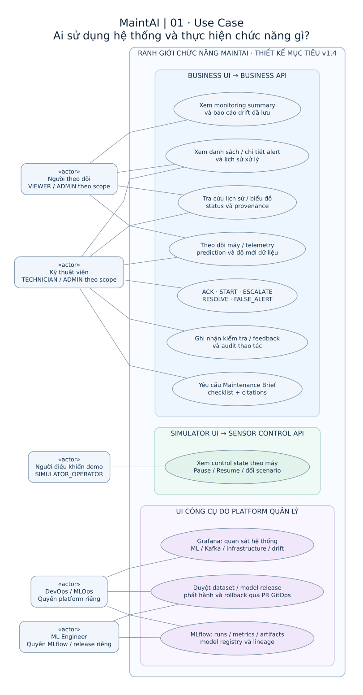
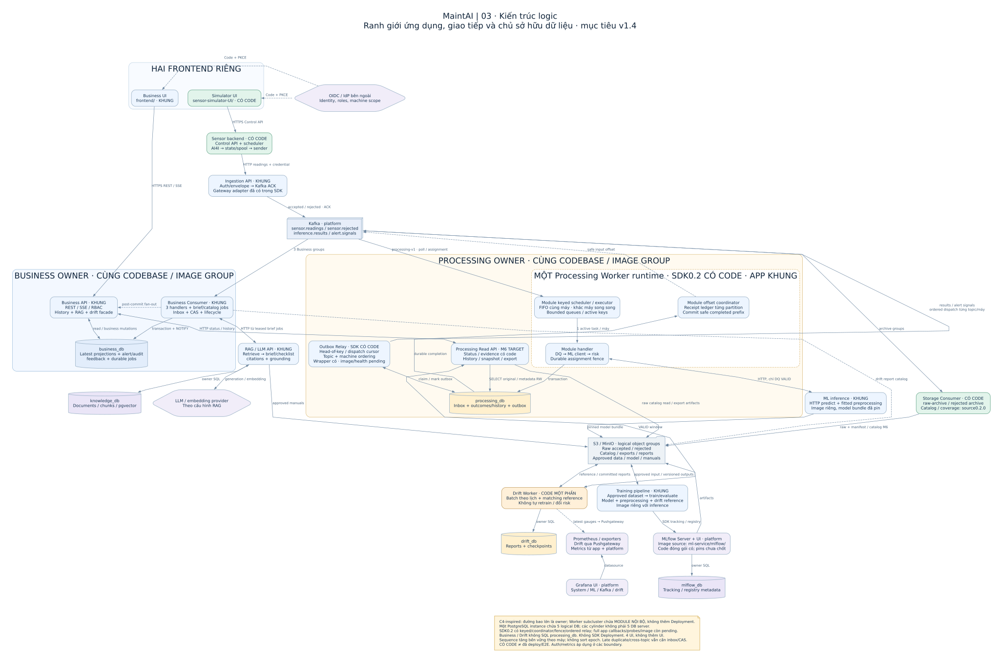
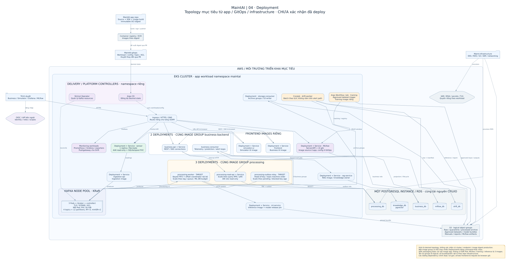
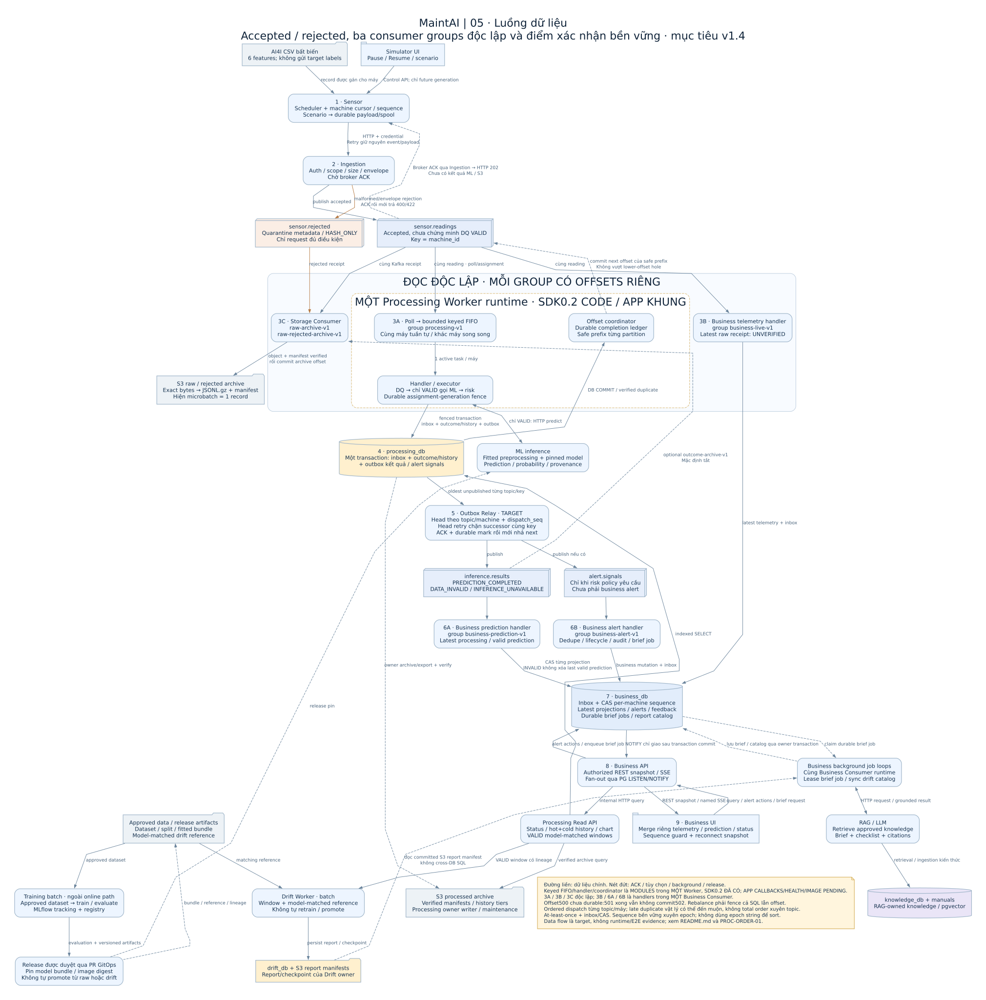

# MaintAI — Bốn sơ đồ hệ thống

**Revision 1.3.0 · 29/10/2026 · thiết kế v1.4 + PROC-ORDER-01 + M6-HISTORY-01.**

Revision1.3 đồng bộ [M6 decision](../M6_HISTORY_ARCHITECTURE_DECISION.md): Read API
snapshot/export, original SELECT + metadata RW; outcomes giữ DB, raw catalog và
exports ở MinIO/S3; không Worker maintenance hoặc processed archive trong M6.
Không thêm deployment. Catalog provider Storage0.2.0 đã có source; History API/exports
của M6 vẫn target. Xem report Storage để phân biệt local tests/CI/K8s.

Revision1.2 trước đó bổ sung keyed scheduler/executor/offset coordinator bên trong
Worker và head-of-key ordering ở Relay. SDK0.2.0 đã có source/tests, app/prod còn pending; không
tăng số runtime/deployment hoặc UI. Use Case giữ nguyên phạm vi chức năng.

Mở [trang xem tương tác](index.html) bằng trình duyệt: chọn sơ đồ, kéo để di
chuyển, cuộn hoặc bấm `+`/`−` để zoom, `Vừa khung` để khôi phục. HTML đã nhúng
bốn SVG, không cần server, internet, JavaScript library hoặc API của MaintAI.
Trong giao diện chỉ đọc Markdown của GitHub, dùng các link SVG/PNG bên dưới;
muốn dùng gallery thì mở bản local của `index.html` trong trình duyệt.

## 1. Danh sách

Giữ số loại **1, 3, 4, 5** theo yêu cầu; không thêm System Context, Sequence,
State Machine hoặc ERD thành những bản vẽ khác.

| Loại | Câu hỏi | Ảnh vector | Ảnh raster | Nguồn chỉnh sửa |
| --- | --- | --- | --- | --- |
| 1 — Use Case | Ai dùng chức năng gì? | [SVG](01-use-case.svg) | [PNG](01-use-case.png) | [DOT](01-use-case.dot) |
| 3 — Kiến trúc logic | Những runtime/owner nào giao tiếp với nhau? | [SVG](03-logical-architecture.svg) | [PNG](03-logical-architecture.png) | [DOT](03-logical-architecture.dot) |
| 4 — Deployment | Workload, image group, Kafka và dữ liệu chạy ở đâu? | [SVG](04-deployment.svg) | [PNG](04-deployment.png) | [DOT](04-deployment.dot) |
| 5 — Data Flow | Dữ liệu đi đâu, lưu ở đâu, xác nhận khi nào? | [SVG](05-data-flow.svg) | [PNG](05-data-flow.png) | [DOT](05-data-flow.dot) |

SVG phù hợp để phóng to hoặc chèn vào tài liệu mà không vỡ chữ. DOT là nguồn
Graphviz có thể sửa và review trong Git. Đây là bộ sơ đồ local; không tạo hoặc
chia sẻ một tldraw/cloud board.

## 2. Đọc sơ đồ đúng phạm vi

- **Use Case:** chức năng mục tiêu theo vai trò. Actor được biểu diễn bằng
  classifier `«actor»`; chức năng là ellipse; đường nối là association, không
  mô tả thứ tự gọi API. ADMIN phải có quyền riêng để vận hành Simulator/platform.
- **Kiến trúc logic:** C4-inspired, không phải một bộ C4 đầy đủ. Khối ứng dụng
  mô tả runtime; đường bao mô tả owner. Subcluster Worker chứa các module nội
  bộ FIFO/handler/coordinator, không phải ba runtimes. Không suy từ số khối/folder
  ra số deployment.
  PostgreSQL có năm logical DB trên một instance; chỉ owner truy cập DB của mình.
- **Deployment:** topology mục tiêu dựa trên docs và manifests GitOps. Các image
  digest, IAM, bootstrap, API/probes và integration vẫn cần hoàn thiện trước khi
  enable workload. Hình không khẳng định hiện có EKS/RDS/S3 hoặc ba Kafka Pods.
- **Data Flow:** mô tả chuyển giao dữ liệu, không phải timeline hoặc total order.
  Các nhãn 3A/3B/3C là ba group đọc cùng topic độc lập. Telemetry, prediction,
  alert và job loops của Business không phải các deployment bổ sung.

Đường liền thể hiện quan hệ/dữ liệu chính. Đường nét đứt được ghi nhãn cụ thể
cho notification, ACK, background job, tùy chọn hoặc release. Chúng không có
nghĩa đồng nhất là “chưa implement”. Màu nền dùng để phân nhóm; dùng nhãn trạng
thái và bảng bên dưới để đọc mức hoàn thiện.

## 3. Snapshot mức hoàn thiện kế thừa23/10

| Phần | Bằng chứng source ở snapshot này | Chưa được chứng minh bởi hình |
| --- | --- | --- |
| Sensor + Simulator UI | Sensor provider0.3.0, UI client/demo và durable state/spool | Production IdP, Kafka và rollout thật |
| Storage Consumer | Runtime0.1.0, archive/retry/probes/metrics, Dockerfile và tests | Bucket/IRSA/ACL thật, Kafka+S3 E2E và capacity |
| Kafka SDK | Producer/runner, inbox/outbox/relay, schemas và CLI | Callback DQ/ML/risk, projection SQL, app REST/SSE |
| PROC-ORDER-01 | SDK0.2 keyed/ordered/fenced code, wrappers và local real broker/DB tests | Full app callbacks/probes/images, DB activation và rollout còn pending |
| Ingestion / Processing / Business / ML / RAG / Business UI | Runtime metadata, contracts và skeleton | Service hoàn chỉnh chạy theo toàn bộ hình |
| Drift | Legacy implementation một phần và target contracts | Tích hợp đầy đủ v1.4, reference/report pipeline production |
| MLflow | Source đóng gói image/local-dev/publisher ở app | Base/version pins được chốt hoặc server production đã bật |
| Kafka / platform | Manifests, topics, ACL, metrics và deployment wiring | Cluster đã reconcile, image đã publish hoặc workload đã Ready |

Trạng thái đầy đủ nằm trong [readiness](../implementation-readiness.md) và
[runtime inventory](../../architecture/README.md). `manifest.json` chụp hash của
source tham chiếu; thay đổi source phải được review trước khi cập nhật hình.

## 4. Những điểm quan trọng được giữ trong cả bộ

1. Bốn UI: Business, Simulator, Grafana, MLflow. Grafana/MLflow dùng UI gốc.
2. Simulator UI gọi Sensor Control API; Business UI chỉ gọi Business REST/SSE.
3. Ingestion publish accepted rồi chờ Kafka ACK mới trả202. Quarantine chỉ áp dụng
   request đủ điều kiện; lỗi auth/oversize không mặc định được archive raw body.
4. Ba nhóm đọc `sensor.readings` độc lập: Processing, Business telemetry, Storage.
5. Worker lưu outcome và outbox trong một transaction. Relay publish rồi chờ ACK;
   downstream dùng inbox/idempotency. Không cam kết exactly-once toàn luồng.
6. Business giữ latest projections và business data; history qua Processing Read
   API. `INVALID` không xóa last valid prediction. PG NOTIFY chỉ giao sau commit.
7. Brief jobs/catalog sync ở Business Consumer; RAG không SQL vào business_db.
   Catalog đọc committed S3 report manifest, không đọc drift_db xuyên owner.
8. M6 giữ processed history trong DB; raw manifest microbatch1 và catalog/coverage
   bổ sung ở Storage. Snapshot/export runner thuộc Read API, không Worker.
   Processed archive/cleanup thật hoãn; optional wire-outcome archive không bật.
9. Drift là batch ngoài critical path. Approved dataset kích hoạt training;
   model/artifacts phát hành qua PR GitOps. Raw upload/drift không tự promote.
10. MLflow Server, training và inference có images riêng. Image MLflow source ở
    app, production config ở GitOps. Folder SDK không phải một service.
11. Cùng máy xử lý tuần tự, khác máy song song trong bounded Worker target;
    commit safe completed prefix từng partition. Read API/Storage không tham gia
    coordinator của Processing. Epoch opaque, source sequence bền vững xuyên restart.
12. Relay target giữ dispatch order từng topic/máy; head retry chặn successor.
    Late duplicate vẫn có thể đến muộn; không có total order xuyên topic.

## 5. Nguồn tham chiếu

- [Functional Overview](../MaintAI_Functional_Overview.md): actors/chức năng.
- [System Contracts](../MaintAI_System_Contracts_v1_4_DEPLOYMENT_PROVENANCE.md):
  semantics, DB ownership, jobs, DQ/outcomes và UI-01.
- [Implementation Guide](../MaintAI_Implementation_Development_Guide_v1_4_DEPLOYMENT_PROVENANCE.md):
  module/runtime và ranh giới triển khai.
- [Deployment Architecture](../DEPLOYMENT_ARCHITECTURE.md),
  [Runtime Dataflow](../RUNTIME_DATAFLOW.md),
  [Versioning & Provenance](../VERSIONING_AND_PROVENANCE.md).
- [UI Architecture](../UI_ARCHITECTURE.md), [Kafka guide](../KAFKA_DEVELOPMENT_GUIDE.md),
  [Processing concurrency/ordering](../PROCESSING_CONCURRENCY_AND_ORDERING.md),
  [runtime map](../../architecture/runtime-map.json),
  [Kafka topology](../../contracts/kafka/topology.json).
- Sibling `MaintAI-gitops`: `platform/kafka/`, `applications/addons/strimzi.yaml`
  và `platform/mlops/mlflow.yaml`. Sibling là nguồn kiểm chứng topology; không
  bắt buộc có clone đó để mở ảnh hoặc gallery.

## 6. Chỉnh sửa và render lại

Cần Python3 và lệnh Graphviz `dot`; bản export này dùng **Graphviz16.0.0** với font
**DejaVu Sans**. Không cài thêm Python/npm packages. Từ root repository:

```bash
python3 docs/diagrams/render.py
python3 docs/diagrams/render.py --check
python3 .github/scripts/check_repository.py
```

Lệnh đầu render bốn DOT thành SVG/PNG, tạo gallery và manifest. `--check` kiểm
hash của nguồn/ảnh/gallery/tài liệu tham chiếu, kiểm SVG XML; không chạy app,
Docker, AWS, Terraform hoặc GitOps. Sibling reference thiếu thì được báo SKIP;
app reference hoặc hình khác snapshot thì FAIL để yêu cầu review. Check tĩnh
không chứng minh mọi nét vẽ đúng về nghiệp vụ hoặc hệ thống đã chạy.

Sau khi sửa README này, render lại để cập nhật hash. Sau khi sửa tài liệu được
`docs/source-manifest.json` quản lý, cập nhật hash tương ứng theo quy ước repo.
Graphviz/font version khác có thể đổi layout/bytes; review ảnh trước khi commit.

## 7. Xem nhanh

### Use Case



### Kiến trúc logic



### Deployment



### Luồng dữ liệu




Revision1.2.0 phản ánh source SDK/transport đã implement. Xem
[implementation report](../PROCESSING_ORDERING_IMPLEMENTATION_REPORT.md) để phân
biệt source/tests với app/probes/image/deployment và legacy cursor bootstrap gap.


## Baseline capacity100 và scale-ready

Giả định hiện tại100 máy×1 reading/s=100/s; kiến trúc có boundary để tối ưu/scale
khiX>100. Sơ đồ mô tả topology/ownership, không đặt giới hạn100 máy hoặc bắt buộc
replica count trong hình cho mọi profile. [Capacity §11](../design-basis/02_ASSUMPTIONS_AND_CAPACITY.md#11-scale-ready-tính-và-tối-ưu-latency-khi-x100)
chỉ rõ cách tínhR=X×r, capacity và end-to-end latency; cloud/local config không tự
đổi do sửa giả định. Source hashes trong manifest được đồng bộ sau amendment.
