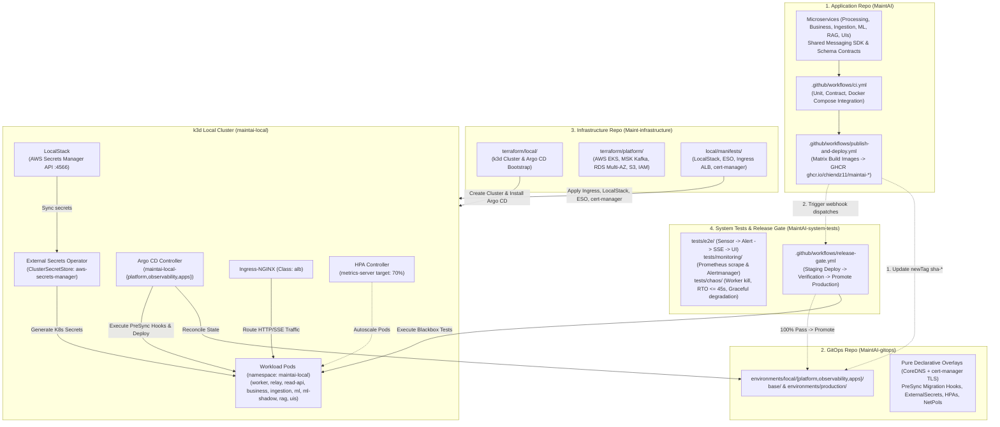
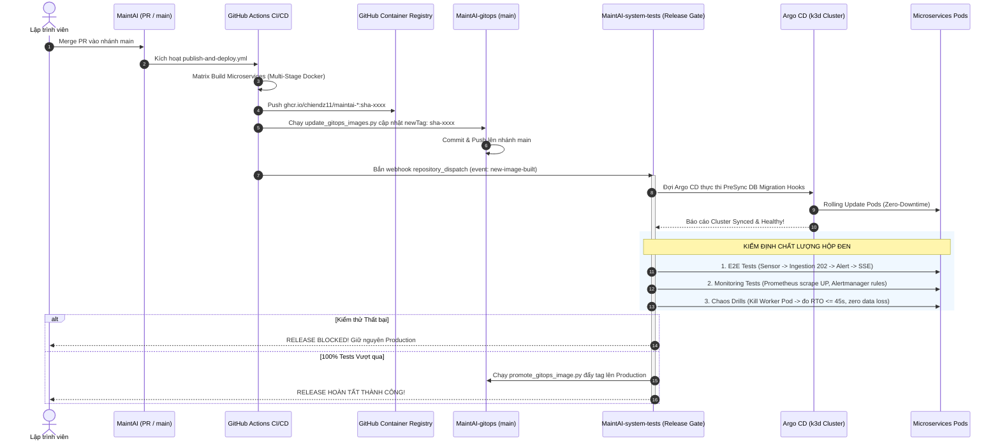

# Framework & Hướng Dẫn Tổng Quát: Cấu Hình k3d Local, Argo CD GitOps và Luồng CI/CD Đa Repository (MaintAI)

Tài liệu này đóng vai trò là **khung chuẩn hóa (DevOps Framework)**, **sổ tay vận hành kỹ thuật (Engineering Runbook)** và **kịch bản trình diễn CI/CD Rolling Update** cho toàn bộ hệ sinh thái **MaintAI (Predictive Maintenance Platform)**. Framework quy định cách phối hợp giữa 4 repositories, khởi tạo cụm Kubernetes cục bộ (`k3d`) bằng Terraform, đồng bộ khai báo qua GitOps (`Argo CD`), quản lý bí mật (**LocalStack + External Secrets Operator**), mạng nội bộ chuẩn Kubernetes (CoreDNS + `cert-manager`), và luồng tự động hóa CI/CD kết hợp cổng kiểm định độc lập (`MaintAI-system-tests`).

> **Tham chiếu nhanh:** Để xem hướng dẫn thao tác khởi động, Stop/Start và kiểm tra cụm demo `maintai-local` hàng ngày, xem [LOCAL_DEMO_GUIDE.md](LOCAL_DEMO_GUIDE.md).

---

## 1. Kiến Trúc Tổng Thể 4-Tier Multi-Repository

Hệ sinh thái MaintAI phân tách trách nhiệm tuyệt đối giữa **Mã nguồn ứng dụng**, **Trạng thái khai báo (Desired State)**, **Mã nguồn hạ tầng (IaC)** và **Kiểm định chất lượng độc lập (System Tests)**:



### Bảng Trách Nhiệm Từng Repository

| Repository | Công nghệ chính | Trách nhiệm cốt lõi |
| :--- | :--- | :--- |
| **`MaintAI`** | Python 3.12 (FastAPI, PyTorch, Psycopg 3), React 19 (TypeScript, Vite), Docker, Kafka SDK | Nghiệp vụ các microservices (`ingestion-api`, `processing-worker`, `processing-outbox-relay`, `processing-read-api`, `business-api`, `business-consumer`, `ml-service`, `rag-service`, `drift-worker`, `frontend`, `sensor-simulator-UI`), wire contracts v1.4, thực thi CI checks và build image đẩy lên GHCR. |
| **`MaintAI-gitops`** | Kustomize (Pure Declarative `base/` + `environments/{local,production}`), Argo CD Applications, PreSync Hooks | Single Source of Truth lưu trữ trạng thái mong muốn của cụm K8s (`environments/local/{platform,observability,apps}`, `environments/production/`, PreSync DB Migrations, `ConfigMaps`, `ExternalSecrets`, `HPAs`, `NetworkPolicies`, `cert-manager` Certificates). |
| **`Maint-infrastructure`** | Terraform, k3d, Helm, LocalStack, External Secrets Operator | Tự động hóa hạ tầng (IaC): khởi tạo cụm `k3d` (`maintai-local`), LocalStack + ESO, Ingress ALB controller, `cert-manager`, bootstrap Argo CD và cung cấp Terraform modules cho AWS Production (`terraform/platform/`). |
| **`MaintAI-system-tests`** | Python 3.12, Pytest, Httpx, Kubernetes SDK | Kiểm thử toàn trình hộp đen (E2E), giám sát Prometheus/Alertmanager, diễn tập chaos (Worker kill, RTO/RPO=0) và sở hữu Release Gate. |

---

## 2. Thiết Lập & Cấu Hình Cụm `k3d` Local Bằng Terraform

Cụm `k3d` tái tạo các dịch vụ AWS Production ngay trên máy trạm thông qua Docker:

- **Cluster Name**: `maintai-local`.
- **Kubernetes API Endpoint**: Bind cố định trên `127.0.0.1:6550`, kubeconfig cô lập tại `Maint-infrastructure/local/.local/kubeconfig`.
- **Volume Bind Mount**: Mount thư mục host vào Rancher `local-path-provisioner` để giữ dữ liệu PostgreSQL 17 (`processing_db`, `business_db`), Kafka logs và MinIO objects khi `k3d cluster stop maintai-local`.
- **Tắt dịch vụ thừa**: `--disable=traefik` và `--disable=servicelb` để dùng Ingress-NGINX mô phỏng AWS ALB.

```bash
cd /home/chienqt/Dev/newBTL/Maint-infrastructure
make tf-init && make tf-apply
```

---

## 3. Kiến Trúc & Vận Hành Argo CD GitOps

Argo CD vận hành theo mô hình Pure Declarative Kustomize, liên tục đối chiếu `MaintAI-gitops` (nhánh `main`) với cụm Kubernetes qua 3 Applications:
1. **`maintai-local-platform`** (`environments/local/platform`): PostgreSQL 17 + pgvector, Apache Kafka KRaft, MinIO, Keycloak OIDC Provider và TLS certificates.
2. **`maintai-local-observability`** (`environments/local/observability`): Prometheus, Loki + Promtail, Pushgateway, Grafana.
3. **`maintai-local-apps`** (`environments/local/apps`): Toàn bộ workloads ứng dụng (`ingestion-api`, 3 deployments `processing`, 2 deployments `business`, `storage-consumer`, `ml-service`, `ml-service-shadow`, `rag-service`, `sensor`, `frontend`, `simulator-ui`) kèm PreSync Migration Hooks.

### Cơ chế PreSync Database Migration Hooks & Self-Healing
- `processing-migration.yaml`: Chạy `maintai-processing-migrate upgrade` và cấp quyền role trước khi `processing-worker` rollout.
- `business-migration.yaml`: Chạy `maintai-business-migrate upgrade` và cấp quyền role trước khi `business-api` rollout.
- Policy chuẩn cho dữ liệu bền vững: `prune: false` (tránh xóa nhầm PVC/DB/Secret stateful ở local khi chưa review) và `selfHeal: true` (tự động khôi phục mọi chỉnh sửa thủ công bằng `kubectl edit` về đúng Git).

---

## 4. Luồng Tự Động Hóa CI/CD & System Tests Release Gate



---

## 5. Phân Tích AWS Cloud Parity: Cấu Trúc Local vs Production

| Thành phần Kiến trúc | Môi trường Local (`k3d`) | Môi trường Production (AWS Cloud) | Cơ chế chuyển đổi & Parity |
| :--- | :--- | :--- | :--- |
| **Kubernetes Engine** | **k3d v5.x** (k3s container, 1 server node) | **Amazon EKS v1.35** (Managed Node Groups Multi-AZ) | Chung K8s manifests, `base/` và `environments/` Kustomize overlays. |
| **Service Mesh / DNS & TLS** | **CoreDNS** (`postgres:5432`, `kafka:9092`) + `cert-manager` | **CoreDNS** + AWS Private CA / RDS Global CA | Bỏ hoàn toàn adapter loopback sidecar; chuẩn hóa direct service DNS. |
| **Message Broker** | **Apache Kafka KRaft** (Pod trong cụm) | **Amazon MSK (Managed Streaming for Kafka)** | Kết nối qua `KAFKA_BOOTSTRAP_SERVERS`; giữ nguyên 4 topics canonical. |
| **Relational Database** | **PostgreSQL 17 Container** (`postgres:17.10` + PVC) | **Amazon RDS PostgreSQL 17 Multi-AZ** (Encrypted) | 5 logical owner DBs, giữ nguyên Alembic/SQL migrations. |
| **Object Storage** | **MinIO S3 API** + PVC | **Amazon S3** (Versioning + KMS Encryption) | Chung AWS S3 SDK (`boto3`) với `S3_ENDPOINT_URL`. |
| **Secrets Management** | **LocalStack** + **External Secrets Operator** | **AWS Secrets Manager** + **AWS KMS** (IRSA) | ESO kết nối LocalStack `:4566` ở Local; kết nối AWS Secrets Manager qua IAM Role trên Cloud. |
| **Ingress & Edge** | **Ingress-NGINX** (`ingressClassName: alb`) | **AWS Application Load Balancer (ALB)** | Chung chuẩn Ingress annotations và domain routing. |
| **AI Inference & LLM** | **Groq Cloud / Local Champion + Shadow ML** | **Groq API / EKS ML Inference (Champion + Shadow)** | Giữ nguyên schema `MaintenanceBriefRequest` và timeout budgets. |

---

## 6. Nền tảng Enterprise DevOps 4 Trụ Cột (Đã Kiểm Chứng)

> [!NOTE]
> Nền tảng 4 trụ cột Enterprise DevOps đã được merge vào `main` xuyên suốt 4 repositories và kiểm chứng trên cụm `maintai-local`. Chi tiết báo cáo xem tại [`PHASE2_DEVOPS_IMPLEMENTATION_REPORT.md`](../reports/PHASE2_DEVOPS_IMPLEMENTATION_REPORT.md).

```mermaid
flowchart TD
    subgraph P1["Trụ Cột 1: Secrets Management"]
        LS["LocalStack (:4566)<br/>AWS Secrets Manager Simulation"] -->|ClusterSecretStore: aws-secrets-manager| ESO["External Secrets Operator (ESO)"]
        ESO -->|Tự động sinh| K8S_SEC["K8s Secrets:<br/>maintai-database, maintai-kafka, groq-api-key"]
    end

    subgraph P2["Trụ Cột 2: Edge Routing"]
        ING_CTRL["Ingress-NGINX (Class: alb)<br/>Port 80/443"]
        ING_CTRL -->|Host: app.maintai.local| FE["Service/frontend:80"]
        ING_CTRL -->|Host: simulator.maintai.local| SIM["Service/simulator-ui:80"]
        ING_CTRL -->|Host: api.maintai.local| BIZ["Service/business-api:8003"]
        ING_CTRL -->|Host: ingest.maintai.local| ING["Service/ingestion-api:8000"]
    end

    subgraph P3["Trụ Cột 3: Autoscaling & K8s Policies"]
        MS["metrics-server"] -->|Scrape CPU/RAM| HPA["HPA Controller<br/>(Worker, Business API, Ingestion, ML: min 1-2, max 4, target 70%)"]
        PDB["PodDisruptionBudget (PDB)<br/>(minAvailable / maxUnavailable: 1)"]
        NETPOL["Zero-Trust NetworkPolicies<br/>(Cách ly Worker, Postgres, Kafka, Ingress)"]
    end

    subgraph P4["Trụ Cột 4: Observability (Metrics + Logs)"]
        PROM["Prometheus<br/>(Scrape microservices /metrics)"]
        LOKI["Grafana Loki + Promtail<br/>(Gom log container stdout/stderr)"]
        PROM --> GRAF["Grafana Dashboards"]
        LOKI --> GRAF
    end
```



1. **Secrets Management (LocalStack + ESO):** LocalStack (`:4566`) giả lập AWS Secrets Manager; ESO (`external-secrets`) đồng bộ tự động qua `ClusterSecretStore: aws-secrets-manager` thành `ExternalSecret` cho các microservices nhạy cảm.
2. **Edge Routing (Ingress-NGINX Class `alb`):** Định tuyến virtual hosts (`app.maintai.local`, `simulator.maintai.local`, `api.maintai.local`, `ingest.maintai.local`, `processing.maintai.local`).
3. **Autoscaling & K8s Policies (HPA, PDB, Zero-Trust NetworkPolicies):** Toàn bộ deployments khai báo `resources.requests/limits`; HPA cho `ingestion-api`, `processing-worker`, `business-api`, `ml-service`, `ml-service-shadow`, `rag-service`, `frontend`; `NetworkPolicy` chặn mặc định (`default-deny-all`) và chỉ mở port cần thiết (bao gồm egress HTTPS `443` cho `rag-service` gọi Groq).
4. **Observability (Prometheus + Loki + Promtail + Grafana):** Thu thập metrics và structured JSON logs (`trace_id`, `correlation_id`, `machine_id`, `event_id`).

---

## 7. Quy Chuẩn Bổ Sung Microservice Mới (Onboarding Checklist)

1. **Codebase & CI (`MaintAI`):** Service có thư mục riêng, `Dockerfile` non-root (`UID 10001`), kiểm tra linting (`ruff`), unit & integration tests trong `.github/workflows/ci.yml`.
2. **Container Build Matrix (`MaintAI`):** Đăng ký service vào `.github/workflows/publish-and-deploy.yml` để build tag `sha-*` lên GHCR.
3. **Kubernetes Base & Overlays (`MaintAI-gitops`):** Khai báo dưới `base/` hoặc `workloads/<service>/` (`deployment.yaml` với `securityContext` non-root, `livenessProbe`, `readinessProbe`, `resources.requests/limits`; `service.yaml`; `kustomization.yaml`).
4. **Policies (`MaintAI-gitops`):** Bổ sung `ExternalSecret`, `HPA` (nếu stateless), và `NetworkPolicy` tương ứng.
5. **Đăng ký vào Kustomization Overlay:** Thêm vào `environments/local/apps/kustomization.yaml` (và `environments/production/` khi sẵn sàng), commit và push lên `main` để Argo CD tự động rollout.

---

## 8. Kịch Bản Demo Thực Chiến CI/CD Rolling Update & Instant Rollback

Dùng để trình diễn trực tiếp luồng **Zero-Downtime Rollout** và **GitOps Rollback** trong buổi bảo vệ đồ án.

### 8.1. Chuẩn bị 3 Terminal Song Song
```bash
# Terminal 1 — Giám sát Argo CD Applications:
export KUBECONFIG="/home/chienqt/Dev/newBTL/Maint-infrastructure/local/.local/kubeconfig"
kubectl get applications -n argocd -w

# Terminal 2 — Giám sát Rolling Update Pods Frontend:
export KUBECONFIG="/home/chienqt/Dev/newBTL/Maint-infrastructure/local/.local/kubeconfig"
kubectl get pods -n maintai-local -l app.kubernetes.io/name=frontend -w

# Terminal 3 — Chứng minh Zero-Downtime liên tục:
while true; do curl -s -o /dev/null -w "%{time_total}s - HTTP %{http_code}\n" http://127.0.0.1:18080/; sleep 0.5; done
```

### 8.2. Các Bước Thực Hiện Rollout Phiên Bản Mới (Frontend UI)
1. **Kiểm tra phiên bản hiện tại** tại `http://127.0.0.1:18080` và kiểm tra image đang chạy:
   ```bash
   kubectl get deployment frontend -n maintai-local -o jsonpath='{.spec.template.spec.containers[0].image}{"\n"}'
   ```
2. **Thay đổi mã nguồn** (ví dụ cập nhật `<title>` trong `MaintAI/frontend/index.html`):
   ```bash
   cd /home/chienqt/Dev/newBTL/MaintAI
   sed -i 's/<title>MaintAI · Thiết bị<\/title>/<title>MaintAI v2.0 · Live Demo Rollout<\/title>/g' frontend/index.html
   ```
3. **Đóng gói image & import vào k3d** (hoặc trigger `gh workflow run publish-and-deploy.yml -f target_branch=main -f services=frontend` để kéo từ GHCR):
   ```bash
   docker build -t ghcr.io/chiendz11/maintai-frontend:v2.0-demo -f frontend/Dockerfile .
   k3d image import ghcr.io/chiendz11/maintai-frontend:v2.0-demo -c maintai-local
   ```
4. **Cập nhật Desired State trong `MaintAI-gitops`:** Đổi `newTag` của `maintai-frontend` trong `MaintAI-gitops/environments/local/apps/kustomization.yaml` thành `v2.0-demo`, sau đó commit & push lên nhánh `main` (hoặc annotate hard refresh để Argo CD sync ngay không cần đợi 3 phút):
   ```bash
   kubectl annotate app maintai-local-apps -n argocd argocd.argoproj.io/refresh=hard --overwrite
   ```
5. **Quan sát Zero-Downtime Rolling Update:** Pod mới khởi tạo và đạt `Readiness Probe` (`1/1 Running`) **trước** khi Kubernetes `Terminating` Pod cũ; Terminal 3 liên tục trả `HTTP 200`, và nhấn `Ctrl+Shift+R` trên trình duyệt sẽ thấy tiêu đề mới ngay lập tức.

### 8.3. Kịch bản Phụ: Instant Rollback trong 10 Giây
Khi muốn hoàn tác phiên bản lỗi về trạng thái ổn định trước đó theo đúng nguyên tắc GitOps (không sửa tay trên cluster):
```bash
cd /home/chienqt/Dev/newBTL/MaintAI-gitops
git revert HEAD --no-edit
git push origin main
```
Argo CD tự động phát hiện commit revert, rollback Pod về image ổn định cũ với audit trail đầy đủ trên Git.

---

## 9. Sổ Tay Vận Hành & Khắc Phục Sự Cố (Troubleshooting Runbook)

| Hiện tượng | Nguyên nhân phổ biến | Lệnh kiểm tra & Cách khắc phục |
| :--- | :--- | :--- |
| **`ImagePullBackOff`** | Tag image `sha-*` chưa build xong trên GHCR hoặc package để Private | Chạy `kubectl describe pod <pod_name> -n maintai-local`. Kiểm tra workflow `publish-and-deploy.yml` trên GitHub Actions và quyền package GHCR. |
| **`CrashLoopBackOff` tại Processing Worker** | Chưa áp dụng migration cho `processing_db` hoặc Postgres chưa sẵn sàng | Kiểm tra logs: `kubectl logs -n maintai-local -l app.kubernetes.io/name=processing-worker` và Job `kubectl get jobs -n maintai-local`. |
| **`SecretSyncedError`** | LocalStack chưa có secret hoặc `ClusterSecretStore` mất kết nối | Kiểm tra `kubectl describe externalsecret -n maintai-local` và Pod `kubectl get pods -n localstack`. |
| **Consumer Lag của Kafka tăng cao** | Worker xử lý ML chậm hoặc số Pod Worker nhỏ hơn số partition (12) | Kiểm tra Prometheus metric `maintai_kafka_consumer_lag` và HPA (`kubectl get hpa -n maintai-local`). |
| **RAG Service báo lỗi `503 RAG_UNAVAILABLE`** | Chưa cấu hình `GROQ_API_KEY` hoặc LLM provider bị rate limit | Kiểm tra `kubectl logs -n maintai-local -l app.kubernetes.io/name=rag-service`. Invariant MaintAI đảm bảo lỗi RAG không chặn luồng tạo Alert. |
| **Argo CD `OutOfSync` liên tục** | Can thiệp sửa trực tiếp bằng `kubectl edit` gây drift so với Git | Không sửa tay trên cụm. Commit thay đổi vào `MaintAI-gitops`, Argo CD (`selfHeal: true`) sẽ tự động reconcile. |
| **HPA hiển thị `cpu: <unknown>/70%`** | `metrics-server` mới khởi động (< 30s) hoặc Deployment thiếu `resources.requests.cpu` | Kiểm tra `kubectl top pods -n maintai-local`. Đảm bảo mỗi deployment khai báo `resources.requests.cpu`. |
