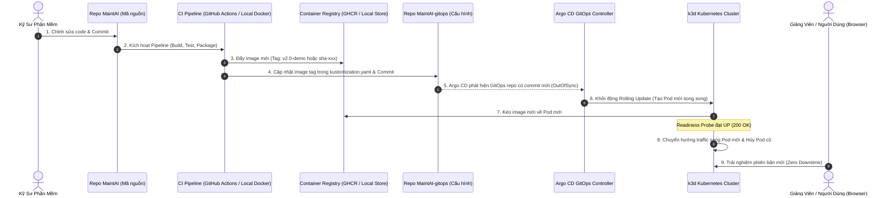

# MaintAI — Kịch Bản Demo Luồng CI/CD và Argo CD Rolling Update (Zero-Downtime Rollout)

Tài liệu này cung cấp kịch bản thực tế từng bước để trình diễn luồng **Continuous Integration & Continuous Deployment (CI/CD)** theo mô hình **GitOps** chuẩn doanh nghiệp cho Giảng viên hướng dẫn.

---

## 0. Tổng Quan Kiến Trúc GitOps CI/CD

Quy trình phát hành phiên bản mới trong MaintAI tách biệt rõ ràng giữa khâu **Tích hợp liên tục (CI)** và **Triển khai liên tục (CD)**, với Git đóng vai trò là **Nguồn Chân Lý Duy Nhất (Single Source of Truth)**:



---

## 1. Chuẩn Bị Trước Khi Demo

Mở sẵn **3 cửa sổ Terminal** cạnh nhau trên màn hình để Giảng viên quan sát toàn bộ quá trình:

- **Terminal 1 (Giám Sát Argo CD):**
  ```bash
  export KUBECONFIG="/home/chienqt/Dev/newBTL/Maint-infrastructure/local/.local/kubeconfig"
  kubectl get applications -n argocd -w
  ```
- **Terminal 2 (Giám Sát Rolling Update Pods):**
  ```bash
  export KUBECONFIG="/home/chienqt/Dev/newBTL/Maint-infrastructure/local/.local/kubeconfig"
  kubectl get pods -n maintai-local -l app.kubernetes.io/name=frontend -w
  ```
- **Terminal 3 (Chứng Minh Zero-Downtime Bằng Vòng Lặp Curl):**
  ```bash
  # Gửi request liên tục mỗi 0.5s đến giao diện người dùng
  while true; do curl -s -o /dev/null -w "%{time_total}s - HTTP %{http_code}\n" http://127.0.0.1:18080/; sleep 0.5; done
  ```

---

## 2. Kịch Bản Demo Trực Tiếp: Rollout Phiên Bản Mới Cho Frontend UI

> [!TIP]
> Chọn dịch vụ **Frontend UI** để demo vì kết quả thay đổi sẽ hiển thị trực quan ngay lập tức trên trình duyệt trước mắt Giảng viên!

### Bước 1: Kiểm tra phiên bản hiện tại
1. Mở trình duyệt tại `http://127.0.0.1:18080`.
2. Kiểm tra image tag hiện tại của Pod Frontend bằng lệnh:
   ```bash
   kubectl get deployment frontend -n maintai-local -o jsonpath='{.spec.template.spec.containers[0].image}{"\n"}'
   ```
   *(Ví dụ: `ghcr.io/chiendz11/maintai-frontend:sha-a1addebda5926e88aab3b78bdf93fdac527073d4`)*

---

### Bước 2: Thay đổi mã nguồn (Source Code Modification)
Mở file giao diện `frontend/index.html` hoặc component hiển thị tiêu đề trong `MaintAI`:
```bash
cd /home/chienqt/Dev/newBTL/MaintAI
```

Chỉnh sửa tiêu đề trang trong file `frontend/index.html` (ví dụ đổi title thành `MaintAI v2.0 · Live Demo Rollout`):
```bash
sed -i 's/<title>MaintAI · Thiết bị<\/title>/<title>MaintAI v2.0 · Live Demo Rollout<\/title>/g' frontend/index.html
```

---

### Bước 3: Đóng gói Container Image mới (CI Phase)

Để buổi demo mượt mà, không phụ thuộc vào đường truyền mạng khi push image nặng lên cloud, chúng ta build trực tiếp và import vào cụm k3d:

```bash
cd /home/chienqt/Dev/newBTL/MaintAI

# 1. Build Docker image mới với tag v2.0-demo
docker build -t ghcr.io/chiendz11/maintai-frontend:v2.0-demo -f frontend/Dockerfile .

# 2. Import trực tiếp image vừa build vào cụm k3d-maintai-local
k3d image import ghcr.io/chiendz11/maintai-frontend:v2.0-demo -c maintai-local
```

---

### Bước 4: Khai Báo Trạng Thái Mong Muốn Trong GitOps (CD Phase)

Chuyển sang repository `MaintAI-gitops` và cập nhật image tag mới:

```bash
cd /home/chienqt/Dev/newBTL/MaintAI-gitops
```

1. Mở file `environments/local/apps/kustomization.yaml`, tìm đến mục image `frontend` và đổi `newTag` thành `v2.0-demo`:
   ```bash
   sed -i '/name: registry.invalid\/maintai-local\/frontend/,/newTag:/ s/newTag: .*/newTag: v2.0-demo/' environments/local/apps/kustomization.yaml
   ```

2. Kiểm tra diff để xác nhận thay đổi chính xác:
   ```bash
   git diff environments/local/apps/kustomization.yaml
   ```

3. Commit và Push thay đổi lên GitOps repository:
   ```bash
   git add environments/local/apps/kustomization.yaml
   git commit -m "feat(frontend): promote UI image to v2.0-demo for instructor walkthrough"
   git push origin feat/local-m6-history
   ```

---

### Bước 5: Quan Sát Argo CD Tự Động Reconcile & Rolling Update

Quan sát ngay trên 3 cửa sổ terminal đã chuẩn bị ở Bước 0:

1. **Tại Terminal 1 (Argo CD):**
   - Ứng dụng `maintai-local-apps` chuyển trạng thái sang `OutOfSync`.
   - Argo CD tự động kích hoạt tiến trình đồng bộ (`Syncing` / `Progressing`).
   - Sau khi hoàn thành, trạng thái trở về `Synced` và `Healthy`.
   *(Nếu muốn kích hoạt kiểm tra ngay lập tức mà không đợi 3 phút định kỳ, chạy: `kubectl annotate app maintai-local-apps -n argocd argocd.argoproj.io/refresh=hard --overwrite`)*

2. **Tại Terminal 2 (Kubernetes Pods):**
   Bạn sẽ thấy cơ chế **RollingUpdate** tiêu chuẩn của Kubernetes diễn ra:
   ```text
   frontend-xxxxxxxxxx-new   0/1   ContainerCreating   0   0s
   frontend-xxxxxxxxxx-new   1/1   Running             0   3s
   frontend-oldddddddd-old   1/1   Terminating         0   45m
   frontend-oldddddddd-old   0/1   Terminating         0   45m
   ```
   > [!IMPORTANT]
   > Pod mới được tạo và vượt qua `Readiness Probe` (1/1 Running) **trước**, sau đó Kubernetes mới tiến hành hủy Pod cũ.

3. **Tại Terminal 3 (Zero Downtime Check):**
   Dòng log curl liên tục trả về `HTTP 200` không ngắt quãng một mili-giây nào trong suốt thời gian Pod chuyển giao!

4. **Tại Trình Duyệt Web:**
   Nhấn **F5** (hoặc `Ctrl + Shift + R`) tại `http://127.0.0.1:18080`:
   - Tiêu đề tab trình duyệt đổi ngay thành: **MaintAI v2.0 · Live Demo Rollout**.

---

## 3. Kịch Bản Phụ: Demo Instant Rollback (Khắc Phục Sự Cố Trong 10 Giây)

Để tạo ấn tượng mạnh mẽ hơn với Giảng viên, hãy mô phỏng kịch bản: *"Phiên bản v2.0 phát sinh lỗi ngoài ý muốn, đội ngũ vận hành cần khôi phục ngay lập tức về phiên bản ổn định trước đó"*.

Thay vì can thiệp thủ công vào cluster (chống chỉ định trong GitOps), ta chỉ cần hoàn tác commit trên Git:

```bash
cd /home/chienqt/Dev/newBTL/MaintAI-gitops

# 1. Revert commit vừa triển khai
git revert HEAD --no-edit

# 2. Push lên remote repository
git push origin feat/local-m6-history
```

**Quan sát kết quả:**
- Argo CD lập tức phát hiện GitOps repository đã rollback về image cũ.
- Kubernetes tự động thực hiện RollingUpdate ngược lại, thay thế Pod `v2.0-demo` bằng image `sha-...` ổn định ban đầu.
- Trình duyệt refresh lại sẽ hiển thị tiêu đề ban đầu `MaintAI · Thiết bị`.
- Toàn bộ quá trình phục hồi diễn ra hoàn toàn tự động, có lịch sử Git kiểm toán (audit trail) rõ ràng!

---

## 4. Tham Khảo: Luồng Full Cloud Production (GitHub Actions)

Trong môi trường thực tế (AWS/EKS kết hợp GitHub Actions):

```text
Developer Git Push (MaintAI:main)
       │
       ▼
GitHub Actions Workflow (.github/workflows/publish-and-deploy.yml)
       ├── 1. Build multi-arch OCI image
       ├── 2. Push image lên GitHub Container Registry (ghcr.io)
       ├── 3. Chạy test kiểm thử tự động
       ├── 4. Dùng update_gitops_images.py tự động cập nhật image tag trong MaintAI-gitops
       └── 5. Tự động commit & push sang MaintAI-gitops
              │
              ▼
Argo CD Reconcile & Deploy lên Production Cluster
```

Khi muốn kích hoạt luồng cloud thủ công, bạn có thể trigger qua giao diện **GitHub Actions > Workflow "Build, Publish and Deploy" > Run workflow** hoặc qua GitHub CLI:

```bash
gh workflow run publish-and-deploy.yml -f target_branch=feat/local-m6-history -f services=frontend
```
