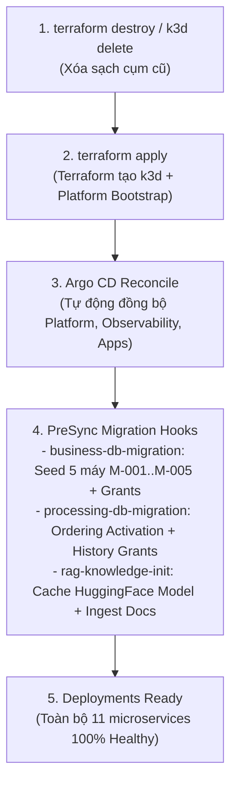

# MaintAI — Hướng Dẫn Vận Hành Vòng Đời Cụm k3d (Demo Giảng Viên)

Tài liệu này cung cấp toàn bộ quy trình và lệnh thực thi chuẩn xác để **tắt cụm**, **bật lại cụm có sẵn**, **dựng lại cụm từ đầu (Zero-Touch Provisioning)** và **theo dõi hệ thống khởi động**, phục vụ cho buổi báo cáo và trình diễn trực tiếp với Giảng viên hướng dẫn.

---

## 0. Chuẩn bị Môi trường Terminal

Trước khi chạy bất kỳ lệnh `kubectl` nào, hãy luôn thiết lập biến môi trường `KUBECONFIG` trỏ tới file cấu hình của cụm local:

```bash
export KUBECONFIG="/home/chienqt/Dev/newBTL/Maint-infrastructure/local/.local/kubeconfig"
```

> [!TIP]
> Bạn có thể thêm dòng trên vào cuối file `~/.bashrc` hoặc `~/.zshrc` để không cần gõ lại mỗi khi mở terminal mới:
> ```bash
> echo 'export KUBECONFIG="/home/chienqt/Dev/newBTL/Maint-infrastructure/local/.local/kubeconfig"' >> ~/.bashrc
> source ~/.bashrc
> ```

---

## 1. Kịch bản 1: Tạm Dừng (Stop) và Bật Lại (Start) Cụm Có Sẵn

Dùng kịch bản này khi bạn muốn **tiết kiệm RAM/CPU** sau phiên làm việc hoặc tạm dừng máy trước khi đến trường báo cáo, **bảo toàn 100% dữ liệu** (Database PostgreSQL, Kafka topic, MinIO objects và các Secret).

### 1.1. Lệnh tắt cụm (Stop)
```bash
k3d cluster stop maintai-local
```
- **Ý nghĩa:** Dừng toàn bộ Docker container của k3d server và load balancer. Cụm ngừng tiêu thụ tài nguyên máy. Dữ liệu trên các persistent volume và SQLite state của k3d vẫn nguyên vẹn trên đĩa.

### 1.2. Lệnh bật lại cụm (Start / Resume)
```bash
k3d cluster start maintai-local
```
- **Thời gian khởi động:** Khoảng **15 – 30 giây**.
- **Ý nghĩa:** K3s container khởi động lại, kubelet tự động reconcile và đưa toàn bộ các Pods của hệ thống trở lại trạng thái `Running`.

### 1.3. Lệnh kiểm tra sau khi bật lại
```bash
# 1. Kiểm tra trạng thái Node
kubectl get nodes

# 2. Kiểm tra 3 ứng dụng Argo CD
kubectl get applications -n argocd

# 3. Kiểm tra toàn bộ Pods trong namespace nghiệp vụ
kubectl get pods -n maintai-local
```

---

## 2. Kịch bản 2: Xóa Hoàn Toàn và Dựng Lại Cụm Từ Đầu (Zero-Touch Provisioning)

Dùng kịch bản này khi bạn muốn **trình diễn năng lực Tự Động Hóa Hạ Tầng (Infrastructure as Code - IaC) & GitOps** với Giảng viên từ con số 0.



### 2.1. Bước 1: Xóa sạch cụm cũ
```bash
# Cách 1: Xóa nhanh thông qua k3d CLI
k3d cluster delete maintai-local

# Hoặc Cách 2: Xóa chuẩn IaC thông qua Terraform
cd /home/chienqt/Dev/newBTL/Maint-infrastructure/terraform/local
terraform destroy -auto-approve
```

### 2.2. Bước 2: Dựng lại cụm tự động bằng Terraform
```bash
cd /home/chienqt/Dev/newBTL/Maint-infrastructure/terraform/local

# 1. Khởi tạo Terraform provider & modules (nếu chạy lần đầu hoặc sau khi đổi plugin)
terraform init

# 2. Thực thi provisioning tự động toàn bộ hạ tầng cục bộ
terraform apply -auto-approve
```

> [!NOTE]
> Lệnh `terraform apply` sẽ tự động thực thi chuỗi công việc:
> 1. Tạo cụm k3d `maintai-local` với các cổng nodeport mapped ra host (`18080`, `18081`, `18490`, `13000`, `15000`, `19000`, `19090`).
> 2. Cài đặt **LocalStack** (giả lập AWS Secrets Manager & S3).
> 3. Cài đặt **External Secrets Operator (ESO)** và nạp toàn bộ mật khẩu an toàn.
> 4. Cài đặt **Ingress NGINX** (giả lập AWS ALB Controller).
> 5. Cài đặt và bootstrap **Argo CD** engine.

### 2.3. Bước 3: Tự động hóa hoàn toàn của Argo CD (Không cần gõ lệnh thủ công)
Khác với quy trình cũ phải chạy các lệnh provision thủ công, hệ thống hiện tại đã tích hợp toàn bộ vào **Argo CD PreSync Hooks**:
- **`business-db-migration`:** Tự động chạy migration schema Business DB, tự động seed 5 máy công nghiệp mẫu (`M-001` đến `M-005`) từ ConfigMap, cấp quyền cho `business_reader`/`business_api`.
- **`processing-db-migration`:** Tự động chạy migration schema Processing DB, kích hoạt cơ chế FIFO Ordered Processing và cấp quyền `processing_history_meta`.
- **`rag-knowledge-init`:** Tự động tải trước model Sentence-Transformers MiniLM vào PVC cache và index tài liệu PDF mẫu vào pgvector.

---

## 3. Các Lệnh Theo Dõi Tiến Trình Khởi Động (Live Monitoring)

Khi trình diễn với Giảng viên, bạn nên mở các tab terminal riêng biệt để theo dõi tiến trình:

### 3.1. Theo dõi tổng thể trạng thái 3 ứng dụng Argo CD
```bash
kubectl get applications -n argocd -w
```
**Trạng thái mong đợi khi hoàn tất:**
```text
NAME                          SYNC STATUS   HEALTH STATUS
maintai-local-platform        Synced        Healthy
maintai-local-observability   Synced        Healthy
maintai-local-apps            Synced        Healthy
```

### 3.2. Theo dõi tiến trình Pods trong namespace `maintai-local`
```bash
kubectl get pods -n maintai-local -w
```

### 3.3. Theo dõi chi tiết các PreSync Migration Hooks
Để chứng minh với Giảng viên rằng database và model được tự động khởi tạo:
```bash
# Xem danh sách các Job đã hoàn thành:
kubectl get jobs -n maintai-local

# Xem log của job seed máy Business:
kubectl logs -n maintai-local job/business-db-migration

# Xem log của job tải model và index tài liệu RAG:
kubectl logs -n maintai-local job/rag-knowledge-init
```

### 3.4. Kiểm tra đồng bộ Secrets từ LocalStack qua External Secrets Operator
```bash
kubectl get externalsecrets -n maintai-local
```
Toàn bộ 9 Secret đều phải hiển thị `SecretSynced: True`.

---

## 4. Script Kiểm Tra Tự Động Toàn Diện (One-Liner Sanity Check)

Chạy đoạn lệnh sau trong terminal để tự động kiểm tra nhanh toàn bộ các dịch vụ trọng yếu:

```bash
echo "=== KIỂM TRA TRẠNG THÁI HỆ THỐNG MAINTAI ===" && \
export KUBECONFIG="/home/chienqt/Dev/newBTL/Maint-infrastructure/local/.local/kubeconfig" && \
echo "1. Argo CD Applications:" && kubectl get applications -n argocd --no-headers && \
echo "--------------------------------------------------" && \
echo "2. Số lượng Pods không ở trạng thái Running/Completed:" && \
kubectl get pods -n maintai-local --no-headers | grep -v "Running" | grep -v "Completed" | wc -l && \
echo "--------------------------------------------------" && \
echo "3. Kiểm tra Frontend UI (Port 18080):" && \
curl -s -o /dev/null -w "HTTP %{http_code}\n" http://127.0.0.1:18080/ && \
echo "--------------------------------------------------" && \
echo "4. Kiểm tra API 5 máy mẫu:" && \
SECRET=$(kubectl get secret local-oidc-registry -n maintai-local -o jsonpath='{.data.client_secret}' | base64 -d) && \
TOKEN=$(curl -k -s -X POST "https://127.0.0.1:18490/realms/maintai/protocol/openid-connect/token" \
  -d "grant_type=client_credentials&client_id=maintai-registry&client_secret=${SECRET}" | jq -r .access_token) && \
curl -s -H "Authorization: Bearer ${TOKEN}" "http://127.0.0.1:18080/api/v1/machines" | jq '.total, .items[].machine_id'
```

---

## 5. Bảng Tra Cứu Địa Chỉ Truy Cập Dịch Vụ Cho Buổi Demo

| Dịch vụ | Địa chỉ URL | Thông tin đăng nhập / Ghi chú |
| :--- | :--- | :--- |
| **Business Dashboard UI** | `http://127.0.0.1:18080` | Giao diện giám sát máy và cảnh báo vận hành |
| **Simulator Control UI** | `http://127.0.0.1:18081` | Bảng điều khiển giả lập cảm biến |
| **Keycloak Identity Gateway** | `https://127.0.0.1:18490` | Quản lý người dùng, OAuth2 / OIDC Realm `maintai` |
| **Grafana Observability** | `http://127.0.0.1:13000` | User: `admin` / Xem metrics hệ thống & ML inference |
| **Prometheus Server** | `http://127.0.0.1:19090` | Truy vấn metrics time-series trực tiếp |
| **MinIO Object Console** | `http://127.0.0.1:19001` | Quản lý S3 raw storage và exported archives |
| **MLflow Model Registry** | `http://127.0.0.1:15000` | Quản lý vòng đời mô hình học máy (Champion / Shadow) |
| **Argo CD Dashboard** | `https://localhost:8080` | Chạy lệnh port-forward bên dưới để mở giao diện |

> [!TIP]
> Để mở giao diện Argo CD trực quan:
> ```bash
> kubectl port-forward svc/argocd-server -n argocd 8080:443
> ```
> - **URL:** `https://localhost:8080`
> - **Username:** `admin`
> - **Lấy mật khẩu:**
>   ```bash
>   kubectl -n argocd get secret argocd-initial-admin-secret -o jsonpath="{.data.password}" | base64 -d && echo
>   ```
