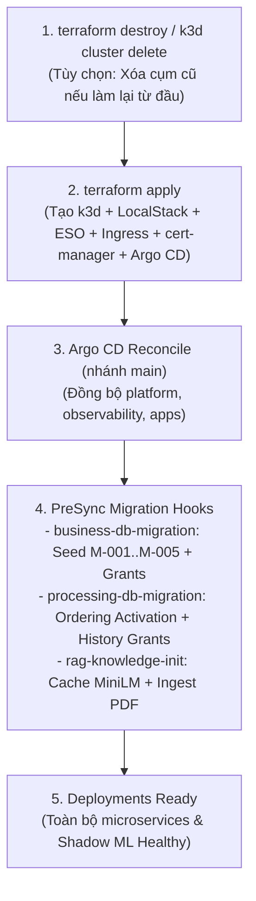

# MaintAI — Hướng dẫn Khởi động & Vận hành Cụm Demo Local (`k3d` + Terraform + Argo CD)

**Cập nhật:** 14/11/2026 (đồng bộ sau khi merge toàn bộ PR vào nhánh `main`, app commit `e67d42d`)  
**Môi trường mục tiêu:** Linux (Arch Linux / Ubuntu hoặc tương đương), Docker Engine, `k3d v5.9.0`, `kubectl` (1.34–1.36), Terraform, Argo CD.  
**Kiến trúc:** Chuẩn **Cloud Production GitOps** & **Pure Declarative Overlays** — Toàn bộ images ứng dụng được build và phân phối qua GitHub Container Registry (`ghcr.io`), giao tiếp nội bộ trực tiếp qua Kubernetes CoreDNS + TLS (`cert-manager`), và Argo CD tự động đồng bộ + chạy PreSync Migration Hooks.

> [!NOTE]
> Tài liệu này hợp nhất **Sổ tay Khởi động Demo**, **Quy trình Vận hành Vòng đời Cụm (`k3d` Stop/Start/Zero-Touch Provisioning)** và đặc tả nền tảng **`LOCAL-K3D-01`**. Để tìm hiểu sâu về kiến trúc DevOps 4-tier và kịch bản demo Rolling Update CI/CD, xem [DEVOPS_FRAMEWORK_AND_OPERATIONS_GUIDE.md](DEVOPS_FRAMEWORK_AND_OPERATIONS_GUIDE.md). Để chuẩn bị model identity và dữ liệu tri thức RAG, xem [LOCAL_DEMO_PREPARATION.md](LOCAL_DEMO_PREPARATION.md).

---

## 0. Tổng quan Kiến trúc Vận hành & Đặc tả `LOCAL-K3D-01`

```text
 ┌────────────────────────────────────────────────────────────────────────┐
 │                      GitHub Actions (Trên Cloud)                       │
 │                                                                        │
 │  MaintAI (main: e67d42d) ──────► Build OCI Images ──► ghcr.io          │
 │                                                              │         │
 │  Tự động tính Lock SHA & Cập nhật Image Tags ──────────────┐ │         │
 │                                                            ▼ ▼         │
 │  MaintAI-gitops (Nhánh: main) ───────────────────────────────────────┐ │
 └──────────────────────────────────────────────────────────────┬───────┼─┘
                                                                │       │
                     Laptop Linux Cá nhân                       │ Git   │ Pull
 ┌──────────────────────────────────────────────────────────────┼───────┼─┐
 │                                                              ▼       │ │
 │  k3d Cluster (maintai-local)                                         │ │
 │  ├── Argo CD ◄───────────────────────────────────────────────┘       │ │
 │  │    ├── 1. Kích hoạt PreSync Hooks (Migrations, Grants, RAG Seed)  │ │
 │  │    └── 2. Đồng bộ Pure Declarative Overlays (CoreDNS + TLS)       │ │
 │  └── containerd ◄────────────────────────────────────────────────────┘ │
 │       (Tự động kéo images từ ghcr.io/chiendz11/maintai-... về chạy)    │
 └────────────────────────────────────────────────────────────────────────┘
```

### Bảng thông số nền tảng Local Profile (`LOCAL-K3D-01`)

| Hạng mục | Cấu hình Local Profile | Invariant được bảo toàn |
| :--- | :--- | :--- |
| **Cluster** | `k3d 5.9.0` / `k3s 1.35.5`, 1 server node, private kubeconfig tại `Maint-infrastructure/local/.local/kubeconfig` | Không đổi AWS/production desired state; không ghi đè `~/.kube/config` |
| **Kafka** | 4 topics × 12 partitions, KRaft 1 broker, `replica=1 / minISR=1` (local) | Group độc lập, key `machine_id`, FIFO/safe prefix/fences (`PROC-ORDER-01`) |
| **PostgreSQL** | PostgreSQL 17 + pgvector 0.8, 5 owner DBs (`processing_db`, `business_db`, `drift_db`, `mlflow_db`, `knowledge_db`) + Processing read role | Không query DB xuyên owner |
| **Object Storage** | MinIO S3-compatible với versioned buckets + scoped owner policies | Raw/quarantine tách biệt processed history; giữ `VersionId` + SHA-256 |
| **Networking & TLS** | Kubernetes CoreDNS (`postgres:5432`, `kafka:9092`, `ml-service:8000`) + `cert-manager` internal certs (không còn adapter sidecar) | Main UI và Simulator UI deploy riêng; Main không proxy simulator control |
| **Monitoring** | Prometheus + Loki + Promtail + Grafana native UI | Metrics thực; thiếu series hoặc Pod `DOWN` không giả `healthy` |
| **ML & Rollout** | `logreg-baseline-v0` (Champion) + `ml-service-shadow` (`SERVICE_ROLE=shadow`) với traffic mirroring | Không gộp training/inference/server; chỉ bundle/image được review mới chạy |

> [!IMPORTANT]
> **Phân biệt phạm vi Local Demo và Production:**
> - **Baseline 100 máy vs Smoke 5 máy:** Kiến trúc thiết kế ban đầu cho 100 máy × 1 reading/s (`scale-ready` cho $X > 100$ theo [02_ASSUMPTIONS_AND_CAPACITY.md §11](../design-basis/02_ASSUMPTIONS_AND_CAPACITY.md#11-scale-ready-tính-và-tối-ưu-latency-khi-x100)); cấu hình mặc định trên laptop sử dụng 5 máy (`M-001`..`M-005`) để trình diễn luồng thực.
> - **Giới hạn local:** 1 broker không kiểm HA/replication; MinIO không thay AWS IAM/IRSA/KMS; secrets, TLS CA, datasets và receipts nằm trong `Maint-infrastructure/local/.local/` (ngoài Git). Không đưa PLAINTEXT Kafka, replication 1 hoặc marker `not-recorded:local-demo` lên production.

---

## 1. Chuẩn bị Môi trường & Bố cục 3 Repository

### 1.1. Công cụ & Biến môi trường
- **Docker Engine**: Đang chạy (`docker info` thành công).
- **k3d**: Đúng bản pin **v5.9.0** (`k3d version`).
- **kubectl**: Bản client minor từ **1.34 – 1.36** (`kubectl version --client`).
- **Terraform**, **Python 3.12**, **Git**, **OpenSSL**, **jq**.

Thiết lập `KUBECONFIG` cô lập trỏ tới cụm local trước khi chạy mọi lệnh `kubectl`:

```bash
export KUBECONFIG="/home/chienqt/Dev/newBTL/Maint-infrastructure/local/.local/kubeconfig"
```

*(Có thể thêm dòng trên vào `~/.bashrc` hoặc `~/.zshrc` để dùng xuyên suốt các terminal.)*

### 1.2. Bố cục thư mục (Sibling Directory Layout)
Ba repository đặt cạnh nhau dưới cùng thư mục cha (ví dụ `/home/chienqt/Dev/newBTL/`):

```bash
cd /home/chienqt/Dev/newBTL
git -C MaintAI pull origin main
git -C MaintAI-gitops pull origin main
git -C Maint-infrastructure pull origin main
```

### 1.3. Khởi tạo môi trường Python & cấu hình private Infrastructure
Chuyển vào `Maint-infrastructure`:

```bash
cd /home/chienqt/Dev/newBTL/Maint-infrastructure

test -d .venv || python3.12 -m venv .venv
.venv/bin/python -m pip install -r local/requirements.lock
.venv/bin/python -m localdev init
```

Kiểm tra file cấu hình private `local/.local/settings.json`:
```json
{
  "schema_version": "1.0.0",
  "gitops_repository": "https://github.com/chiendz11/MaintAI-gitops.git",
  "gitops_revision": "main",
  "gitops_checkout": "../MaintAI-gitops",
  "app_checkout": "../MaintAI",
  "machine_count": 5
}
```

---

## 2. Khởi tạo Cụm từ Đầu bằng Terraform (Zero-Touch Provisioning)

Toàn bộ hạ tầng local (`k3d`, LocalStack, ESO, Ingress-NGINX, `cert-manager`, Argo CD bootstrap) được tự động hóa bằng Terraform tại `Maint-infrastructure/terraform/local/`:



```bash
cd /home/chienqt/Dev/newBTL/Maint-infrastructure/terraform/local

# 1. Khởi tạo provider (null, local)
terraform init

# 2. Khởi tạo và kích hoạt toàn bộ cụm hạ tầng:
terraform apply -auto-approve
```
*(Hoặc chạy từ thư mục gốc `Maint-infrastructure`: `make tf-init && make tf-apply`.)*

Khi chạy xong, Terraform in ra danh sách URL truy cập:
```text
Apply complete! Resources: ...
Outputs:
argocd_ui_url    = "https://127.0.0.1:18443"
business_ui_url  = "http://127.0.0.1:18080"
cluster_name     = "maintai-local"
grafana_url      = "http://127.0.0.1:13000"
keycloak_url     = "https://127.0.0.1:18490"
minio_url        = "http://127.0.0.1:19001"
simulator_ui_url = "http://127.0.0.1:18081"
```

### (Tùy chọn) Khởi tạo Thủ công từng bước bằng Python CLI
Nếu muốn tự build/import image local hoặc kiểm soát từng bước thay vì 1-click Terraform:
```bash
cd /home/chienqt/Dev/newBTL/Maint-infrastructure

.venv/bin/python -m localdev up
.venv/bin/python -m localdev build-platform
.venv/bin/python -m localdev import-images --component minio --component mc --component dev-tools
.venv/bin/python -m localdev prepare platform
# Commit & push MaintAI-gitops/environments/local/platform nếu có diff
.venv/bin/python -m localdev bootstrap-argocd
.venv/bin/python -m localdev model-identity
.venv/bin/python -m localdev provision
.venv/bin/python -m localdev activate-ordering --legacy-writers-drained
```

---

## 3. Đồng bộ Argo CD, PreSync Hooks & Theo dõi Trực tiếp

### 3.1. Kích hoạt đồng bộ (nếu cần sync ngay)
```bash
export KUBECONFIG="/home/chienqt/Dev/newBTL/Maint-infrastructure/local/.local/kubeconfig"
kubectl --context k3d-maintai-local -n argocd patch application maintai-local-apps \
  --type merge -p '{"operation":{"sync":{"prune":false}}}'
```

Khi đồng bộ, Argo CD tự động thực thi:
1. **PreSync Stage:** Chạy các Kubernetes Jobs:
   - `business-db-migration`: Chạy `maintai-business-migrate upgrade`, seed 5 máy mẫu (`M-001`..`M-005`) và cấp quyền cho business roles.
   - `processing-db-migration`: Chạy `maintai-processing-migrate upgrade`, kích hoạt cơ chế FIFO Ordered Processing và cấp quyền `processing_history_meta`.
   - `rag-knowledge-init`: Tải trước embedding model MiniLM vào PVC cache và index tài liệu PDF mẫu vào pgvector.
2. **Sync Stage:** Pull container images từ `ghcr.io/chiendz11/...` và rollout toàn bộ Pods (`Running`).

### 3.2. Các lệnh Live Monitoring
```bash
# 1. Theo dõi 3 ứng dụng Argo CD (Synced / Healthy):
kubectl get applications -n argocd -w

# 2. Theo dõi tiến trình Pods trong namespace maintai-local:
kubectl get pods -n maintai-local -w

# 3. Kiểm tra chi tiết PreSync Migration Hooks:
kubectl get jobs -n maintai-local
kubectl logs -n maintai-local job/business-db-migration
kubectl logs -n maintai-local job/rag-knowledge-init

# 4. Kiểm tra đồng bộ Secrets từ LocalStack qua External Secrets Operator:
kubectl get externalsecrets -n maintai-local   # Phải đạt SecretSynced: True
```

### 3.3. Script Sanity Check Toàn Diện (One-Liner)
```bash
echo "=== KIỂM TRA TRẠNG THÁI HỆ THỐNG MAINTAI ===" && \
export KUBECONFIG="/home/chienqt/Dev/newBTL/Maint-infrastructure/local/.local/kubeconfig" && \
echo "1. Argo CD Applications:" && kubectl get applications -n argocd --no-headers && \
echo "--------------------------------------------------" && \
echo "2. Số lượng Pods không ở trạng thái Running/Completed:" && \
kubectl get pods -n maintai-local --no-headers | grep -v "Running" | grep -v "Completed" | wc -l && \
echo "--------------------------------------------------" && \
echo "3. Kiểm tra Frontend UI (Port 18080):" && \
curl -s -o /dev/null -w "HTTP %{http_code}\n" http://127.0.0.1:18080/ && \
echo "--------------------------------------------------" && \
echo "4. Kiểm tra API 5 máy mẫu:" && \
SECRET=$(kubectl get secret local-oidc-registry -n maintai-local -o jsonpath='{.data.client_secret}' | base64 -d) && \
TOKEN=$(curl -k -s -X POST "https://127.0.0.1:18490/realms/maintai/protocol/openid-connect/token" \
  -d "grant_type=client_credentials&client_id=maintai-registry&client_secret=${SECRET}" | jq -r .access_token) && \
curl -s -H "Authorization: Bearer ${TOKEN}" "http://127.0.0.1:18080/api/v1/machines" | jq '.total, .items[].machine_id'
```

---

## 4. Vòng đời Cụm (Tạm dừng / Khởi động lại / Xóa cụm)

### 4.1. Tạm dừng (Stop) và Bật lại (Start / Resume) bảo toàn 100% Dữ liệu
Dùng khi muốn giải phóng RAM/CPU nhưng giữ nguyên PostgreSQL DBs, Kafka topics, MinIO objects và Secrets trên PVC:

```bash
# Tạm dừng cụm (bảo toàn volume/SQLite state):
k3d cluster stop maintai-local
# Hoặc qua CLI: .venv/bin/python -m localdev stop

# Bật lại cụm (khoảng 15–30 giây):
k3d cluster start maintai-local
# Hoặc qua CLI: .venv/bin/python -m localdev start && .venv/bin/python -m localdev status

# Kiểm tra lại trạng thái:
kubectl get nodes && kubectl get applications -n argocd && kubectl get pods -n maintai-local
```

### 4.2. Hủy hoàn toàn cụm (Clean Reset)
```bash
# Cách 1 — Chuẩn Terraform IaC:
cd /home/chienqt/Dev/newBTL/Maint-infrastructure/terraform/local
terraform destroy -auto-approve

# Cách 2 — Qua k3d hoặc Python CLI:
k3d cluster delete maintai-local
# Hoặc: .venv/bin/python -m localdev delete --confirm-delete-cluster
```
*(Lưu ý: Dữ liệu private tại `Maint-infrastructure/local/.local/` trên host vẫn được giữ nguyên nếu không xóa thủ công.)*

---

## 5. Bảng Tra cứu URL & Mở Argo CD Dashboard

| Giao diện / Dịch vụ | URL trên laptop | Thông tin đăng nhập / Mục đích |
| :--- | :--- | :--- |
| **Business Dashboard UI** | `http://127.0.0.1:18080` | Giám sát máy thời gian thực, Cảnh báo (Alerts), Lịch sử M6, Export CSV/Parquet & Graceful Degradation UI |
| **Simulator Control UI** | `http://127.0.0.1:18081` | Điều khiển 5 máy ảo Sensor (`M-001`..`M-005`): Resume/Pause, đổi Scenario & inject sự cố |
| **Keycloak IdP** | `https://127.0.0.1:18490` | Tài khoản kỹ thuật viên: `technician` / `technician123` hoặc `administrator` / `admin123` (hoặc trong `local/.local/credentials.json`) |
| **Grafana Observability** | `http://127.0.0.1:13000` | Metrics Prometheus, Consumer Lag Kafka, Latency & Logs Loki |
| **Prometheus Server** | `http://127.0.0.1:19090` | Truy vấn metrics time-series trực tiếp |
| **MinIO Object Console** | `http://127.0.0.1:19001` | S3 raw storage (`maintai-raw*`), models & exported Parquet (mặc định `minioadmin` / `minioadmin` hoặc trong secrets) |
| **MLflow Model Registry** | `http://127.0.0.1:15000` | Quản lý vòng đời model (`Champion` / `@shadow`) |
| **Argo CD Dashboard** | `https://127.0.0.1:18443` *(hoặc `https://localhost:8080`)* | User `admin`; mở qua port-forward bên dưới |

**Mở Port-Forward cho Argo CD:**
```bash
# Cách 1: qua localdev
cd /home/chienqt/Dev/newBTL/Maint-infrastructure && .venv/bin/python -m localdev forward argocd

# Cách 2: kubectl port-forward trực tiếp
kubectl port-forward svc/argocd-server -n argocd 8080:443
# Lấy password admin:
kubectl -n argocd get secret argocd-initial-admin-secret -o jsonpath="{.data.password}" | base64 -d && echo
```

> [!TIP]
> **Xác thực TLS Keycloak (`:18490`):** Khi trình duyệt cảnh báo chứng chỉ tự ký, chọn **Advanced → Proceed to 127.0.0.1** hoặc import CA tại `Maint-infrastructure/local/.local/tls/ca.crt`.

---

## 6. Kịch bản Trình diễn Demo (E2E Walkthrough)

1. **Khởi động Sensor phát Dữ liệu:** Mở **Simulator UI** (`http://127.0.0.1:18081`). Ban đầu cả 5 máy ở trạng thái `PAUSED`. Bấm **Resume** trên `M-001` (hoặc cả 5 máy). Sensor đẩy reading qua `Ingestion API` (HTTP 202) → Kafka `sensor.readings`.
2. **Xem Telemetry & Prediction Real-time trên Business UI:** Mở **Business UI** (`http://127.0.0.1:18080`). Các chỉ số (`Air temp`, `Process temp`, `Rotational speed`, `Torque`, `Tool wear`) cập nhật qua SSE; `ml-service` đánh giá rủi ro đồng thời nhân bản traffic sang `ml-service-shadow`.
3. **Mô phỏng Sự cố & Vòng đời Cảnh báo (Alert Lifecycle):** Trên Simulator UI chọn `M-001` chuyển sang scenario `CRITICAL` / `DEGRADATION`. Trên Business UI mở tab **Alerts** và đăng nhập tài khoản `technician` thực hiện: `ACK` → `START` → nhập ghi chú phản hồi → `RESOLVE`.
4. **Kiểm chứng Graceful Degradation UI khi AI/Processing gặp sự cố:** Khi luồng inference suy giảm hoặc gián đoạn, giao diện vẫn hiển thị **Physical Guardrails** (cảnh báo ngưỡng vật lý từ telemetry thô và xu hướng cảm biến gần nhất) tách bạch rõ ràng với kết quả dự báo AI hợp lệ gần nhất (`Latest Valid Prediction`).
5. **Trình diễn M6 — Tra cứu Lịch sử & Export:** Vào chi tiết máy `M-001` → tab **History** xem biểu đồ chuỗi thời gian, thử nghiệm **Export CSV** và **Export Parquet** (job bất đồng bộ tải từ MinIO).

---

## 7. Xử lý Sự cố Nhanh (Troubleshooting)

| Hiện tượng | Nguyên nhân | Hướng xử lý |
| :--- | :--- | :--- |
| `Source differs from reviewed lock` | Code trên máy khác SHA trong `app-source.lock.json` | Chạy `git pull origin main` ở cả 3 repo hoặc đồng bộ lại lockfile bằng commit đã review. |
| Pod `ImagePullBackOff` | Cụm k3d không kéo được image từ GHCR hoặc package bị Private | Kiểm tra kết nối mạng/firewall và trạng thái Public của GHCR package. |
| Telemetry trên UI không cập nhật | Sensor đang ở trạng thái `PAUSED` | Mở Simulator UI (`http://127.0.0.1:18081`) và bấm **Resume**. |
| Lỗi đăng nhập Keycloak OIDC | Trình duyệt chưa tin cậy chứng chỉ HTTPS cổng `18490` | Truy cập trực tiếp `https://127.0.0.1:18490` chọn **Proceed** hoặc trust `ca.crt`. |
| Port `18080` / `18081` từ chối kết nối | Service/Ingress/Pod Edge chưa `Running` | Kiểm tra `kubectl -n maintai-local get pods` xem `frontend` và `simulator-ui` đã `Running` chưa. |
| `bootstrap-argocd` báo lỗi remote HEAD | Nhánh GitOps trong settings chưa push lên remote | Đảm bảo `settings.json` trỏ `gitops_revision: "main"` và đã push nhánh lên GitHub. |
